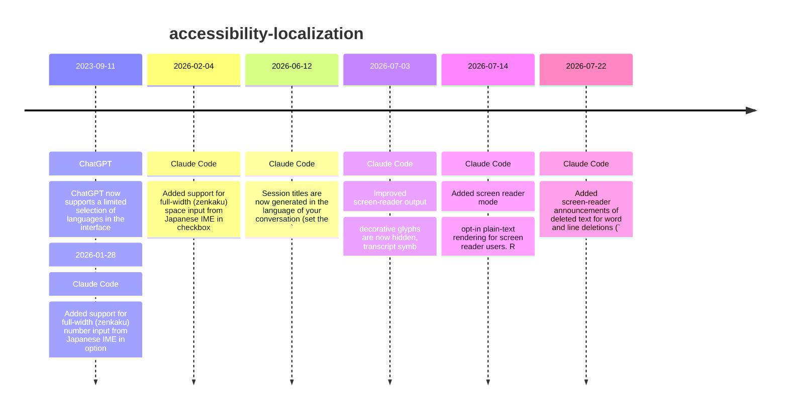

# Theme: accessibility-localization

## Cross-Product Timeline
<!-- chronolog:begin region="timeline" -->

<!-- chronolog:end -->

## Change Cards
<!-- chronolog:begin region="cards" -->
- 2023-09-11 ChatGPT: [[Changes/ChatGPT/2023-09-11-chatgpt-now-supports-a-limited-selection-of-languages-in-the-interface|ChatGPT now supports a limited selection of languages in the interface:]]
- 2026-01-28 Claude Code: [[Changes/Claude Code/2026-01-28-added-support-for-full-width-zenkaku-number-input-from-japanese-ime-in-option-se|Added support for full-width (zenkaku) number input from Japanese IME in option]]
- 2026-02-04 Claude Code: [[Changes/Claude Code/2026-02-04-added-support-for-full-width-zenkaku-space-input-from-japanese-ime-in-checkbox-s|Added support for full-width (zenkaku) space input from Japanese IME in checkbox]]
- 2026-06-12 Claude Code: [[Changes/Claude Code/2026-06-12-session-titles-are-now-generated-in-the-language-of-your-conversation-set-the-la|Session titles are now generated in the language of your conversation (set the `]]
- 2026-07-03 Claude Code: [[Changes/Claude Code/2026-07-03-improved-screen-reader-output-decorative-glyphs-are-now-hidden-transcript-symbol|Improved screen-reader output: decorative glyphs are now hidden, transcript symb]]
- 2026-07-14 Claude Code: [[Changes/Claude Code/2026-07-14-added-screen-reader-mode-opt-in-plain-text-rendering-for-screen-reader-users-run|Added screen reader mode: opt-in plain-text rendering for screen reader users. R]]
- 2026-07-22 Claude Code: [[Changes/Claude Code/2026-07-22-added-screen-reader-announcements-of-deleted-text-for-word-and-line-deletions-op|Added screen-reader announcements of deleted text for word and line deletions (`]]
<!-- chronolog:end -->