# Theme: account-access

## Cross-Product Timeline

```mermaid
timeline
    title account-access
    2023-03-30 : Cursor : AI now requires login
    2023-06-06 : Cursor : Login via github, then add the repo you wish to sync!
    2023-06-27 : Cursor : If you're not logged in, we show the popup to log in again
    2023-07-25 : Cursor : You can now chat with any codebase. No need to have a Github repo / login throug
    2023-08-03 : ChatGPT : Stay logged in: You’ll no longer be logged out every 2 weeks! When you do need t
    2023-09-01 : Cursor : You should now be able to sign in with GitHub again.
    2024-04-01 : ChatGPT : We’re making it easier for people to experience the benefits of AI without needi
    2026-01-22 : Claude Code : [VSCode] Added ability for OAuth users to browse and resume remote Claude sessio
    2026-02-03 : Claude Code : Added pre-configured OAuth client credentials for MCP servers that don't support
    2026-02-13 : Claude Code : Added `claude auth login`, `claude auth status`, and `claude auth logout` CLI su
    2026-02-19 : Claude Code : Improved performance by caching authentication failures for HTTP and SSE MCP ser
    2026-02-24 : Claude Code : BashTool now skips login shell (`-l` flag) by default when a shell snapshot is a
    2026-03-11 : Claude Code : Added actionable guidance when OAuth login or connectivity checks fail due to SS
    2026-03-18 : Claude Code : Added `--console` flag to `claude auth login` for Anthropic Console (API billing
    2026-03-26 : Claude Code : MCP OAuth now follows RFC 9728 Protected Resource Metadata discovery to find the
    2026-04-04 : Claude Code : Added interactive Bedrock setup wizard accessible from the login screen when sel
    2026-04-09 : Claude Code : Added interactive Google Vertex AI setup wizard accessible from the login screen
    2026-04-22 : ChatGPT : We’re launching ChatGPT for Clinicians, a free version of ChatGPT for verified c
    2026-04-28 : Claude Code : Clarified the `/mcp` message shown when an MCP server is still unauthorized afte
    2026-04-30 : ChatGPT : We’re rolling out Advanced Account Security, an optional setting for personal Ch
    2026-05-01 : Claude Code : `claude auth login` now accepts the OAuth code pasted into the terminal when the
    2026-05-04 : Claude Code : `--channels` now works with console (API key) authentication — console orgs with
    2026-05-05 : ChatGPT : ChatGPT for Excel and Google Sheets is now available globally, bringing ChatGPT
    2026-05-06 : Claude Code : Improved visual consistency in slash command dialogs and `/login`, `/upgrade`, `
    2026-06-02 : ChatGPT : Active sessions shows sessions known through session management, including ChatG
    2026-06-02 : ChatGPT : Log out of individual sessions or all sessions from Active sessions
    2026-06-02 : Claude Code : Added a prompt before writing to shell startup files (`.zshenv`, `.zlogin`, `.ba
    2026-06-22 : Claude Code : Added `claude mcp login <name>` and `claude mcp logout <name>` to authenticate M
    2026-06-22 : Claude Code : Added "Claude Platform on AWS - refresh credentials" option to `/login` when `aw
    2026-06-24 : Claude Code : Improved MCP OAuth: discovery and token requests now retry once after transient
    2026-06-25 : Claude Code : Added a startup notice when MCP servers need authentication, pointing at `/mcp`
    2026-07-07 : Claude Code : Added a warning when your login is about to expire, so you can re-authenticate b
    2026-07-09 : ChatGPT : We’re deprecating Atlas as we bring browser-based agentic capabilities into Chat
    2026-07-10 : Claude Code : Gateway: `/login` now supports Anthropic-operated public gateway endpoints
    2026-07-21 : Claude Code : Changed the login-expiry warning to appear 3 days before expiry instead of 5
    2026-07-29 : ChatGPT : When you connect a supported app from the plugin directory ChatGPT, you can use
    2026-07-29 : ChatGPT : Research rarely happens alone. ChatGPT for Academic Researchers gives faculty an
    2026-07-29 : ChatGPT : We’re beginning to roll out Sign in with ChatGPT in beta across select plugins a
    2026-07-29 : ChatGPT : When you sign in, only your name, email, and profile picture (if you have one) a
```

<!-- chronolog:begin region="timeline" -->

<!-- chronolog:end -->

## Change Cards
<!-- chronolog:begin region="cards" -->
- 2023-03-30 Cursor: [[Changes/Cursor/2023-03-30-ai-now-requires-login|AI now requires login]]
- 2023-06-06 Cursor: [[Changes/Cursor/2023-06-06-login-via-github-then-add-the-repo-you-wish-to-sync|Login via github, then add the repo you wish to sync!]]
- 2023-06-27 Cursor: [[Changes/Cursor/2023-06-27-if-you-re-not-logged-in-we-show-the-popup-to-log-in-again|If you're not logged in, we show the popup to log in again]]
- 2023-07-25 Cursor: [[Changes/Cursor/2023-07-25-you-can-now-chat-with-any-codebase-no-need-to-have-a-github-repo-login-through-g|You can now chat with any codebase. No need to have a Github repo / login throug]]
- 2023-08-03 ChatGPT: [[Changes/ChatGPT/2023-08-03-stay-logged-in-you-ll-no-longer-be-logged-out-every-2-weeks-when-you-do-need-to|Stay logged in: You’ll no longer be logged out every 2 weeks! When you do need t]]
- 2023-09-01 Cursor: [[Changes/Cursor/2023-09-01-you-should-now-be-able-to-sign-in-with-github-again|You should now be able to sign in with GitHub again.]]
- 2024-04-01 ChatGPT: [[Changes/ChatGPT/2024-04-01-we-re-making-it-easier-for-people-to-experience-the-benefits-of-ai-without-needi|We’re making it easier for people to experience the benefits of AI without needi]]
- 2026-01-22 Claude Code: [[Changes/Claude Code/2026-01-22-vscode-added-ability-for-oauth-users-to-browse-and-resume-remote-claude-sessions|[VSCode] Added ability for OAuth users to browse and resume remote Claude sessio]]
- 2026-02-03 Claude Code: [[Changes/Claude Code/2026-02-03-added-pre-configured-oauth-client-credentials-for-mcp-servers-that-don-t-support|Added pre-configured OAuth client credentials for MCP servers that don't support]]
- 2026-02-13 Claude Code: [[Changes/Claude Code/2026-02-13-added-claude-auth-login-claude-auth-status-and-claude-auth-logout-cli-subcommand|Added `claude auth login`, `claude auth status`, and `claude auth logout` CLI su]]
- 2026-02-19 Claude Code: [[Changes/Claude Code/2026-02-19-improved-performance-by-caching-authentication-failures-for-http-and-sse-mcp-ser|Improved performance by caching authentication failures for HTTP and SSE MCP ser]]
- 2026-02-24 Claude Code: [[Changes/Claude Code/2026-02-24-bashtool-now-skips-login-shell-l-flag-by-default-when-a-shell-snapshot-is-availa|BashTool now skips login shell (`-l` flag) by default when a shell snapshot is a]]
- 2026-03-11 Claude Code: [[Changes/Claude Code/2026-03-11-added-actionable-guidance-when-oauth-login-or-connectivity-checks-fail-due-to-ss|Added actionable guidance when OAuth login or connectivity checks fail due to SS]]
- 2026-03-18 Claude Code: [[Changes/Claude Code/2026-03-18-added-console-flag-to-claude-auth-login-for-anthropic-console-api-billing-authen|Added `--console` flag to `claude auth login` for Anthropic Console (API billing]]
- 2026-03-26 Claude Code: [[Changes/Claude Code/2026-03-26-mcp-oauth-now-follows-rfc-9728-protected-resource-metadata-discovery-to-find-the|MCP OAuth now follows RFC 9728 Protected Resource Metadata discovery to find the]]
- 2026-04-04 Claude Code: [[Changes/Claude Code/2026-04-04-added-interactive-bedrock-setup-wizard-accessible-from-the-login-screen-when-sel|Added interactive Bedrock setup wizard accessible from the login screen when sel]]
- 2026-04-09 Claude Code: [[Changes/Claude Code/2026-04-09-added-interactive-google-vertex-ai-setup-wizard-accessible-from-the-login-screen|Added interactive Google Vertex AI setup wizard accessible from the login screen]]
- 2026-04-22 ChatGPT: [[Changes/ChatGPT/2026-04-22-we-re-launching-chatgpt-for-clinicians-a-free-version-of-chatgpt-for-verified-cl|We’re launching ChatGPT for Clinicians, a free version of ChatGPT for verified c]]
- 2026-04-28 Claude Code: [[Changes/Claude Code/2026-04-28-clarified-the-mcp-message-shown-when-an-mcp-server-is-still-unauthorized-after-t|Clarified the `/mcp` message shown when an MCP server is still unauthorized afte]]
- 2026-04-30 ChatGPT: [[Changes/ChatGPT/2026-04-30-we-re-rolling-out-advanced-account-security-an-optional-setting-for-personal-cha|We’re rolling out Advanced Account Security, an optional setting for personal Ch]]
- 2026-05-01 Claude Code: [[Changes/Claude Code/2026-05-01-claude-auth-login-now-accepts-the-oauth-code-pasted-into-the-terminal-when-the-b|`claude auth login` now accepts the OAuth code pasted into the terminal when the]]
- 2026-05-04 Claude Code: [[Changes/Claude Code/2026-05-04-channels-now-works-with-console-api-key-authentication-console-orgs-with-managed|`--channels` now works with console (API key) authentication — console orgs with]]
- 2026-05-05 ChatGPT: [[Changes/ChatGPT/2026-05-05-chatgpt-for-excel-and-google-sheets-is-now-available-globally-bringing-chatgpt-i|ChatGPT for Excel and Google Sheets is now available globally, bringing ChatGPT]]
- 2026-05-06 Claude Code: [[Changes/Claude Code/2026-05-06-improved-visual-consistency-in-slash-command-dialogs-and-login-upgrade-extra-usa|Improved visual consistency in slash command dialogs and `/login`, `/upgrade`, `]]
- 2026-06-02 ChatGPT: [[Changes/ChatGPT/2026-06-02-active-sessions-shows-sessions-known-through-session-management-including-chatgp|Active sessions shows sessions known through session management, including ChatG]]
- 2026-06-02 ChatGPT: [[Changes/ChatGPT/2026-06-02-log-out-of-individual-sessions-or-all-sessions-from-active-sessions|Log out of individual sessions or all sessions from Active sessions]]
- 2026-06-02 Claude Code: [[Changes/Claude Code/2026-06-02-added-a-prompt-before-writing-to-shell-startup-files-zshenv-zlogin-bash-login-an|Added a prompt before writing to shell startup files (`.zshenv`, `.zlogin`, `.ba]]
- 2026-06-22 Claude Code: [[Changes/Claude Code/2026-06-22-added-claude-mcp-login-name-and-claude-mcp-logout-name-to-authenticate-mcp-serve|Added `claude mcp login <name>` and `claude mcp logout <name>` to authenticate M]]
- 2026-06-22 Claude Code: [[Changes/Claude Code/2026-06-22-added-claude-platform-on-aws-refresh-credentials-option-to-login-when-awsauthref|Added "Claude Platform on AWS - refresh credentials" option to `/login` when `aw]]
- 2026-06-24 Claude Code: [[Changes/Claude Code/2026-06-24-improved-mcp-oauth-discovery-and-token-requests-now-retry-once-after-transient-n|Improved MCP OAuth: discovery and token requests now retry once after transient]]
- 2026-06-25 Claude Code: [[Changes/Claude Code/2026-06-25-added-a-startup-notice-when-mcp-servers-need-authentication-pointing-at-mcp|Added a startup notice when MCP servers need authentication, pointing at `/mcp`]]
- 2026-07-07 Claude Code: [[Changes/Claude Code/2026-07-07-added-a-warning-when-your-login-is-about-to-expire-so-you-can-re-authenticate-be|Added a warning when your login is about to expire, so you can re-authenticate b]]
- 2026-07-09 ChatGPT: [[Changes/ChatGPT/2026-07-09-we-re-deprecating-atlas-as-we-bring-browser-based-agentic-capabilities-into-chat|We’re deprecating Atlas as we bring browser-based agentic capabilities into Chat]]
- 2026-07-10 Claude Code: [[Changes/Claude Code/2026-07-10-gateway-login-now-supports-anthropic-operated-public-gateway-endpoints|Gateway: `/login` now supports Anthropic-operated public gateway endpoints]]
- 2026-07-21 Claude Code: [[Changes/Claude Code/2026-07-21-changed-the-login-expiry-warning-to-appear-3-days-before-expiry-instead-of-5|Changed the login-expiry warning to appear 3 days before expiry instead of 5]]
- 2026-07-29 ChatGPT: [[Changes/ChatGPT/2026-07-29-when-you-connect-a-supported-app-from-the-plugin-directory-chatgpt-you-can-use-s|When you connect a supported app from the plugin directory ChatGPT, you can use]]
- 2026-07-29 ChatGPT: [[Changes/ChatGPT/2026-07-29-research-rarely-happens-alone-chatgpt-for-academic-researchers-gives-faculty-and|Research rarely happens alone. ChatGPT for Academic Researchers gives faculty an]]
- 2026-07-29 ChatGPT: [[Changes/ChatGPT/2026-07-29-we-re-beginning-to-roll-out-sign-in-with-chatgpt-in-beta-across-select-plugins-a|We’re beginning to roll out Sign in with ChatGPT in beta across select plugins a]]
- 2026-07-29 ChatGPT: [[Changes/ChatGPT/2026-07-29-when-you-sign-in-only-your-name-email-and-profile-picture-if-you-have-one-are-sh|When you sign in, only your name, email, and profile picture (if you have one) a]]
<!-- chronolog:end -->