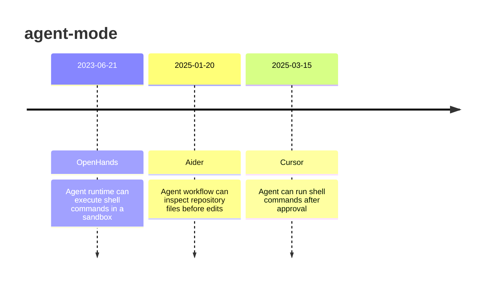

# Theme: agent-mode

## Cross-Product Timeline
<!-- chronolog:begin region="timeline" -->

<!-- chronolog:end -->

## Change Cards
<!-- chronolog:begin region="cards" -->
- 2023-06-21 OpenHands: [[Changes/OpenHands/2023-06-21-agent-runtime-can-execute-shell-commands-in-a-sandbox|Agent runtime can execute shell commands in a sandbox]]
- 2025-01-20 Aider: [[Changes/Aider/2025-01-20-agent-workflow-can-inspect-repository-files-before-edits|Agent workflow can inspect repository files before edits]]
- 2025-03-15 Cursor: [[Changes/Cursor/2025-03-15-agent-can-run-shell-commands-after-approval|Agent can run shell commands after approval]]
<!-- chronolog:end -->