# Theme: automation-scheduling

## Cross-Product Timeline

```mermaid
timeline
    title automation-scheduling
    2025-01-14 : ChatGPT : Scheduled tasks is in early beta for Plus, Pro, and Teams. Eventually this will
    2025-01-14 : ChatGPT : Today we’re rolling out a beta version of tasks—a new way to ask ChatGPT to do t
    2025-04-25 : ChatGPT : We’re making additional improvements to GPT-4o, optimizing when it saves memorie
    2025-05-08 : ChatGPT : Opt‑in reminders
    2025-06-03 : ChatGPT : Opt‑in reminders
    2025-09-25 : ChatGPT : Updates are delivered once a day as visual summaries you can scan at a glance or
    2025-09-25 : ChatGPT : If you ask for something new in the evening, we aim to include it the next morni
    2025-12-17 : ChatGPT : Tasks let you set up automated prompts that ChatGPT can run for you. You can now
    2025-12-17 : ChatGPT : Create tasks in chat or in Pulse—whatever’s easier in the moment.
    2026-03-05 : Cursor : Cursor now supports automations for building always-on agents that run based on
    2026-03-05 : Cursor : Create automations at cursor.com/automations, or start from a template. Read mor
    2026-03-05 : Cursor : Automations run on schedules or are triggered by events from Slack, Linear, GitH
    2026-03-07 : Claude Code : Added cron scheduling tools for recurring prompts within a session
    2026-03-07 : Claude Code : Added `/loop` command to run a prompt or slash command on a recurring interval (
    2026-03-11 : Cursor : Most plugins contain MCPs that cloud agents can use when kicked off manually or
    2026-03-26 : Claude Code : Added timestamp markers in transcripts when scheduled tasks (`/loop`, `CronCreat
    2026-04-13 : Claude Code : `/proactive` is now an alias for `/loop`
    2026-05-01 : Claude Code : `claude_code.skill_activated` OpenTelemetry event now fires for user-typed slash
    2026-05-20 : Cursor : Multi-repo automations
    2026-05-20 : Cursor : For the next 7 days, all agent runs for newly created automations are 50% off.
    2026-05-20 : Cursor : Automations in the Agents Window
    2026-05-20 : Cursor : Cursor Automations are now available in the Agents Window, in addition to cursor
    2026-05-20 : Cursor : This release brings Cursor Automations to the Agents Window and introduces the a
    2026-06-08 : Claude Code : `/workflows` now opens immediately even while a turn is in progress
    2026-06-17 : ChatGPT : Users can schedule work for specific times or broader windows, such as morning,
    2026-06-18 : Cursor : Cursor Automations save you time by automating repetitive tasks with always-on a
    2026-06-18 : Cursor : Use /automate to create an automation directly in your local agent session.
    2026-06-18 : Cursor : Describe the task you want to automate in plain language and Cursor will configu
    2026-06-18 : Cursor : /automate skill
    2026-07-09 : ChatGPT : Work can also keep projects moving through Scheduled Tasks that run once, repeat
```

<!-- chronolog:begin region="timeline" -->

<!-- chronolog:end -->

## Change Cards
<!-- chronolog:begin region="cards" -->
- 2025-01-14 ChatGPT: [[Changes/ChatGPT/2025-01-14-scheduled-tasks-is-in-early-beta-for-plus-pro-and-teams-eventually-this-will-be|Scheduled tasks is in early beta for Plus, Pro, and Teams. Eventually this will]]
- 2025-01-14 ChatGPT: [[Changes/ChatGPT/2025-01-14-today-we-re-rolling-out-a-beta-version-of-tasks-a-new-way-to-ask-chatgpt-to-do-t|Today we’re rolling out a beta version of tasks—a new way to ask ChatGPT to do t]]
- 2025-04-25 ChatGPT: [[Changes/ChatGPT/2025-04-25-we-re-making-additional-improvements-to-gpt-4o-optimizing-when-it-saves-memories|We’re making additional improvements to GPT-4o, optimizing when it saves memorie]]
- 2025-05-08 ChatGPT: [[Changes/ChatGPT/2025-05-08-opt-in-reminders|Opt‑in reminders]]
- 2025-06-03 ChatGPT: [[Changes/ChatGPT/2025-06-03-opt-in-reminders|Opt‑in reminders]]
- 2025-09-25 ChatGPT: [[Changes/ChatGPT/2025-09-25-updates-are-delivered-once-a-day-as-visual-summaries-you-can-scan-at-a-glance-or|Updates are delivered once a day as visual summaries you can scan at a glance or]]
- 2025-09-25 ChatGPT: [[Changes/ChatGPT/2025-09-25-if-you-ask-for-something-new-in-the-evening-we-aim-to-include-it-the-next-mornin|If you ask for something new in the evening, we aim to include it the next morni]]
- 2025-12-17 ChatGPT: [[Changes/ChatGPT/2025-12-17-tasks-let-you-set-up-automated-prompts-that-chatgpt-can-run-for-you-you-can-now|Tasks let you set up automated prompts that ChatGPT can run for you. You can now]]
- 2025-12-17 ChatGPT: [[Changes/ChatGPT/2025-12-17-create-tasks-in-chat-or-in-pulse-whatever-s-easier-in-the-moment|Create tasks in chat or in Pulse—whatever’s easier in the moment.]]
- 2026-03-05 Cursor: [[Changes/Cursor/2026-03-05-cursor-now-supports-automations-for-building-always-on-agents-that-run-based-on|Cursor now supports automations for building always-on agents that run based on]]
- 2026-03-05 Cursor: [[Changes/Cursor/2026-03-05-create-automations-at-cursor-com-automations-or-start-from-a-template-read-more|Create automations at cursor.com/automations, or start from a template. Read mor]]
- 2026-03-05 Cursor: [[Changes/Cursor/2026-03-05-automations-run-on-schedules-or-are-triggered-by-events-from-slack-linear-github|Automations run on schedules or are triggered by events from Slack, Linear, GitH]]
- 2026-03-07 Claude Code: [[Changes/Claude Code/2026-03-07-added-cron-scheduling-tools-for-recurring-prompts-within-a-session|Added cron scheduling tools for recurring prompts within a session]]
- 2026-03-07 Claude Code: [[Changes/Claude Code/2026-03-07-added-loop-command-to-run-a-prompt-or-slash-command-on-a-recurring-interval-e-g|Added `/loop` command to run a prompt or slash command on a recurring interval (]]
- 2026-03-11 Cursor: [[Changes/Cursor/2026-03-11-most-plugins-contain-mcps-that-cloud-agents-can-use-when-kicked-off-manually-or|Most plugins contain MCPs that cloud agents can use when kicked off manually or]]
- 2026-03-26 Claude Code: [[Changes/Claude Code/2026-03-26-added-timestamp-markers-in-transcripts-when-scheduled-tasks-loop-croncreate-fire|Added timestamp markers in transcripts when scheduled tasks (`/loop`, `CronCreat]]
- 2026-04-13 Claude Code: [[Changes/Claude Code/2026-04-13-proactive-is-now-an-alias-for-loop|`/proactive` is now an alias for `/loop`]]
- 2026-05-01 Claude Code: [[Changes/Claude Code/2026-05-01-claude-code-skill-activated-opentelemetry-event-now-fires-for-user-typed-slash-c|`claude_code.skill_activated` OpenTelemetry event now fires for user-typed slash]]
- 2026-05-20 Cursor: [[Changes/Cursor/2026-05-20-multi-repo-automations|Multi-repo automations]]
- 2026-05-20 Cursor: [[Changes/Cursor/2026-05-20-for-the-next-7-days-all-agent-runs-for-newly-created-automations-are-50-off|For the next 7 days, all agent runs for newly created automations are 50% off.]]
- 2026-05-20 Cursor: [[Changes/Cursor/2026-05-20-automations-in-the-agents-window|Automations in the Agents Window]]
- 2026-05-20 Cursor: [[Changes/Cursor/2026-05-20-cursor-automations-are-now-available-in-the-agents-window-in-addition-to-cursor|Cursor Automations are now available in the Agents Window, in addition to cursor]]
- 2026-05-20 Cursor: [[Changes/Cursor/2026-05-20-this-release-brings-cursor-automations-to-the-agents-window-and-introduces-the-a|This release brings Cursor Automations to the Agents Window and introduces the a]]
- 2026-06-08 Claude Code: [[Changes/Claude Code/2026-06-08-workflows-now-opens-immediately-even-while-a-turn-is-in-progress|`/workflows` now opens immediately even while a turn is in progress]]
- 2026-06-17 ChatGPT: [[Changes/ChatGPT/2026-06-17-users-can-schedule-work-for-specific-times-or-broader-windows-such-as-morning-af|Users can schedule work for specific times or broader windows, such as morning,]]
- 2026-06-18 Cursor: [[Changes/Cursor/2026-06-18-cursor-automations-save-you-time-by-automating-repetitive-tasks-with-always-on-a|Cursor Automations save you time by automating repetitive tasks with always-on a]]
- 2026-06-18 Cursor: [[Changes/Cursor/2026-06-18-use-automate-to-create-an-automation-directly-in-your-local-agent-session|Use /automate to create an automation directly in your local agent session.]]
- 2026-06-18 Cursor: [[Changes/Cursor/2026-06-18-describe-the-task-you-want-to-automate-in-plain-language-and-cursor-will-configu|Describe the task you want to automate in plain language and Cursor will configu]]
- 2026-06-18 Cursor: [[Changes/Cursor/2026-06-18-automate-skill|/automate skill]]
- 2026-07-09 ChatGPT: [[Changes/ChatGPT/2026-07-09-work-can-also-keep-projects-moving-through-scheduled-tasks-that-run-once-repeat|Work can also keep projects moving through Scheduled Tasks that run once, repeat]]
<!-- chronolog:end -->