# Theme: collaboration

## Cross-Product Timeline

```mermaid
timeline
    title collaboration
    2023-05-24 : ChatGPT : Shared Links
    2023-09-08 : Cursor : Teams can also share private docs.
    2023-11-06 : ChatGPT : We’re rolling out custom versions of ChatGPT that you can create for a specific
    2024-01-10 : ChatGPT : Use ChatGPT alongside your team
    2024-01-10 : ChatGPT : We’re launching a new ChatGPT plan for teams of all sizes, which provides a secu
    2024-02-13 : ChatGPT : We are rolling out to a small portion of ChatGPT free and Plus users this week t
    2024-03-20 : Cursor : Admin improvements: Team admins can now mark themselves as unpaid users and can
    2024-08-22 : Cursor : We have a new chat UX! Excited for you to try it out and share your thoughts.
    2024-08-22 : Cursor : Composer is now default-on and available to all Pro/Business users by hitting cm
    2024-12-13 : ChatGPT : ChatGPT Projects are available to all Plus, Team, and Pro users.
    2025-03-23 : Cursor : Improved indexing performance for teams sharing codebases
    2025-03-23 : Cursor : Enhanced visibility of auto-run controls configured by team admins, clarifying w
    2025-06-12 : ChatGPT : Sharing chats from projects
    2025-06-12 : ChatGPT : Starting today, we’re adding several updates to projects in ChatGPT to help you
    2025-06-12 : Cursor : Use Cursor where your team works
    2025-08-11 : ChatGPT : Pro: Microsoft Teams and Github
    2025-08-11 : ChatGPT : Plus: Box, Canva, Dropbox, HubSpot, Notion, Microsoft SharePoint, and Microsoft
    2025-10-23 : ChatGPT : Content creation: Apply project-specific instructions to keep tone and style con
    2025-10-23 : ChatGPT : Shared projects are ideal for:
    2025-11-13 : ChatGPT : We’re piloting group chats so you can bring people - and ChatGPT - into the same
    2026-02-05 : Claude Code : Added research preview agent teams feature for multi-agent collaboration (token-
    2026-02-13 : ChatGPT : Cleaner “Select All” behavior (Cmd+A). Cmd+A now selects only the conversation c
    2026-03-03 : Cursor : Team marketplaces for plugins
    2026-03-25 : Claude Code : Added `managed-settings.d/` drop-in directory alongside `managed-settings.json`,
    2026-04-10 : Claude Code : Added `/team-onboarding` command to generate a teammate ramp-up guide from your
    2026-05-01 : Cursor : Admins can now create a team marketplace without connecting a repository first.
    2026-05-04 : Cursor : Customers with existing blocklists will need to migrate to the new system by Jun
    2026-05-11 : Cursor : Cursor is now available in Microsoft Teams.
    2026-05-20 : Cursor : Shared canvases
    2026-05-20 : Cursor : You can now share canvases from Cursor with your team.
    2026-05-20 : Cursor : View your team's shared canvases in the Cursor Dashboard with read-only access.
    2026-06-02 : Claude Code : `OTEL_RESOURCE_ATTRIBUTES` values are now included as labels on metric datapoint
    2026-06-03 : Cursor : An organization is the top-level container for your company's identity, administ
    2026-06-03 : Cursor : A user can belong to more than one team, with a different role in each. For curr
    2026-06-04 : Cursor : With canvases, agents can create interactive artifacts like dashboards, reports,
    2026-06-18 : ChatGPT : World Cup updates: ChatGPT can now help you follow the tournament in a more conv
    2026-06-22 : Cursor : Cursor now shows you a leaderboard of the most popular plugins, skills, and MCPs
    2026-06-30 : Cursor : Team MCPs in team marketplaces
    2026-06-30 : Cursor : We've expanded team marketplaces to support Team MCPs and organization groups.
    2026-07-09 : ChatGPT : ChatGPT Sites lets you turn your work or ideas into an interactive website or li
    2026-07-09 : ChatGPT : Existing group chats will remain available and can continue to be used for now.
```

<!-- chronolog:begin region="timeline" -->

<!-- chronolog:end -->

## Change Cards
<!-- chronolog:begin region="cards" -->
- 2023-05-24 ChatGPT: [[Changes/ChatGPT/2023-05-24-shared-links|Shared Links]]
- 2023-09-08 Cursor: [[Changes/Cursor/2023-09-08-teams-can-also-share-private-docs|Teams can also share private docs.]]
- 2023-11-06 ChatGPT: [[Changes/ChatGPT/2023-11-06-we-re-rolling-out-custom-versions-of-chatgpt-that-you-can-create-for-a-specific|We’re rolling out custom versions of ChatGPT that you can create for a specific]]
- 2024-01-10 ChatGPT: [[Changes/ChatGPT/2024-01-10-use-chatgpt-alongside-your-team|Use ChatGPT alongside your team]]
- 2024-01-10 ChatGPT: [[Changes/ChatGPT/2024-01-10-we-re-launching-a-new-chatgpt-plan-for-teams-of-all-sizes-which-provides-a-secur|We’re launching a new ChatGPT plan for teams of all sizes, which provides a secu]]
- 2024-02-13 ChatGPT: [[Changes/ChatGPT/2024-02-13-we-are-rolling-out-to-a-small-portion-of-chatgpt-free-and-plus-users-this-week-t|We are rolling out to a small portion of ChatGPT free and Plus users this week t]]
- 2024-03-20 Cursor: [[Changes/Cursor/2024-03-20-admin-improvements-team-admins-can-now-mark-themselves-as-unpaid-users-and-can-s|Admin improvements: Team admins can now mark themselves as unpaid users and can]]
- 2024-08-22 Cursor: [[Changes/Cursor/2024-08-22-we-have-a-new-chat-ux-excited-for-you-to-try-it-out-and-share-your-thoughts|We have a new chat UX! Excited for you to try it out and share your thoughts.]]
- 2024-08-22 Cursor: [[Changes/Cursor/2024-08-22-composer-is-now-default-on-and-available-to-all-pro-business-users-by-hitting-cm|Composer is now default-on and available to all Pro/Business users by hitting cm]]
- 2024-12-13 ChatGPT: [[Changes/ChatGPT/2024-12-13-chatgpt-projects-are-available-to-all-plus-team-and-pro-users|ChatGPT Projects are available to all Plus, Team, and Pro users.]]
- 2025-03-23 Cursor: [[Changes/Cursor/2025-03-23-improved-indexing-performance-for-teams-sharing-codebases|Improved indexing performance for teams sharing codebases]]
- 2025-03-23 Cursor: [[Changes/Cursor/2025-03-23-enhanced-visibility-of-auto-run-controls-configured-by-team-admins-clarifying-wh|Enhanced visibility of auto-run controls configured by team admins, clarifying w]]
- 2025-06-12 ChatGPT: [[Changes/ChatGPT/2025-06-12-sharing-chats-from-projects|Sharing chats from projects]]
- 2025-06-12 ChatGPT: [[Changes/ChatGPT/2025-06-12-starting-today-we-re-adding-several-updates-to-projects-in-chatgpt-to-help-you-d|Starting today, we’re adding several updates to projects in ChatGPT to help you]]
- 2025-06-12 Cursor: [[Changes/Cursor/2025-06-12-use-cursor-where-your-team-works|Use Cursor where your team works]]
- 2025-08-11 ChatGPT: [[Changes/ChatGPT/2025-08-11-pro-microsoft-teams-and-github|Pro: Microsoft Teams and Github]]
- 2025-08-11 ChatGPT: [[Changes/ChatGPT/2025-08-11-plus-box-canva-dropbox-hubspot-notion-microsoft-sharepoint-and-microsoft-teams|Plus: Box, Canva, Dropbox, HubSpot, Notion, Microsoft SharePoint, and Microsoft]]
- 2025-10-23 ChatGPT: [[Changes/ChatGPT/2025-10-23-content-creation-apply-project-specific-instructions-to-keep-tone-and-style-cons|Content creation: Apply project-specific instructions to keep tone and style con]]
- 2025-10-23 ChatGPT: [[Changes/ChatGPT/2025-10-23-shared-projects-are-ideal-for|Shared projects are ideal for:]]
- 2025-11-13 ChatGPT: [[Changes/ChatGPT/2025-11-13-we-re-piloting-group-chats-so-you-can-bring-people-and-chatgpt-into-the-same-con|We’re piloting group chats so you can bring people - and ChatGPT - into the same]]
- 2026-02-05 Claude Code: [[Changes/Claude Code/2026-02-05-added-research-preview-agent-teams-feature-for-multi-agent-collaboration-token-i|Added research preview agent teams feature for multi-agent collaboration (token-]]
- 2026-02-13 ChatGPT: [[Changes/ChatGPT/2026-02-13-cleaner-select-all-behavior-cmd-a-cmd-a-now-selects-only-the-conversation-conten|Cleaner “Select All” behavior (Cmd+A). Cmd+A now selects only the conversation c]]
- 2026-03-03 Cursor: [[Changes/Cursor/2026-03-03-team-marketplaces-for-plugins|Team marketplaces for plugins]]
- 2026-03-25 Claude Code: [[Changes/Claude Code/2026-03-25-added-managed-settings-d-drop-in-directory-alongside-managed-settings-json-letti|Added `managed-settings.d/` drop-in directory alongside `managed-settings.json`,]]
- 2026-04-10 Claude Code: [[Changes/Claude Code/2026-04-10-added-team-onboarding-command-to-generate-a-teammate-ramp-up-guide-from-your-loc|Added `/team-onboarding` command to generate a teammate ramp-up guide from your]]
- 2026-05-01 Cursor: [[Changes/Cursor/2026-05-01-admins-can-now-create-a-team-marketplace-without-connecting-a-repository-first-a|Admins can now create a team marketplace without connecting a repository first.]]
- 2026-05-04 Cursor: [[Changes/Cursor/2026-05-04-customers-with-existing-blocklists-will-need-to-migrate-to-the-new-system-by-jun|Customers with existing blocklists will need to migrate to the new system by Jun]]
- 2026-05-11 Cursor: [[Changes/Cursor/2026-05-11-cursor-is-now-available-in-microsoft-teams|Cursor is now available in Microsoft Teams.]]
- 2026-05-20 Cursor: [[Changes/Cursor/2026-05-20-shared-canvases|Shared canvases]]
- 2026-05-20 Cursor: [[Changes/Cursor/2026-05-20-you-can-now-share-canvases-from-cursor-with-your-team|You can now share canvases from Cursor with your team.]]
- 2026-05-20 Cursor: [[Changes/Cursor/2026-05-20-view-your-team-s-shared-canvases-in-the-cursor-dashboard-with-read-only-access-s|View your team's shared canvases in the Cursor Dashboard with read-only access.]]
- 2026-06-02 Claude Code: [[Changes/Claude Code/2026-06-02-otel-resource-attributes-values-are-now-included-as-labels-on-metric-datapoints|`OTEL_RESOURCE_ATTRIBUTES` values are now included as labels on metric datapoint]]
- 2026-06-03 Cursor: [[Changes/Cursor/2026-06-03-an-organization-is-the-top-level-container-for-your-company-s-identity-administr|An organization is the top-level container for your company's identity, administ]]
- 2026-06-03 Cursor: [[Changes/Cursor/2026-06-03-a-user-can-belong-to-more-than-one-team-with-a-different-role-in-each-for-curren|A user can belong to more than one team, with a different role in each. For curr]]
- 2026-06-04 Cursor: [[Changes/Cursor/2026-06-04-with-canvases-agents-can-create-interactive-artifacts-like-dashboards-reports-an|With canvases, agents can create interactive artifacts like dashboards, reports,]]
- 2026-06-18 ChatGPT: [[Changes/ChatGPT/2026-06-18-world-cup-updates-chatgpt-can-now-help-you-follow-the-tournament-in-a-more-conve|World Cup updates: ChatGPT can now help you follow the tournament in a more conv]]
- 2026-06-22 Cursor: [[Changes/Cursor/2026-06-22-cursor-now-shows-you-a-leaderboard-of-the-most-popular-plugins-skills-and-mcps-a|Cursor now shows you a leaderboard of the most popular plugins, skills, and MCPs]]
- 2026-06-30 Cursor: [[Changes/Cursor/2026-06-30-team-mcps-in-team-marketplaces|Team MCPs in team marketplaces]]
- 2026-06-30 Cursor: [[Changes/Cursor/2026-06-30-we-ve-expanded-team-marketplaces-to-support-team-mcps-and-organization-groups|We've expanded team marketplaces to support Team MCPs and organization groups.]]
- 2026-07-09 ChatGPT: [[Changes/ChatGPT/2026-07-09-chatgpt-sites-lets-you-turn-your-work-or-ideas-into-an-interactive-website-or-li|ChatGPT Sites lets you turn your work or ideas into an interactive website or li]]
- 2026-07-09 ChatGPT: [[Changes/ChatGPT/2026-07-09-existing-group-chats-will-remain-available-and-can-continue-to-be-used-for-now-w|Existing group chats will remain available and can continue to be used for now.]]
<!-- chronolog:end -->