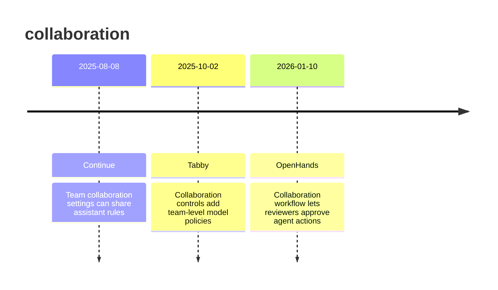

# Theme: collaboration

## Cross-Product Timeline
<!-- chronolog:begin region="timeline" -->

<!-- chronolog:end -->

## Change Cards
<!-- chronolog:begin region="cards" -->
- 2025-08-08 Continue: [[Changes/Continue/2025-08-08-team-collaboration-settings-can-share-assistant-rules|Team collaboration settings can share assistant rules]]
- 2025-10-02 Tabby: [[Changes/Tabby/2025-10-02-collaboration-controls-add-team-level-model-policies|Collaboration controls add team-level model policies]]
- 2026-01-10 OpenHands: [[Changes/OpenHands/2026-01-10-collaboration-workflow-lets-reviewers-approve-agent-actions|Collaboration workflow lets reviewers approve agent actions]]
<!-- chronolog:end -->