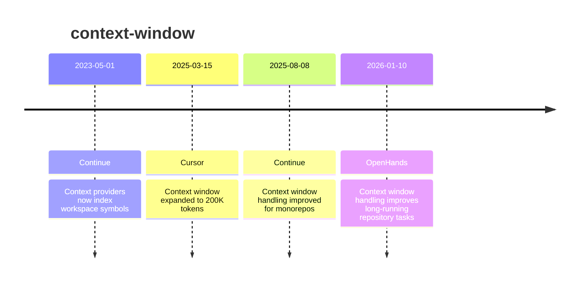

# Theme: context-window

## Cross-Product Timeline
<!-- chronolog:begin region="timeline" -->

<!-- chronolog:end -->

## Change Cards
<!-- chronolog:begin region="cards" -->
- 2023-05-01 Continue: [[2023-05-01-context-providers-now-index-workspace-symbols|Context providers now index workspace symbols]]
- 2025-03-15 Cursor: [[2025-03-15-context-window-expanded-to-200k-tokens|Context window expanded to 200K tokens]]
- 2025-08-08 Continue: [[2025-08-08-context-window-handling-improved-for-monorepos|Context window handling improved for monorepos]]
- 2026-01-10 OpenHands: [[2026-01-10-context-window-handling-improves-long-running-repository-tasks|Context window handling improves long-running repository tasks]]
<!-- chronolog:end -->