# Theme: context-window

## Cross-Product Timeline

```mermaid
timeline
    title context-window
    2023-05-04 : Cursor : Extended prompt length for project generation
    2023-05-04 : Cursor : Alpha feature: 🧠 Alpha feature: Ask questions about your entire repo 🛠️. We are
    2023-05-12 : ChatGPT : In addition to the beta panel, users can now choose to continue generating a mes
    2023-05-17 : Cursor : Press Cmd+Shift+L, and the model will add the terminal context to chat
    2023-06-06 : Cursor : Introducing v1 of codebase-wide context! We'll be shipping major improvements to
    2023-06-06 : Cursor : Codebase Context v1
    2023-06-06 : Cursor : We've improved codebase context!
    2023-06-06 : Cursor : Or, on chat, press Cmd+Enter in order to get a response that uses context from t
    2023-06-06 : Cursor : Following this, you'll be able to see an improved version of codebase context in
    2023-07-19 : Cursor : Advanced context controls only show up if you have indexed your codebase
    2023-07-19 : Cursor : More control of context building abilities for codebase-wide chat
    2023-08-22 : Cursor : Follow-up chat messages to "with codebase" will keep the codebase context.
    2023-08-22 : Cursor : If you @ reference a long file that will be cutoff by the context limit, you'll
    2023-08-26 : Cursor : Have the advanced context button show up for non git repos.
    2023-08-30 : Cursor : For "with codebase" chats, you can now see the codebase context that Cursor show
    2023-09-08 : Cursor : You can also paste a url into the chat and the model will automatically include
    2023-09-10 : Cursor : Ask a question about an edit that the model with option+enter, or bring in conte
    2023-11-10 : Cursor : Copilot++ (beta): this is an "add-on" to Copilot that suggests diffs around your
    2023-11-21 : Cursor : Integrates GPT-V into chat for the editor. This means you can take screenshots/i
    2023-11-24 : Cursor : You can now @folder in the chat to chat with a folder. Let us know what you thin
    2023-11-27 : Cursor : @ folders: You can now use the @ symbol to reference specific folders! We'll try
    2023-11-30 : Cursor : Better context chat: in particular, followups are now smarter!
    2024-04-01 : Cursor : Long Context Chat (Beta): This is a new experimental feature that lets you talk
    2024-04-12 : Cursor : .cursorrules: You can write down repo-level rules for the AI by creating a .curs
    2024-06-08 : Cursor : Adds context pills to chat messages, so you can see what will be/was used
    2024-06-08 : Cursor : Cmd K context-building improvements
    2024-08-22 : Cursor : We've also trained a new Cursor Tab model that's smarter and more context-aware.
    2024-11-24 : Cursor : @Recommended in chat/composer to semantically search for context
    2024-11-24 : Cursor : File pill recommendations in chat/composer
    2024-11-24 : Cursor : Early version of an agent in composer that can pick its own context and use the
    2024-12-13 : ChatGPT : Projects provide a new way to group files and chats for personal use, simplifyin
    2025-01-23 : Cursor : Summarize Previous Composers: When conversations grow too long, you can start a
    2025-04-15 : Cursor : You can now generate rules directly from a conversation using the /Generate Curs
    2025-06-12 : Cursor : Agents understand context
    2025-07-29 : Cursor : At the end of a conversation you can now see how much of the context window is u
    2025-07-29 : Cursor : View context usage in Chat
    2025-08-06 : Cursor : Agents are significantly improved when operating across large codebases. Context
    2025-08-12 : ChatGPT : ChatGPT Plus users now have 3,000 messages/week with GPT-5 Thinking, and then ex
    2025-08-22 : ChatGPT : This creates a focused, self-contained space, which is useful for long-running o
    2025-09-12 : Cursor : Summarization triggers
    2025-09-12 : Cursor : Cursor automatically summarizes long conversation for you when reaching the cont
    2025-12-18 : Cursor : Cursor can now analyze the code and context in each agent session to understand
    2026-01-13 : Claude Code : Added `context_window.used_percentage` and `context_window.remaining_percentage`
    2026-01-16 : Claude Code : Added `auto:N` syntax for configuring the MCP tool search auto-enable threshold,
    2026-01-22 : Cursor : The result is faster overall execution, more focused context in your main conver
    2026-02-03 : Claude Code : Added `pages` parameter to the Read tool for PDFs, allowing specific page ranges
    2026-02-05 : Claude Code : Added "Summarize from here" to the message selector, allowing partial conversati
    2026-02-13 : ChatGPT : Attach up to 20 files in a single message. You can now upload up to 20 files at
    2026-02-13 : Claude Code : Improved `/rename` to auto-generate session name from conversation context when
    2026-02-20 : ChatGPT : ChatGPT now has a total context window length of 256k tokens (128k input and 128
    2026-02-25 : ChatGPT : Ad-hoc text sources: Paste notes, briefs, or reference material directly to capt
    2026-02-25 : ChatGPT : Projects now make it easy to build a living knowledge base by adding sources whe
    2026-03-05 : ChatGPT : GPT‑5.4 brings together the best of our recent advances in reasoning, coding, an
    2026-03-14 : Claude Code : Added `PostCompact` hook that fires after compaction completes
    2026-03-19 : Cursor : Standard: $0.50/M input, $2.50/M output tokens
    2026-03-19 : Cursor : Fast (default): $1.50/M input, $7.50/M output tokens
    2026-03-25 : ChatGPT : Starting today for ChatGPT Plus, Pro, and Business users, long pastes are handle
    2026-03-27 : Claude Code : Reduced token overhead when mentioning files with `@` — raw string content no lo
    2026-04-09 : Claude Code : Added `--exclude-dynamic-system-prompt-sections` flag to print mode for improved
    2026-04-14 : Claude Code : Added `ENABLE_PROMPT_CACHING_1H` env var to opt into 1-hour prompt cache TTL on
    2026-04-14 : Claude Code : Added recap feature to provide context when returning to a session, configurable
    2026-04-15 : Claude Code : Added option to show Claude's last response as commented context in the `Ctrl+G`
    2026-05-04 : Cursor : Admins can now set more granular allow or blocklists at the model and provider l
    2026-05-06 : Cursor : Use these stats to diagnose context issues and improve your setup across rules,
    2026-05-06 : Cursor : You can now see a breakdown of your agent's context usage.
    2026-05-11 : Cursor : Cursor automatically picks the right repository and model based on your prompt a
    2026-05-18 : Cursor : Fast (default): $3.00/M input, $15.00/M output tokens
    2026-05-18 : Cursor : Standard: $0.50/M input, $2.50/M output tokens
    2026-05-28 : Claude Code : Claude now reserves the multiple-choice question prompt for decisions it genuine
    2026-06-04 : Cursor : Context usage report in canvas
    2026-06-04 : Cursor : This release introduces Design Mode for faster canvas editing, new ways to under
    2026-06-08 : Claude Code : Added `/cd` command to move a session to a new working directory without breakin
    2026-06-12 : Claude Code : [VSCode] Added usage attribution to the Account & usage dialog (`/usage`) showin
    2026-06-22 : ChatGPT : Starting today for ChatGPT Free and Go users, long pastes are handled differentl
    2026-06-30 : Claude Code : Introducing Claude Sonnet 5: now the default model in Claude Code, with a native
    2026-07-08 : Claude Code : Improved auto mode to ask before running `rm -rf` on a variable it can't resolve
    2026-07-10 : Cursor : Each side chat is a durable, full agent conversation that you can follow up on,
    2026-07-10 : Cursor : Open a side chat to ask questions, explore ideas, and investigate tangents witho
```

<!-- chronolog:begin region="timeline" -->

<!-- chronolog:end -->

## Change Cards
<!-- chronolog:begin region="cards" -->
- 2023-05-04 Cursor: [[Changes/Cursor/2023-05-04-extended-prompt-length-for-project-generation|Extended prompt length for project generation]]
- 2023-05-04 Cursor: [[Changes/Cursor/2023-05-04-alpha-feature-alpha-feature-ask-questions-about-your-entire-repo-we-are-experime|Alpha feature: 🧠 Alpha feature: Ask questions about your entire repo 🛠️. We are]]
- 2023-05-12 ChatGPT: [[Changes/ChatGPT/2023-05-12-in-addition-to-the-beta-panel-users-can-now-choose-to-continue-generating-a-mess|In addition to the beta panel, users can now choose to continue generating a mes]]
- 2023-05-17 Cursor: [[Changes/Cursor/2023-05-17-press-cmd-shift-l-and-the-model-will-add-the-terminal-context-to-chat|Press Cmd+Shift+L, and the model will add the terminal context to chat]]
- 2023-06-06 Cursor: [[Changes/Cursor/2023-06-06-introducing-v1-of-codebase-wide-context-we-ll-be-shipping-major-improvements-to|Introducing v1 of codebase-wide context! We'll be shipping major improvements to]]
- 2023-06-06 Cursor: [[Changes/Cursor/2023-06-06-codebase-context-v1|Codebase Context v1]]
- 2023-06-06 Cursor: [[Changes/Cursor/2023-06-06-we-ve-improved-codebase-context|We've improved codebase context!]]
- 2023-06-06 Cursor: [[Changes/Cursor/2023-06-06-or-on-chat-press-cmd-enter-in-order-to-get-a-response-that-uses-context-from-the|Or, on chat, press Cmd+Enter in order to get a response that uses context from t]]
- 2023-06-06 Cursor: [[Changes/Cursor/2023-06-06-following-this-you-ll-be-able-to-see-an-improved-version-of-codebase-context-in|Following this, you'll be able to see an improved version of codebase context in]]
- 2023-07-19 Cursor: [[Changes/Cursor/2023-07-19-advanced-context-controls-only-show-up-if-you-have-indexed-your-codebase|Advanced context controls only show up if you have indexed your codebase]]
- 2023-07-19 Cursor: [[Changes/Cursor/2023-07-19-more-control-of-context-building-abilities-for-codebase-wide-chat|More control of context building abilities for codebase-wide chat]]
- 2023-08-22 Cursor: [[Changes/Cursor/2023-08-22-follow-up-chat-messages-to-with-codebase-will-keep-the-codebase-context|Follow-up chat messages to "with codebase" will keep the codebase context.]]
- 2023-08-22 Cursor: [[Changes/Cursor/2023-08-22-if-you-reference-a-long-file-that-will-be-cutoff-by-the-context-limit-you-ll-be|If you @ reference a long file that will be cutoff by the context limit, you'll]]
- 2023-08-26 Cursor: [[Changes/Cursor/2023-08-26-have-the-advanced-context-button-show-up-for-non-git-repos|Have the advanced context button show up for non git repos.]]
- 2023-08-30 Cursor: [[Changes/Cursor/2023-08-30-for-with-codebase-chats-you-can-now-see-the-codebase-context-that-cursor-shows-g|For "with codebase" chats, you can now see the codebase context that Cursor show]]
- 2023-09-08 Cursor: [[Changes/Cursor/2023-09-08-you-can-also-paste-a-url-into-the-chat-and-the-model-will-automatically-include|You can also paste a url into the chat and the model will automatically include]]
- 2023-09-10 Cursor: [[Changes/Cursor/2023-09-10-ask-a-question-about-an-edit-that-the-model-with-option-enter-or-bring-in-contex|Ask a question about an edit that the model with option+enter, or bring in conte]]
- 2023-11-10 Cursor: [[Changes/Cursor/2023-11-10-copilot-beta-this-is-an-add-on-to-copilot-that-suggests-diffs-around-your-cursor|Copilot++ (beta): this is an "add-on" to Copilot that suggests diffs around your]]
- 2023-11-21 Cursor: [[Changes/Cursor/2023-11-21-integrates-gpt-v-into-chat-for-the-editor-this-means-you-can-take-screenshots-im|Integrates GPT-V into chat for the editor. This means you can take screenshots/i]]
- 2023-11-24 Cursor: [[Changes/Cursor/2023-11-24-you-can-now-folder-in-the-chat-to-chat-with-a-folder-let-us-know-what-you-think|You can now @folder in the chat to chat with a folder. Let us know what you thin]]
- 2023-11-27 Cursor: [[Changes/Cursor/2023-11-27-folders-you-can-now-use-the-symbol-to-reference-specific-folders-we-ll-try-to-pi|@ folders: You can now use the @ symbol to reference specific folders! We'll try]]
- 2023-11-30 Cursor: [[Changes/Cursor/2023-11-30-better-context-chat-in-particular-followups-are-now-smarter|Better context chat: in particular, followups are now smarter!]]
- 2024-04-01 Cursor: [[Changes/Cursor/2024-04-01-long-context-chat-beta-this-is-a-new-experimental-feature-that-lets-you-talk-wit|Long Context Chat (Beta): This is a new experimental feature that lets you talk]]
- 2024-04-12 Cursor: [[Changes/Cursor/2024-04-12-cursorrules-you-can-write-down-repo-level-rules-for-the-ai-by-creating-a-cursorr|.cursorrules: You can write down repo-level rules for the AI by creating a .curs]]
- 2024-06-08 Cursor: [[Changes/Cursor/2024-06-08-adds-context-pills-to-chat-messages-so-you-can-see-what-will-be-was-used|Adds context pills to chat messages, so you can see what will be/was used]]
- 2024-06-08 Cursor: [[Changes/Cursor/2024-06-08-cmd-k-context-building-improvements|Cmd K context-building improvements]]
- 2024-08-22 Cursor: [[Changes/Cursor/2024-08-22-we-ve-also-trained-a-new-cursor-tab-model-that-s-smarter-and-more-context-aware|We've also trained a new Cursor Tab model that's smarter and more context-aware.]]
- 2024-11-24 Cursor: [[Changes/Cursor/2024-11-24-recommended-in-chat-composer-to-semantically-search-for-context|@Recommended in chat/composer to semantically search for context]]
- 2024-11-24 Cursor: [[Changes/Cursor/2024-11-24-file-pill-recommendations-in-chat-composer|File pill recommendations in chat/composer]]
- 2024-11-24 Cursor: [[Changes/Cursor/2024-11-24-early-version-of-an-agent-in-composer-that-can-pick-its-own-context-and-use-the|Early version of an agent in composer that can pick its own context and use the]]
- 2024-12-13 ChatGPT: [[Changes/ChatGPT/2024-12-13-projects-provide-a-new-way-to-group-files-and-chats-for-personal-use-simplifying|Projects provide a new way to group files and chats for personal use, simplifyin]]
- 2025-01-23 Cursor: [[Changes/Cursor/2025-01-23-summarize-previous-composers-when-conversations-grow-too-long-you-can-start-a-ne|Summarize Previous Composers: When conversations grow too long, you can start a]]
- 2025-04-15 Cursor: [[Changes/Cursor/2025-04-15-you-can-now-generate-rules-directly-from-a-conversation-using-the-generate-curso|You can now generate rules directly from a conversation using the /Generate Curs]]
- 2025-06-12 Cursor: [[Changes/Cursor/2025-06-12-agents-understand-context|Agents understand context]]
- 2025-07-29 Cursor: [[Changes/Cursor/2025-07-29-at-the-end-of-a-conversation-you-can-now-see-how-much-of-the-context-window-is-u|At the end of a conversation you can now see how much of the context window is u]]
- 2025-07-29 Cursor: [[Changes/Cursor/2025-07-29-view-context-usage-in-chat|View context usage in Chat]]
- 2025-08-06 Cursor: [[Changes/Cursor/2025-08-06-agents-are-significantly-improved-when-operating-across-large-codebases-context|Agents are significantly improved when operating across large codebases. Context]]
- 2025-08-12 ChatGPT: [[Changes/ChatGPT/2025-08-12-chatgpt-plus-users-now-have-3-000-messages-week-with-gpt-5-thinking-and-then-ext|ChatGPT Plus users now have 3,000 messages/week with GPT-5 Thinking, and then ex]]
- 2025-08-22 ChatGPT: [[Changes/ChatGPT/2025-08-22-this-creates-a-focused-self-contained-space-which-is-useful-for-long-running-or|This creates a focused, self-contained space, which is useful for long-running o]]
- 2025-09-12 Cursor: [[Changes/Cursor/2025-09-12-summarization-triggers|Summarization triggers]]
- 2025-09-12 Cursor: [[Changes/Cursor/2025-09-12-cursor-automatically-summarizes-long-conversation-for-you-when-reaching-the-cont|Cursor automatically summarizes long conversation for you when reaching the cont]]
- 2025-12-18 Cursor: [[Changes/Cursor/2025-12-18-cursor-can-now-analyze-the-code-and-context-in-each-agent-session-to-understand|Cursor can now analyze the code and context in each agent session to understand]]
- 2026-01-13 Claude Code: [[Changes/Claude Code/2026-01-13-added-context-window-used-percentage-and-context-window-remaining-percentage-fie|Added `context_window.used_percentage` and `context_window.remaining_percentage`]]
- 2026-01-16 Claude Code: [[Changes/Claude Code/2026-01-16-added-auto-n-syntax-for-configuring-the-mcp-tool-search-auto-enable-threshold-wh|Added `auto:N` syntax for configuring the MCP tool search auto-enable threshold,]]
- 2026-01-22 Cursor: [[Changes/Cursor/2026-01-22-the-result-is-faster-overall-execution-more-focused-context-in-your-main-convers|The result is faster overall execution, more focused context in your main conver]]
- 2026-02-03 Claude Code: [[Changes/Claude Code/2026-02-03-added-pages-parameter-to-the-read-tool-for-pdfs-allowing-specific-page-ranges-to|Added `pages` parameter to the Read tool for PDFs, allowing specific page ranges]]
- 2026-02-05 Claude Code: [[Changes/Claude Code/2026-02-05-added-summarize-from-here-to-the-message-selector-allowing-partial-conversation|Added "Summarize from here" to the message selector, allowing partial conversati]]
- 2026-02-13 ChatGPT: [[Changes/ChatGPT/2026-02-13-attach-up-to-20-files-in-a-single-message-you-can-now-upload-up-to-20-files-at-o|Attach up to 20 files in a single message. You can now upload up to 20 files at]]
- 2026-02-13 Claude Code: [[Changes/Claude Code/2026-02-13-improved-rename-to-auto-generate-session-name-from-conversation-context-when-cal|Improved `/rename` to auto-generate session name from conversation context when]]
- 2026-02-20 ChatGPT: [[Changes/ChatGPT/2026-02-20-chatgpt-now-has-a-total-context-window-length-of-256k-tokens-128k-input-and-128k|ChatGPT now has a total context window length of 256k tokens (128k input and 128]]
- 2026-02-25 ChatGPT: [[Changes/ChatGPT/2026-02-25-ad-hoc-text-sources-paste-notes-briefs-or-reference-material-directly-to-capture|Ad-hoc text sources: Paste notes, briefs, or reference material directly to capt]]
- 2026-02-25 ChatGPT: [[Changes/ChatGPT/2026-02-25-projects-now-make-it-easy-to-build-a-living-knowledge-base-by-adding-sources-whe|Projects now make it easy to build a living knowledge base by adding sources whe]]
- 2026-03-05 ChatGPT: [[Changes/ChatGPT/2026-03-05-gpt-5-4-brings-together-the-best-of-our-recent-advances-in-reasoning-coding-and|GPT‑5.4 brings together the best of our recent advances in reasoning, coding, an]]
- 2026-03-14 Claude Code: [[Changes/Claude Code/2026-03-14-added-postcompact-hook-that-fires-after-compaction-completes|Added `PostCompact` hook that fires after compaction completes]]
- 2026-03-19 Cursor: [[Changes/Cursor/2026-03-19-standard-0-50-m-input-2-50-m-output-tokens|Standard: $0.50/M input, $2.50/M output tokens]]
- 2026-03-19 Cursor: [[Changes/Cursor/2026-03-19-fast-default-1-50-m-input-7-50-m-output-tokens|Fast (default): $1.50/M input, $7.50/M output tokens]]
- 2026-03-25 ChatGPT: [[Changes/ChatGPT/2026-03-25-starting-today-for-chatgpt-plus-pro-and-business-users-long-pastes-are-handled-d|Starting today for ChatGPT Plus, Pro, and Business users, long pastes are handle]]
- 2026-03-27 Claude Code: [[Changes/Claude Code/2026-03-27-reduced-token-overhead-when-mentioning-files-with-raw-string-content-no-longer-j|Reduced token overhead when mentioning files with `@` — raw string content no lo]]
- 2026-04-09 Claude Code: [[Changes/Claude Code/2026-04-09-added-exclude-dynamic-system-prompt-sections-flag-to-print-mode-for-improved-cro|Added `--exclude-dynamic-system-prompt-sections` flag to print mode for improved]]
- 2026-04-14 Claude Code: [[Changes/Claude Code/2026-04-14-added-enable-prompt-caching-1h-env-var-to-opt-into-1-hour-prompt-cache-ttl-on-ap|Added `ENABLE_PROMPT_CACHING_1H` env var to opt into 1-hour prompt cache TTL on]]
- 2026-04-14 Claude Code: [[Changes/Claude Code/2026-04-14-added-recap-feature-to-provide-context-when-returning-to-a-session-configurable|Added recap feature to provide context when returning to a session, configurable]]
- 2026-04-15 Claude Code: [[Changes/Claude Code/2026-04-15-added-option-to-show-claude-s-last-response-as-commented-context-in-the-ctrl-g-e|Added option to show Claude's last response as commented context in the `Ctrl+G`]]
- 2026-05-04 Cursor: [[Changes/Cursor/2026-05-04-admins-can-now-set-more-granular-allow-or-blocklists-at-the-model-and-provider-l|Admins can now set more granular allow or blocklists at the model and provider l]]
- 2026-05-06 Cursor: [[Changes/Cursor/2026-05-06-use-these-stats-to-diagnose-context-issues-and-improve-your-setup-across-rules-s|Use these stats to diagnose context issues and improve your setup across rules,]]
- 2026-05-06 Cursor: [[Changes/Cursor/2026-05-06-you-can-now-see-a-breakdown-of-your-agent-s-context-usage|You can now see a breakdown of your agent's context usage.]]
- 2026-05-11 Cursor: [[Changes/Cursor/2026-05-11-cursor-automatically-picks-the-right-repository-and-model-based-on-your-prompt-a|Cursor automatically picks the right repository and model based on your prompt a]]
- 2026-05-18 Cursor: [[Changes/Cursor/2026-05-18-fast-default-3-00-m-input-15-00-m-output-tokens|Fast (default): $3.00/M input, $15.00/M output tokens]]
- 2026-05-18 Cursor: [[Changes/Cursor/2026-05-18-standard-0-50-m-input-2-50-m-output-tokens|Standard: $0.50/M input, $2.50/M output tokens]]
- 2026-05-28 Claude Code: [[Changes/Claude Code/2026-05-28-claude-now-reserves-the-multiple-choice-question-prompt-for-decisions-it-genuine|Claude now reserves the multiple-choice question prompt for decisions it genuine]]
- 2026-06-04 Cursor: [[Changes/Cursor/2026-06-04-context-usage-report-in-canvas|Context usage report in canvas]]
- 2026-06-04 Cursor: [[Changes/Cursor/2026-06-04-this-release-introduces-design-mode-for-faster-canvas-editing-new-ways-to-unders|This release introduces Design Mode for faster canvas editing, new ways to under]]
- 2026-06-08 Claude Code: [[Changes/Claude Code/2026-06-08-added-cd-command-to-move-a-session-to-a-new-working-directory-without-breaking-t|Added `/cd` command to move a session to a new working directory without breakin]]
- 2026-06-12 Claude Code: [[Changes/Claude Code/2026-06-12-vscode-added-usage-attribution-to-the-account-usage-dialog-usage-showing-cache-m|[VSCode] Added usage attribution to the Account & usage dialog (`/usage`) showin]]
- 2026-06-22 ChatGPT: [[Changes/ChatGPT/2026-06-22-starting-today-for-chatgpt-free-and-go-users-long-pastes-are-handled-differently|Starting today for ChatGPT Free and Go users, long pastes are handled differentl]]
- 2026-06-30 Claude Code: [[Changes/Claude Code/2026-06-30-introducing-claude-sonnet-5-now-the-default-model-in-claude-code-with-a-native-1|Introducing Claude Sonnet 5: now the default model in Claude Code, with a native]]
- 2026-07-08 Claude Code: [[Changes/Claude Code/2026-07-08-improved-auto-mode-to-ask-before-running-rm-rf-on-a-variable-it-can-t-resolve-fr|Improved auto mode to ask before running `rm -rf` on a variable it can't resolve]]
- 2026-07-10 Cursor: [[Changes/Cursor/2026-07-10-each-side-chat-is-a-durable-full-agent-conversation-that-you-can-follow-up-on-re|Each side chat is a durable, full agent conversation that you can follow up on,]]
- 2026-07-10 Cursor: [[Changes/Cursor/2026-07-10-open-a-side-chat-to-ask-questions-explore-ideas-and-investigate-tangents-without|Open a side chat to ask questions, explore ideas, and investigate tangents witho]]
<!-- chronolog:end -->