# Theme: developer-workflow

## Cross-Product Timeline

```mermaid
timeline
    title developer-workflow
    2023-03-18 : Cursor : Built-in terminal
    2023-03-27 : Cursor : Opens the terminal in your current folder
    2023-04-07 : Cursor : Turns off the auto-install of the "cursor ." command (and fixes its install alto
    2023-04-14 : Cursor : Don't install "cursor" command on startup
    2023-04-29 : Cursor : 🌐 Working remote ssh support through the "OpenRemote - SSH" extension
    2023-05-17 : Cursor : In-terminal Debugging
    2023-05-17 : Cursor : Press Cmd+D to auto-debug a terminal error
    2023-06-14 : Cursor : Small fix for a format-on-save bug that was introduced in the last release. Some
    2023-06-17 : Cursor : The AI linter now shows diffs!
    2023-06-24 : Cursor : Chat was failing on some non-git folders. That is now fixed.
    2023-06-27 : Cursor : You can now use Run & debug in Cursor again (the toolbar is back)
    2023-06-27 : Cursor : Early support for slash commands
    2023-07-12 : Cursor : This update patches search (Cmd/Win+Shift+F) and many extensions for and WSL and
    2023-07-27 : Cursor : Linter is back!
    2023-08-01 : Cursor : Improved linter! Please give us feedback on the linter suggestions using the smi
    2023-08-03 : Cursor : Also, the linter is slightly improved.
    2023-08-17 : Cursor : The cursor-nightly command now works on Mac.
    2023-08-22 : Cursor : Applies the patch from Github across all your WSL (Windows Subsystem for Linux)
    2023-08-26 : Cursor : We had a big bug for people on language packs. Thank you to all who helped us de
    2023-09-05 : Cursor : Ships with cursor-python, a Language-Server fork of pyright built for Cursor
    2023-09-23 : Cursor : never lets your root directory be in the gitignore
    2023-10-01 : Cursor : Ask about git commits and PRs using @git in chat!
    2023-10-20 : Cursor : Also, there's an experimental bash mode: enable it in the settings, and let the
    2024-01-06 : Cursor : WSL and Dev Containers should now work properly.
    2024-01-06 : Cursor : Dev containers are now supported! This build also:
    2024-01-06 : Cursor : Improves the stability of WSL.
    2024-01-15 : Cursor : Working WSL codebase search
    2024-02-15 : Cursor : Linter: You can now turn on an AI linter in the "More" tab beside Chat. It'll sc
    2024-06-08 : Cursor : Remote tunnels are now supported! Remote SSH support is also more robust (now su
    2024-07-03 : Cursor : When the chat suggests a code block, click "Apply" to instantly see the change t
    2024-10-09 : Cursor : We have made slight improvements to Debug with AI and added back @Lint Errors in
    2024-11-24 : Cursor : Generation of git commit messages
    2024-12-17 : Cursor : Agent reads linter errors to automatically fix issues
    2024-12-17 : Cursor : With Yolo Mode, the agent can auto-run terminal commands
    2024-12-17 : Cursor : Agent sees terminal exit codes, can run commands in the background, and commands
    2025-02-19 : Cursor : Windows: Fixed newline errors in Chat Codeblocks and resolved auto-uninstallatio
    2025-06-04 : Cursor : Bugbot automatically reviews your PRs and catches potential bugs and issues.
    2025-06-04 : Cursor : Automatic code review with Bugbot
    2025-07-29 : Cursor : Share terminal with Agent
    2025-08-21 : Cursor : Improved review flow in Agent terminal
    2025-08-21 : Cursor : The terminal now opens on the left with a clear backdrop and border animation to
    2025-09-12 : Cursor : You can now create reusable prompts and quickly share them with your team. Comma
    2025-09-12 : Cursor : We've been using them for running linters, fixing compile errors, and creating P
    2025-09-12 : Cursor : Custom slash commands
    2025-11-21 : Cursor : You can now find and fix bugs directly in Cursor with AI code reviews. It will l
    2025-11-21 : Cursor : AI Code Reviews
    2025-12-10 : Cursor : Debug Mode helps you reproduce and fix the most tricky bugs.
    2025-12-19 : Claude Code : Added LSP (Language Server Protocol) tool for code intelligence features like go
    2025-12-19 : Claude Code : Added `/terminal-setup` support for Kitty, Alacritty, Zed, and Warp terminals
    2026-01-08 : Cursor : Use the new agent models command, --list-models flag, or /models slash command t
    2026-01-09 : Claude Code : Improved slash command suggestion readability by truncating long descriptions to
    2026-01-09 : Claude Code : Added source path metadata to images dragged onto the terminal, helping Claude u
    2026-01-09 : Claude Code : Added clickable hyperlinks for file paths in tool output in terminals that suppo
    2026-01-12 : Claude Code : Added `CLAUDE_CODE_TMPDIR` environment variable to override the temp directory u
    2026-01-13 : Claude Code : Added date range filtering to `/stats` command - press `r` to cycle between Last
    2026-01-13 : Claude Code : Added search functionality to `/config` command for quickly filtering settings
    2026-01-16 : Claude Code : Added session URL attribution to commits and PRs created from web sessions
    2026-01-20 : Claude Code : [VSCode] Added `/usage` command to display current plan usage
    2026-01-21 : Claude Code : Added deprecation notification for npm installations - run `claude install` or s
    2026-01-22 : Claude Code : Added new task management system, including new capabilities like dependency tra
    2026-01-23 : Claude Code : Changed indexed argument syntax from `$ARGUMENTS.0` to `$ARGUMENTS[0]` (bracket
    2026-01-23 : Claude Code : Added shorthand `$0`, `$1`, etc. for accessing individual arguments in custom co
    2026-01-27 : Claude Code : Added support for loading `CLAUDE.md` files from additional directories specifie
    2026-01-28 : Claude Code : [VSCode] Added automatic Python virtual environment activation, ensuring `python
    2026-01-29 : Claude Code : Changed Bash commands to show timeout duration alongside elapsed time
    2026-01-30 : Claude Code : Sessions are now automatically linked to PRs when created via `gh pr create`
    2026-01-30 : Claude Code : Added tool call failures and denials to debug logs
    2026-02-03 : Claude Code : Added support for additional `git log` and `git show` flags in read-only mode (e
    2026-02-03 : Claude Code : Added `/debug` for Claude to help troubleshoot the current session
    2026-02-04 : Claude Code : Reduced layout jitter in the terminal when the spinner appears and disappears du
    2026-02-10 : Claude Code : Improved heredoc delimiter parsing to prevent command smuggling
    2026-02-18 : Cursor : Mermaid ASCII diagrams in CLI
    2026-02-19 : ChatGPT : Review code in split-screen views
    2026-02-20 : Claude Code : Added `WorktreeCreate` and `WorktreeRemove` hook events, enabling custom VCS set
    2026-02-20 : Claude Code : Added support for `startupTimeout` configuration for LSP servers
    2026-02-26 : Claude Code : Improved "always allow" prefix suggestions for compound bash commands (e.g. `cd
    2026-02-26 : Cursor : Bugbot will post a comment on the original PR with a preview of the autofix chan
    2026-02-26 : Cursor : Bugbot can automatically fix issues it finds in pull requests.
    2026-02-28 : Claude Code : Improved `/model` command to show the currently active model in the slash comman
    2026-02-28 : Claude Code : Added `/simplify` and `/batch` bundled slash commands
    2026-03-03 : Cursor : This release introduces interactive UIs in agent chats, a way for teams to share
    2026-03-05 : Claude Code : Added Ctrl+U on an empty bash prompt (`!`) to exit bash mode, matching `escape`
    2026-03-07 : Claude Code : Added `fmt`, `comm`, `cmp`, `numfmt`, `expr`, `test`, `printf`, `getconf`, `seq`
    2026-03-10 : Claude Code : Added `ExitWorktree` tool to leave an `EnterWorktree` session
    2026-03-12 : Claude Code : [VSCode] Improved scroll wheel responsiveness in the integrated terminal with te
    2026-03-14 : Claude Code : Added `worktree.sparsePaths` setting for `claude --worktree` in large monorepos
    2026-03-17 : Claude Code : Terminal notifications (iTerm2/Kitty/Ghostty popups, progress bar) now reach the
    2026-03-20 : Claude Code : Resuming a session that was in a worktree now switches back to that worktree
    2026-03-20 : Claude Code : Added `--bare` flag for scripted `-p` calls — skips hooks, LSP, plugin sync, and
    2026-03-26 : Claude Code : Added `WorktreeCreate` hook support for `type: "http"` — return the created work
    2026-03-27 : Claude Code : Added `X-Claude-Code-Session-Id` header to API requests so proxies can aggregate
    2026-04-02 : Cursor : The new Cursor interface allows you to run many agents in parallel across repos
    2026-04-08 : Claude Code : Added `workspace.git_worktree` to the status line JSON input, set when the curre
    2026-04-08 : Cursor : Bugbot can now learn from feedback on pull requests and turn those signals into
    2026-04-13 : Claude Code : Added `path` parameter to the `EnterWorktree` tool to switch into an existing wo
    2026-04-14 : Cursor : Use /debug to find root causes and fix tricky bugs that are hard to reproduce or
    2026-04-14 : Cursor : We've shipped quality-of-life improvements to the Cursor CLI to make working wit
    2026-04-14 : Cursor : Debug Mode in CLI
    2026-04-14 : Cursor : /btw support in CLI
    2026-04-15 : Claude Code : Changed `Ctrl+O` to toggle between normal and verbose transcript only; focus vie
    2026-04-15 : Cursor : In the Agents Window, canvases are durable artifacts that live in the side panel
    2026-04-16 : Claude Code : Added "Auto (match terminal)" theme option that matches your terminal's dark/lig
    2026-04-17 : Claude Code : Changed the CLI to spawn a native Claude Code binary (via a per-platform optiona
    2026-04-22 : Claude Code : The `/resume` command now offers to summarize stale, large sessions before re-re
    2026-04-23 : Claude Code : Added `prUrlTemplate` setting to point the footer PR badge at a custom code-revi
    2026-04-28 : Claude Code : OpenTelemetry: added `claude_code.at_mention` log event for `@`-mention resoluti
    2026-05-06 : Claude Code : Added `CLAUDE_CODE_PACKAGE_MANAGER_AUTO_UPDATE`: when set on Homebrew or WinGet
    2026-05-07 : Claude Code : Added `worktree.baseRef` setting (`fresh` | `head`) to choose whether `--worktre
    2026-05-07 : Cursor : A new PR review experience is now available in Cursor 3. Take PRs from creation
    2026-05-07 : Cursor : This release introduces a new PR review experience, faster execution on plans th
    2026-05-08 : Claude Code : Improved visual consistency across slash command dialogs: standardized footer hi
    2026-05-15 : Claude Code : Added `worktree.bgIsolation: "none"` setting to let background sessions edit the
    2026-05-21 : Claude Code : Renamed `/simplify` to `/code-review` with an optional effort level (e.g. `/code
    2026-05-21 : Claude Code : Renamed `/simplify` to `/code-review`. It now reports correctness bugs at a chos
    2026-05-27 : Claude Code : `/code-review --fix` now applies review findings to your working tree after the
    2026-05-27 : Claude Code : Added `/reload-skills` command to re-scan skill directories without restarting t
    2026-05-28 : Claude Code : Status line commands now receive `COLUMNS` and `LINES` environment variables so
    2026-05-29 : Claude Code : `EnterWorktree` can now switch between Claude-managed worktrees mid-session
    2026-06-02 : Claude Code : `acceptEdits` mode now prompts before writing build-tool config files that grant
    2026-06-02 : Claude Code : Parallel tool calls: a failed Bash command no longer cancels other calls in the
    2026-06-03 : Claude Code : `--tools`: explicitly listing Grep/Glob now provides the dedicated search tools
    2026-06-04 : Claude Code : Skills: added `\$` escape syntax to include a literal `$` before a digit in comm
    2026-06-10 : Cursor : Run Bugbot before you push
    2026-06-15 : Claude Code : Improved `/doctor` with consistent flat tree layout across all sections, clearer
    2026-06-17 : Cursor : Cursor can now help you set up your dev environment in the cloud in less than 10
    2026-07-02 : Claude Code : `claude agents` session rows now show pull-request links as bare `#N` without th
    2026-07-10 : Claude Code : `EnterWorktree` now asks for confirmation before entering a git worktree outside
    2026-07-10 : Claude Code : `/commit-push-pr` now auto-allows `git push` to the repo's configured push remot
    2026-07-10 : Claude Code : Added directory path suggestions to `/cd`, matching `/add-dir` behavior
    2026-07-19 : Claude Code : Claude no longer runs the `/verify` and `/code-review` skills on its own; invoke
    2026-07-21 : Claude Code : Improved footer PR badge links to be clickable hyperlinks even when terminal sup
    2026-07-22 : Claude Code : Changed `/code-review` to run as a background subagent, so review work no longer
```

<!-- chronolog:begin region="timeline" -->

<!-- chronolog:end -->

## Change Cards
<!-- chronolog:begin region="cards" -->
- 2023-03-18 Cursor: [[Changes/Cursor/2023-03-18-built-in-terminal|Built-in terminal]]
- 2023-03-27 Cursor: [[Changes/Cursor/2023-03-27-opens-the-terminal-in-your-current-folder|Opens the terminal in your current folder]]
- 2023-04-07 Cursor: [[Changes/Cursor/2023-04-07-turns-off-the-auto-install-of-the-cursor-command-and-fixes-its-install-altogethe|Turns off the auto-install of the "cursor ." command (and fixes its install alto]]
- 2023-04-14 Cursor: [[Changes/Cursor/2023-04-14-don-t-install-cursor-command-on-startup|Don't install "cursor" command on startup]]
- 2023-04-29 Cursor: [[Changes/Cursor/2023-04-29-working-remote-ssh-support-through-the-openremote-ssh-extension|🌐 Working remote ssh support through the "OpenRemote - SSH" extension]]
- 2023-05-17 Cursor: [[Changes/Cursor/2023-05-17-in-terminal-debugging|In-terminal Debugging]]
- 2023-05-17 Cursor: [[Changes/Cursor/2023-05-17-press-cmd-d-to-auto-debug-a-terminal-error|Press Cmd+D to auto-debug a terminal error]]
- 2023-06-14 Cursor: [[Changes/Cursor/2023-06-14-small-fix-for-a-format-on-save-bug-that-was-introduced-in-the-last-release-some|Small fix for a format-on-save bug that was introduced in the last release. Some]]
- 2023-06-17 Cursor: [[Changes/Cursor/2023-06-17-the-ai-linter-now-shows-diffs|The AI linter now shows diffs!]]
- 2023-06-24 Cursor: [[Changes/Cursor/2023-06-24-chat-was-failing-on-some-non-git-folders-that-is-now-fixed|Chat was failing on some non-git folders. That is now fixed.]]
- 2023-06-27 Cursor: [[Changes/Cursor/2023-06-27-you-can-now-use-run-debug-in-cursor-again-the-toolbar-is-back|You can now use Run & debug in Cursor again (the toolbar is back)]]
- 2023-06-27 Cursor: [[Changes/Cursor/2023-06-27-early-support-for-slash-commands|Early support for slash commands]]
- 2023-07-12 Cursor: [[Changes/Cursor/2023-07-12-this-update-patches-search-cmd-win-shift-f-and-many-extensions-for-and-wsl-and-s|This update patches search (Cmd/Win+Shift+F) and many extensions for and WSL and]]
- 2023-07-27 Cursor: [[Changes/Cursor/2023-07-27-linter-is-back|Linter is back!]]
- 2023-08-01 Cursor: [[Changes/Cursor/2023-08-01-improved-linter-please-give-us-feedback-on-the-linter-suggestions-using-the-smil|Improved linter! Please give us feedback on the linter suggestions using the smi]]
- 2023-08-03 Cursor: [[Changes/Cursor/2023-08-03-also-the-linter-is-slightly-improved|Also, the linter is slightly improved.]]
- 2023-08-17 Cursor: [[Changes/Cursor/2023-08-17-the-cursor-nightly-command-now-works-on-mac|The cursor-nightly command now works on Mac.]]
- 2023-08-22 Cursor: [[Changes/Cursor/2023-08-22-applies-the-patch-from-github-across-all-your-wsl-windows-subsystem-for-linux-di|Applies the patch from Github across all your WSL (Windows Subsystem for Linux)]]
- 2023-08-26 Cursor: [[Changes/Cursor/2023-08-26-we-had-a-big-bug-for-people-on-language-packs-thank-you-to-all-who-helped-us-deb|We had a big bug for people on language packs. Thank you to all who helped us de]]
- 2023-09-05 Cursor: [[Changes/Cursor/2023-09-05-ships-with-cursor-python-a-language-server-fork-of-pyright-built-for-cursor|Ships with cursor-python, a Language-Server fork of pyright built for Cursor]]
- 2023-09-23 Cursor: [[Changes/Cursor/2023-09-23-never-lets-your-root-directory-be-in-the-gitignore|never lets your root directory be in the gitignore]]
- 2023-10-01 Cursor: [[Changes/Cursor/2023-10-01-ask-about-git-commits-and-prs-using-git-in-chat|Ask about git commits and PRs using @git in chat!]]
- 2023-10-20 Cursor: [[Changes/Cursor/2023-10-20-also-there-s-an-experimental-bash-mode-enable-it-in-the-settings-and-let-the-cha|Also, there's an experimental bash mode: enable it in the settings, and let the]]
- 2024-01-06 Cursor: [[Changes/Cursor/2024-01-06-wsl-and-dev-containers-should-now-work-properly|WSL and Dev Containers should now work properly.]]
- 2024-01-06 Cursor: [[Changes/Cursor/2024-01-06-dev-containers-are-now-supported-this-build-also|Dev containers are now supported! This build also:]]
- 2024-01-06 Cursor: [[Changes/Cursor/2024-01-06-improves-the-stability-of-wsl|Improves the stability of WSL.]]
- 2024-01-15 Cursor: [[Changes/Cursor/2024-01-15-working-wsl-codebase-search|Working WSL codebase search]]
- 2024-02-15 Cursor: [[Changes/Cursor/2024-02-15-linter-you-can-now-turn-on-an-ai-linter-in-the-more-tab-beside-chat-it-ll-scan-y|Linter: You can now turn on an AI linter in the "More" tab beside Chat. It'll sc]]
- 2024-06-08 Cursor: [[Changes/Cursor/2024-06-08-remote-tunnels-are-now-supported-remote-ssh-support-is-also-more-robust-now-supp|Remote tunnels are now supported! Remote SSH support is also more robust (now su]]
- 2024-07-03 Cursor: [[Changes/Cursor/2024-07-03-when-the-chat-suggests-a-code-block-click-apply-to-instantly-see-the-change-to-t|When the chat suggests a code block, click "Apply" to instantly see the change t]]
- 2024-10-09 Cursor: [[Changes/Cursor/2024-10-09-we-have-made-slight-improvements-to-debug-with-ai-and-added-back-lint-errors-in|We have made slight improvements to Debug with AI and added back @Lint Errors in]]
- 2024-11-24 Cursor: [[Changes/Cursor/2024-11-24-generation-of-git-commit-messages|Generation of git commit messages]]
- 2024-12-17 Cursor: [[Changes/Cursor/2024-12-17-agent-reads-linter-errors-to-automatically-fix-issues|Agent reads linter errors to automatically fix issues]]
- 2024-12-17 Cursor: [[Changes/Cursor/2024-12-17-with-yolo-mode-the-agent-can-auto-run-terminal-commands|With Yolo Mode, the agent can auto-run terminal commands]]
- 2024-12-17 Cursor: [[Changes/Cursor/2024-12-17-agent-sees-terminal-exit-codes-can-run-commands-in-the-background-and-commands-a|Agent sees terminal exit codes, can run commands in the background, and commands]]
- 2025-02-19 Cursor: [[Changes/Cursor/2025-02-19-windows-fixed-newline-errors-in-chat-codeblocks-and-resolved-auto-uninstallation|Windows: Fixed newline errors in Chat Codeblocks and resolved auto-uninstallatio]]
- 2025-06-04 Cursor: [[Changes/Cursor/2025-06-04-bugbot-automatically-reviews-your-prs-and-catches-potential-bugs-and-issues|Bugbot automatically reviews your PRs and catches potential bugs and issues.]]
- 2025-06-04 Cursor: [[Changes/Cursor/2025-06-04-automatic-code-review-with-bugbot|Automatic code review with Bugbot]]
- 2025-07-29 Cursor: [[Changes/Cursor/2025-07-29-share-terminal-with-agent|Share terminal with Agent]]
- 2025-08-21 Cursor: [[Changes/Cursor/2025-08-21-improved-review-flow-in-agent-terminal|Improved review flow in Agent terminal]]
- 2025-08-21 Cursor: [[Changes/Cursor/2025-08-21-the-terminal-now-opens-on-the-left-with-a-clear-backdrop-and-border-animation-to|The terminal now opens on the left with a clear backdrop and border animation to]]
- 2025-09-12 Cursor: [[Changes/Cursor/2025-09-12-you-can-now-create-reusable-prompts-and-quickly-share-them-with-your-team-comman|You can now create reusable prompts and quickly share them with your team. Comma]]
- 2025-09-12 Cursor: [[Changes/Cursor/2025-09-12-we-ve-been-using-them-for-running-linters-fixing-compile-errors-and-creating-prs|We've been using them for running linters, fixing compile errors, and creating P]]
- 2025-09-12 Cursor: [[Changes/Cursor/2025-09-12-custom-slash-commands|Custom slash commands]]
- 2025-11-21 Cursor: [[Changes/Cursor/2025-11-21-you-can-now-find-and-fix-bugs-directly-in-cursor-with-ai-code-reviews-it-will-lo|You can now find and fix bugs directly in Cursor with AI code reviews. It will l]]
- 2025-11-21 Cursor: [[Changes/Cursor/2025-11-21-ai-code-reviews|AI Code Reviews]]
- 2025-12-10 Cursor: [[Changes/Cursor/2025-12-10-debug-mode-helps-you-reproduce-and-fix-the-most-tricky-bugs|Debug Mode helps you reproduce and fix the most tricky bugs.]]
- 2025-12-19 Claude Code: [[Changes/Claude Code/2025-12-19-added-lsp-language-server-protocol-tool-for-code-intelligence-features-like-go-t|Added LSP (Language Server Protocol) tool for code intelligence features like go]]
- 2025-12-19 Claude Code: [[Changes/Claude Code/2025-12-19-added-terminal-setup-support-for-kitty-alacritty-zed-and-warp-terminals|Added `/terminal-setup` support for Kitty, Alacritty, Zed, and Warp terminals]]
- 2026-01-08 Cursor: [[Changes/Cursor/2026-01-08-use-the-new-agent-models-command-list-models-flag-or-models-slash-command-to-lis|Use the new agent models command, --list-models flag, or /models slash command t]]
- 2026-01-09 Claude Code: [[Changes/Claude Code/2026-01-09-improved-slash-command-suggestion-readability-by-truncating-long-descriptions-to|Improved slash command suggestion readability by truncating long descriptions to]]
- 2026-01-09 Claude Code: [[Changes/Claude Code/2026-01-09-added-source-path-metadata-to-images-dragged-onto-the-terminal-helping-claude-un|Added source path metadata to images dragged onto the terminal, helping Claude u]]
- 2026-01-09 Claude Code: [[Changes/Claude Code/2026-01-09-added-clickable-hyperlinks-for-file-paths-in-tool-output-in-terminals-that-suppo|Added clickable hyperlinks for file paths in tool output in terminals that suppo]]
- 2026-01-12 Claude Code: [[Changes/Claude Code/2026-01-12-added-claude-code-tmpdir-environment-variable-to-override-the-temp-directory-use|Added `CLAUDE_CODE_TMPDIR` environment variable to override the temp directory u]]
- 2026-01-13 Claude Code: [[Changes/Claude Code/2026-01-13-added-date-range-filtering-to-stats-command-press-r-to-cycle-between-last-7-days|Added date range filtering to `/stats` command - press `r` to cycle between Last]]
- 2026-01-13 Claude Code: [[Changes/Claude Code/2026-01-13-added-search-functionality-to-config-command-for-quickly-filtering-settings|Added search functionality to `/config` command for quickly filtering settings]]
- 2026-01-16 Claude Code: [[Changes/Claude Code/2026-01-16-added-session-url-attribution-to-commits-and-prs-created-from-web-sessions|Added session URL attribution to commits and PRs created from web sessions]]
- 2026-01-20 Claude Code: [[Changes/Claude Code/2026-01-20-vscode-added-usage-command-to-display-current-plan-usage|[VSCode] Added `/usage` command to display current plan usage]]
- 2026-01-21 Claude Code: [[Changes/Claude Code/2026-01-21-added-deprecation-notification-for-npm-installations-run-claude-install-or-see-h|Added deprecation notification for npm installations - run `claude install` or s]]
- 2026-01-22 Claude Code: [[Changes/Claude Code/2026-01-22-added-new-task-management-system-including-new-capabilities-like-dependency-trac|Added new task management system, including new capabilities like dependency tra]]
- 2026-01-23 Claude Code: [[Changes/Claude Code/2026-01-23-changed-indexed-argument-syntax-from-arguments-0-to-arguments-0-bracket-syntax|Changed indexed argument syntax from `$ARGUMENTS.0` to `$ARGUMENTS[0]` (bracket]]
- 2026-01-23 Claude Code: [[Changes/Claude Code/2026-01-23-added-shorthand-0-1-etc-for-accessing-individual-arguments-in-custom-commands|Added shorthand `$0`, `$1`, etc. for accessing individual arguments in custom co]]
- 2026-01-27 Claude Code: [[Changes/Claude Code/2026-01-27-added-support-for-loading-claude-md-files-from-additional-directories-specified|Added support for loading `CLAUDE.md` files from additional directories specifie]]
- 2026-01-28 Claude Code: [[Changes/Claude Code/2026-01-28-vscode-added-automatic-python-virtual-environment-activation-ensuring-python-and|[VSCode] Added automatic Python virtual environment activation, ensuring `python]]
- 2026-01-29 Claude Code: [[Changes/Claude Code/2026-01-29-changed-bash-commands-to-show-timeout-duration-alongside-elapsed-time|Changed Bash commands to show timeout duration alongside elapsed time]]
- 2026-01-30 Claude Code: [[Changes/Claude Code/2026-01-30-sessions-are-now-automatically-linked-to-prs-when-created-via-gh-pr-create|Sessions are now automatically linked to PRs when created via `gh pr create`]]
- 2026-01-30 Claude Code: [[Changes/Claude Code/2026-01-30-added-tool-call-failures-and-denials-to-debug-logs|Added tool call failures and denials to debug logs]]
- 2026-02-03 Claude Code: [[Changes/Claude Code/2026-02-03-added-support-for-additional-git-log-and-git-show-flags-in-read-only-mode-e-g-to|Added support for additional `git log` and `git show` flags in read-only mode (e]]
- 2026-02-03 Claude Code: [[Changes/Claude Code/2026-02-03-added-debug-for-claude-to-help-troubleshoot-the-current-session|Added `/debug` for Claude to help troubleshoot the current session]]
- 2026-02-04 Claude Code: [[Changes/Claude Code/2026-02-04-reduced-layout-jitter-in-the-terminal-when-the-spinner-appears-and-disappears-du|Reduced layout jitter in the terminal when the spinner appears and disappears du]]
- 2026-02-10 Claude Code: [[Changes/Claude Code/2026-02-10-improved-heredoc-delimiter-parsing-to-prevent-command-smuggling|Improved heredoc delimiter parsing to prevent command smuggling]]
- 2026-02-18 Cursor: [[Changes/Cursor/2026-02-18-mermaid-ascii-diagrams-in-cli|Mermaid ASCII diagrams in CLI]]
- 2026-02-19 ChatGPT: [[Changes/ChatGPT/2026-02-19-review-code-in-split-screen-views|Review code in split-screen views]]
- 2026-02-20 Claude Code: [[Changes/Claude Code/2026-02-20-added-worktreecreate-and-worktreeremove-hook-events-enabling-custom-vcs-setup-an|Added `WorktreeCreate` and `WorktreeRemove` hook events, enabling custom VCS set]]
- 2026-02-20 Claude Code: [[Changes/Claude Code/2026-02-20-added-support-for-startuptimeout-configuration-for-lsp-servers|Added support for `startupTimeout` configuration for LSP servers]]
- 2026-02-26 Claude Code: [[Changes/Claude Code/2026-02-26-improved-always-allow-prefix-suggestions-for-compound-bash-commands-e-g-cd-tmp-g|Improved "always allow" prefix suggestions for compound bash commands (e.g. `cd]]
- 2026-02-26 Cursor: [[Changes/Cursor/2026-02-26-bugbot-will-post-a-comment-on-the-original-pr-with-a-preview-of-the-autofix-chan|Bugbot will post a comment on the original PR with a preview of the autofix chan]]
- 2026-02-26 Cursor: [[Changes/Cursor/2026-02-26-bugbot-can-automatically-fix-issues-it-finds-in-pull-requests|Bugbot can automatically fix issues it finds in pull requests.]]
- 2026-02-28 Claude Code: [[Changes/Claude Code/2026-02-28-improved-model-command-to-show-the-currently-active-model-in-the-slash-command-m|Improved `/model` command to show the currently active model in the slash comman]]
- 2026-02-28 Claude Code: [[Changes/Claude Code/2026-02-28-added-simplify-and-batch-bundled-slash-commands|Added `/simplify` and `/batch` bundled slash commands]]
- 2026-03-03 Cursor: [[Changes/Cursor/2026-03-03-this-release-introduces-interactive-uis-in-agent-chats-a-way-for-teams-to-share|This release introduces interactive UIs in agent chats, a way for teams to share]]
- 2026-03-05 Claude Code: [[Changes/Claude Code/2026-03-05-added-ctrl-u-on-an-empty-bash-prompt-to-exit-bash-mode-matching-escape-and-backs|Added Ctrl+U on an empty bash prompt (`!`) to exit bash mode, matching `escape`]]
- 2026-03-07 Claude Code: [[Changes/Claude Code/2026-03-07-added-fmt-comm-cmp-numfmt-expr-test-printf-getconf-seq-tsort-and-pr-to-the-bash|Added `fmt`, `comm`, `cmp`, `numfmt`, `expr`, `test`, `printf`, `getconf`, `seq`]]
- 2026-03-10 Claude Code: [[Changes/Claude Code/2026-03-10-added-exitworktree-tool-to-leave-an-enterworktree-session|Added `ExitWorktree` tool to leave an `EnterWorktree` session]]
- 2026-03-12 Claude Code: [[Changes/Claude Code/2026-03-12-vscode-improved-scroll-wheel-responsiveness-in-the-integrated-terminal-with-term|[VSCode] Improved scroll wheel responsiveness in the integrated terminal with te]]
- 2026-03-14 Claude Code: [[Changes/Claude Code/2026-03-14-added-worktree-sparsepaths-setting-for-claude-worktree-in-large-monorepos-to-che|Added `worktree.sparsePaths` setting for `claude --worktree` in large monorepos]]
- 2026-03-17 Claude Code: [[Changes/Claude Code/2026-03-17-terminal-notifications-iterm2-kitty-ghostty-popups-progress-bar-now-reach-the-ou|Terminal notifications (iTerm2/Kitty/Ghostty popups, progress bar) now reach the]]
- 2026-03-20 Claude Code: [[Changes/Claude Code/2026-03-20-resuming-a-session-that-was-in-a-worktree-now-switches-back-to-that-worktree|Resuming a session that was in a worktree now switches back to that worktree]]
- 2026-03-20 Claude Code: [[Changes/Claude Code/2026-03-20-added-bare-flag-for-scripted-p-calls-skips-hooks-lsp-plugin-sync-and-skill-direc|Added `--bare` flag for scripted `-p` calls — skips hooks, LSP, plugin sync, and]]
- 2026-03-26 Claude Code: [[Changes/Claude Code/2026-03-26-added-worktreecreate-hook-support-for-type-http-return-the-created-worktree-path|Added `WorktreeCreate` hook support for `type: "http"` — return the created work]]
- 2026-03-27 Claude Code: [[Changes/Claude Code/2026-03-27-added-x-claude-code-session-id-header-to-api-requests-so-proxies-can-aggregate-r|Added `X-Claude-Code-Session-Id` header to API requests so proxies can aggregate]]
- 2026-04-02 Cursor: [[Changes/Cursor/2026-04-02-the-new-cursor-interface-allows-you-to-run-many-agents-in-parallel-across-repos|The new Cursor interface allows you to run many agents in parallel across repos]]
- 2026-04-08 Claude Code: [[Changes/Claude Code/2026-04-08-added-workspace-git-worktree-to-the-status-line-json-input-set-when-the-current|Added `workspace.git_worktree` to the status line JSON input, set when the curre]]
- 2026-04-08 Cursor: [[Changes/Cursor/2026-04-08-bugbot-can-now-learn-from-feedback-on-pull-requests-and-turn-those-signals-into|Bugbot can now learn from feedback on pull requests and turn those signals into]]
- 2026-04-13 Claude Code: [[Changes/Claude Code/2026-04-13-added-path-parameter-to-the-enterworktree-tool-to-switch-into-an-existing-worktr|Added `path` parameter to the `EnterWorktree` tool to switch into an existing wo]]
- 2026-04-14 Cursor: [[Changes/Cursor/2026-04-14-use-debug-to-find-root-causes-and-fix-tricky-bugs-that-are-hard-to-reproduce-or|Use /debug to find root causes and fix tricky bugs that are hard to reproduce or]]
- 2026-04-14 Cursor: [[Changes/Cursor/2026-04-14-we-ve-shipped-quality-of-life-improvements-to-the-cursor-cli-to-make-working-wit|We've shipped quality-of-life improvements to the Cursor CLI to make working wit]]
- 2026-04-14 Cursor: [[Changes/Cursor/2026-04-14-debug-mode-in-cli|Debug Mode in CLI]]
- 2026-04-14 Cursor: [[Changes/Cursor/2026-04-14-btw-support-in-cli|/btw support in CLI]]
- 2026-04-15 Claude Code: [[Changes/Claude Code/2026-04-15-changed-ctrl-o-to-toggle-between-normal-and-verbose-transcript-only-focus-view-i|Changed `Ctrl+O` to toggle between normal and verbose transcript only; focus vie]]
- 2026-04-15 Cursor: [[Changes/Cursor/2026-04-15-in-the-agents-window-canvases-are-durable-artifacts-that-live-in-the-side-panel|In the Agents Window, canvases are durable artifacts that live in the side panel]]
- 2026-04-16 Claude Code: [[Changes/Claude Code/2026-04-16-added-auto-match-terminal-theme-option-that-matches-your-terminal-s-dark-light-m|Added "Auto (match terminal)" theme option that matches your terminal's dark/lig]]
- 2026-04-17 Claude Code: [[Changes/Claude Code/2026-04-17-changed-the-cli-to-spawn-a-native-claude-code-binary-via-a-per-platform-optional|Changed the CLI to spawn a native Claude Code binary (via a per-platform optiona]]
- 2026-04-22 Claude Code: [[Changes/Claude Code/2026-04-22-the-resume-command-now-offers-to-summarize-stale-large-sessions-before-re-readin|The `/resume` command now offers to summarize stale, large sessions before re-re]]
- 2026-04-23 Claude Code: [[Changes/Claude Code/2026-04-23-added-prurltemplate-setting-to-point-the-footer-pr-badge-at-a-custom-code-review|Added `prUrlTemplate` setting to point the footer PR badge at a custom code-revi]]
- 2026-04-28 Claude Code: [[Changes/Claude Code/2026-04-28-opentelemetry-added-claude-code-at-mention-log-event-for-mention-resolution|OpenTelemetry: added `claude_code.at_mention` log event for `@`-mention resoluti]]
- 2026-05-06 Claude Code: [[Changes/Claude Code/2026-05-06-added-claude-code-package-manager-auto-update-when-set-on-homebrew-or-winget-ins|Added `CLAUDE_CODE_PACKAGE_MANAGER_AUTO_UPDATE`: when set on Homebrew or WinGet]]
- 2026-05-07 Claude Code: [[Changes/Claude Code/2026-05-07-added-worktree-baseref-setting-fresh-head-to-choose-whether-worktree-enterworktr|Added `worktree.baseRef` setting (`fresh` | `head`) to choose whether `--worktre]]
- 2026-05-07 Cursor: [[Changes/Cursor/2026-05-07-a-new-pr-review-experience-is-now-available-in-cursor-3-take-prs-from-creation-t|A new PR review experience is now available in Cursor 3. Take PRs from creation]]
- 2026-05-07 Cursor: [[Changes/Cursor/2026-05-07-this-release-introduces-a-new-pr-review-experience-faster-execution-on-plans-thr|This release introduces a new PR review experience, faster execution on plans th]]
- 2026-05-08 Claude Code: [[Changes/Claude Code/2026-05-08-improved-visual-consistency-across-slash-command-dialogs-standardized-footer-hin|Improved visual consistency across slash command dialogs: standardized footer hi]]
- 2026-05-15 Claude Code: [[Changes/Claude Code/2026-05-15-added-worktree-bgisolation-none-setting-to-let-background-sessions-edit-the-work|Added `worktree.bgIsolation: "none"` setting to let background sessions edit the]]
- 2026-05-21 Claude Code: [[Changes/Claude Code/2026-05-21-renamed-simplify-to-code-review-with-an-optional-effort-level-e-g-code-review-hi|Renamed `/simplify` to `/code-review` with an optional effort level (e.g. `/code]]
- 2026-05-21 Claude Code: [[Changes/Claude Code/2026-05-21-renamed-simplify-to-code-review-it-now-reports-correctness-bugs-at-a-chosen-effo|Renamed `/simplify` to `/code-review`. It now reports correctness bugs at a chos]]
- 2026-05-27 Claude Code: [[Changes/Claude Code/2026-05-27-code-review-fix-now-applies-review-findings-to-your-working-tree-after-the-revie|`/code-review --fix` now applies review findings to your working tree after the]]
- 2026-05-27 Claude Code: [[Changes/Claude Code/2026-05-27-added-reload-skills-command-to-re-scan-skill-directories-without-restarting-the|Added `/reload-skills` command to re-scan skill directories without restarting t]]
- 2026-05-28 Claude Code: [[Changes/Claude Code/2026-05-28-status-line-commands-now-receive-columns-and-lines-environment-variables-so-scri|Status line commands now receive `COLUMNS` and `LINES` environment variables so]]
- 2026-05-29 Claude Code: [[Changes/Claude Code/2026-05-29-enterworktree-can-now-switch-between-claude-managed-worktrees-mid-session|`EnterWorktree` can now switch between Claude-managed worktrees mid-session]]
- 2026-06-02 Claude Code: [[Changes/Claude Code/2026-06-02-acceptedits-mode-now-prompts-before-writing-build-tool-config-files-that-grant-c|`acceptEdits` mode now prompts before writing build-tool config files that grant]]
- 2026-06-02 Claude Code: [[Changes/Claude Code/2026-06-02-parallel-tool-calls-a-failed-bash-command-no-longer-cancels-other-calls-in-the-s|Parallel tool calls: a failed Bash command no longer cancels other calls in the]]
- 2026-06-03 Claude Code: [[Changes/Claude Code/2026-06-03-tools-explicitly-listing-grep-glob-now-provides-the-dedicated-search-tools-on-na|`--tools`: explicitly listing Grep/Glob now provides the dedicated search tools]]
- 2026-06-04 Claude Code: [[Changes/Claude Code/2026-06-04-skills-added-escape-syntax-to-include-a-literal-before-a-digit-in-command-bodies|Skills: added `\$` escape syntax to include a literal `$` before a digit in comm]]
- 2026-06-10 Cursor: [[Changes/Cursor/2026-06-10-run-bugbot-before-you-push|Run Bugbot before you push]]
- 2026-06-15 Claude Code: [[Changes/Claude Code/2026-06-15-improved-doctor-with-consistent-flat-tree-layout-across-all-sections-clearer-sec|Improved `/doctor` with consistent flat tree layout across all sections, clearer]]
- 2026-06-17 Cursor: [[Changes/Cursor/2026-06-17-cursor-can-now-help-you-set-up-your-dev-environment-in-the-cloud-in-less-than-10|Cursor can now help you set up your dev environment in the cloud in less than 10]]
- 2026-07-02 Claude Code: [[Changes/Claude Code/2026-07-02-claude-agents-session-rows-now-show-pull-request-links-as-bare-n-without-the-red|`claude agents` session rows now show pull-request links as bare `#N` without th]]
- 2026-07-10 Claude Code: [[Changes/Claude Code/2026-07-10-enterworktree-now-asks-for-confirmation-before-entering-a-git-worktree-outside-t|`EnterWorktree` now asks for confirmation before entering a git worktree outside]]
- 2026-07-10 Claude Code: [[Changes/Claude Code/2026-07-10-commit-push-pr-now-auto-allows-git-push-to-the-repo-s-configured-push-remote-rem|`/commit-push-pr` now auto-allows `git push` to the repo's configured push remot]]
- 2026-07-10 Claude Code: [[Changes/Claude Code/2026-07-10-added-directory-path-suggestions-to-cd-matching-add-dir-behavior|Added directory path suggestions to `/cd`, matching `/add-dir` behavior]]
- 2026-07-19 Claude Code: [[Changes/Claude Code/2026-07-19-claude-no-longer-runs-the-verify-and-code-review-skills-on-its-own-invoke-them-w|Claude no longer runs the `/verify` and `/code-review` skills on its own; invoke]]
- 2026-07-21 Claude Code: [[Changes/Claude Code/2026-07-21-improved-footer-pr-badge-links-to-be-clickable-hyperlinks-even-when-terminal-sup|Improved footer PR badge links to be clickable hyperlinks even when terminal sup]]
- 2026-07-22 Claude Code: [[Changes/Claude Code/2026-07-22-changed-code-review-to-run-as-a-background-subagent-so-review-work-no-longer-fil|Changed `/code-review` to run as a background subagent, so review work no longer]]
<!-- chronolog:end -->