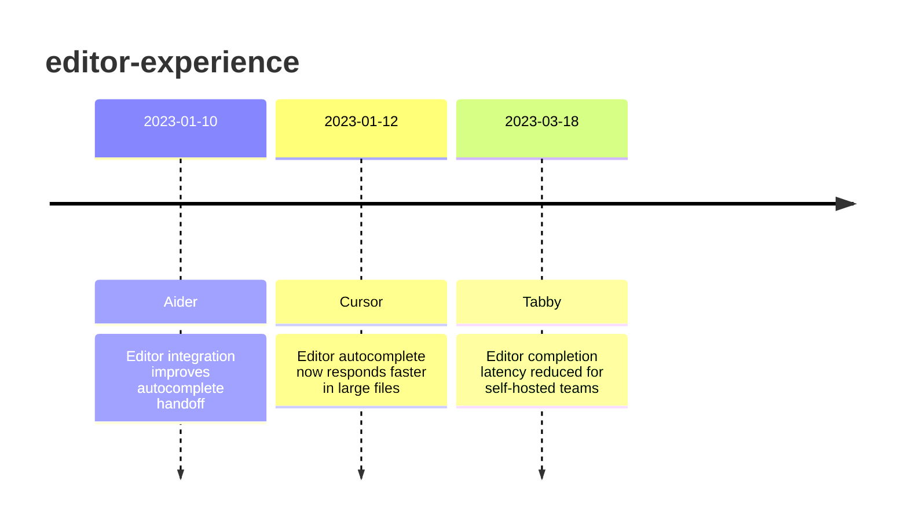

# Theme: editor-experience

## Cross-Product Timeline
<!-- chronolog:begin region="timeline" -->

<!-- chronolog:end -->

## Change Cards
<!-- chronolog:begin region="cards" -->
- 2023-01-10 Aider: [[Changes/Aider/2023-01-10-editor-integration-improves-autocomplete-handoff|Editor integration improves autocomplete handoff]]
- 2023-01-12 Cursor: [[Changes/Cursor/2023-01-12-editor-autocomplete-now-responds-faster-in-large-files|Editor autocomplete now responds faster in large files]]
- 2023-03-18 Tabby: [[Changes/Tabby/2023-03-18-editor-completion-latency-reduced-for-self-hosted-teams|Editor completion latency reduced for self-hosted teams]]
<!-- chronolog:end -->