# Theme: editor-experience

## Cross-Product Timeline

```mermaid
timeline
    title editor-experience
    2023-03-14 : Cursor : Instant fix all lint errors with AI 😎
    2023-03-14 : Cursor : Editing works for same file on multiple tabs
    2023-03-14 : Cursor : Edits can be as long as you'd like
    2023-03-18 : Cursor : Diffs automatically continue
    2023-03-18 : Cursor : Have chat auto-insert suggested changes into editor
    2023-03-23 : Cursor : Automatically apply chat suggestion
    2023-03-23 : Cursor : Ask AI to "fix" language errors
    2023-03-25 : Cursor : Fuzzy search for file names
    2023-04-06 : Cursor : While currently similar to a standard code editor with AI features, we plan to e
    2023-04-06 : Cursor : This allows us to focus on AI features while leveraging VS Code's mature text ed
    2023-04-06 : Cursor : Transitioned to building Cursor on top of a fork of VSCodium
    2023-04-06 : Cursor : We've transitioned to building Cursor on top of a fork of VSCodium, moving away
    2023-04-06 : Cursor : Our goal is to create an IDE optimized for pair-programming with AI.
    2023-04-14 : Cursor : Hover over an error to have the AI explain it/fix it
    2023-04-16 : Cursor : Nicer edits, now work with cmd-Z
    2023-04-29 : Cursor : Experimental support for multi-file diffs
    2023-05-04 : Cursor : Improved prompting for edits and generates
    2023-05-06 : Cursor : Rarely, pressing Enter in the editor does nothing
    2023-06-06 : Cursor : In order to take full advantage, navigate to Settings (top right button), then "
    2023-07-03 : Cursor : Long code selections no longer brick the editor
    2023-07-03 : Cursor : Cmd+K's UI has been changed: it's in-editor, "sticky," and @-symbol-compatible.
    2023-07-06 : ChatGPT : It lets ChatGPT run code, optionally with access to files you've uploaded. You c
    2023-07-11 : Cursor : This update improves the prompt for Cmd-k when you don't have any code selected.
    2023-07-12 : Cursor : Pop-out chat! You can now view the chat in an editor, which is great if you're o
    2023-07-12 : Cursor : Semantic search in Cmd-Shift-F
    2023-07-19 : Cursor : A better flow for getting CMD-k to produce code with no linter errors (you shoul
    2023-07-19 : Cursor : Some UI/UX tweaks to CMD-K
    2023-07-22 : Cursor : Cmd-K can again see all of your cells in Jupyter!
    2023-07-27 : Cursor : Experimental @Codebase support in the chat (and coming to the cmd-k soon!)
    2023-07-28 : Cursor : But copilot can be slow and sometimes just not smart enough :(. So we're trying
    2023-07-28 : Cursor : Long AI completions
    2023-07-28 : Cursor : We know that sometimes all of us want copilot to write an entire function or a b
    2023-08-10 : Cursor : For those who don't want the chat side-by-side, you can now pop it into your edi
    2023-08-10 : Cursor : Cmd-K now has a fast mode! It is about 1 second faster, and we're working on mak
    2023-08-12 : Cursor : The cmd-k edits now support followups! This is an early preview — please let us
    2023-08-13 : Cursor : Better experience for long files!
    2023-08-22 : Cursor : Codeblocks and code symbols in "with codebase" responses will now often be click
    2023-08-22 : Cursor : You can now reply to Cmd-K outputs, making it much easier to have the model revi
    2023-09-05 : Cursor : Cmd-K will no longer output backticks if you do @file.
    2023-09-19 : Cursor : You can now alternate between diffs and texts responses in Cmd-K. This can be he
    2023-09-21 : Cursor : Hacky first version of cmd-K in the terminal! Let us know what you think.
    2023-09-27 : Cursor : You can now use an early preview of /edit in the chat! It's significantly faster
    2023-10-01 : Cursor : Cmd-k is now in the terminal! A bit hackily implemented, but surprisingly useful
    2023-11-03 : Cursor : Cmd-K diffs: these now obey word-wrap! You can also copy from the red text.
    2023-11-10 : Cursor : Apply chat suggestions: click on the play button on any code block to have the A
    2023-11-15 : Cursor : Caching — add and delete a letter and the suggestion will still be there for you
    2023-11-15 : Cursor : Copilot++ improvements:
    2023-11-15 : Cursor : Do not interfere with intellisense and cmd-k.
    2023-11-15 : Cursor : Copilot++ sees your lint errors and will use this to improve its suggestions
    2023-11-22 : Cursor : Experimental feature: go to "More" > "Interpreter Mode" to enable it. Gives the
    2023-11-27 : Cursor : Interpreter Mode Beta: You can now enable Interpreter Mode in the "More" tab. Th
    2023-11-30 : Cursor : More reliable Copilot++ changes: less flashing, better highlighting of what's ne
    2023-12-02 : Cursor : Running Cmd+enter on followups should result in much better codebase results.
    2023-12-14 : Cursor : We made Copilot++ faster, smarter, more constrained, and switched to a ghost-tex
    2023-12-16 : Cursor : UPDATE (0.20.1-0.20.2): We added TLDRs to make it easier to sort through the bug
    2023-12-16 : Cursor : AI Review (beta): This is a new experimental feature that let's GPT-4 scan your
    2023-12-29 : Cursor : You can now run multiple Command-K's in parallel! Also, it should now be easier
    2023-12-31 : Cursor : You can now use chat and cmd-k in the aux window without too many problems.
    2024-01-06 : Cursor : Upgrades Cursor to VS Code 1.85, which comes with support for dragging out tabs
    2024-01-18 : Cursor : More chat symbol links: When the chat references a code symbol, you'll often be
    2024-01-18 : Cursor : Apply button: We've added some polish to the "apply codeblock" experience in cha
    2024-01-18 : Cursor : Chat lints: If the AI suggests a code change in chat that involves a made up cod
    2024-02-02 : Cursor : Hold down cmd-I over a selection to heal the code with GPT-4. Useful for writing
    2024-02-09 : Cursor : Copilot++ quality of life improvements (show ghost text more often, toggle on/of
    2024-02-09 : Cursor : AI Previews: this is an experimental new code reading feature. After enabling in
    2024-02-23 : Cursor : Cursor is now based on VS Code 1.86.2! Among other things, this adds sticky scro
    2024-03-20 : Cursor : Team invites: We made it a bit easier for you to invite your colleagues to your
    2024-03-20 : Cursor : New Settings: We moved all our settings to be accessible by the gear in the top
    2024-04-12 : Cursor : Copilot++ UX: Suggestion previews now have syntax highlighting, which we find ma
    2024-05-26 : Cursor : Merges VS Code 1.89 into Cursor
    2024-05-26 : Cursor : New Cursor Prediction UI
    2024-05-26 : Cursor : Better performance of Copilot++ on linter errors
    2024-05-26 : Cursor : Accept partial completions with Copilot++
    2024-06-08 : Cursor : Default-on Cursor Prediction with a new UI
    2024-07-13 : Cursor : This build comes with a new experimental multi-file editing feature. To enable i
    2024-07-23 : Cursor : VS Code 1.91.1: Cursor is now based on VS Code 1.91.1.
    2024-08-02 : Cursor : Cursor Tab (previously called Copilot++) defaults to chunked streaming. This bui
    2024-08-22 : Cursor : Auto imports (beta) for Cursor Tab for TypeScript files — when Tab suggests an u
    2024-10-09 : Cursor : Python auto import for Cursor Tab is much more stable in this release.
    2024-10-09 : Cursor : VS Code 1.93.1: Cursor is now based on VS Code 1.93.1.
    2025-03-11 : Cursor : 0.47.2: Cursor Tab accepts work with single-line selections
    2025-06-04 : Cursor : When an issue is found, Bugbot leaves a comment on your PRs in GitHub. You can c
    2025-08-07 : ChatGPT : On web: Click your profile icon at the bottom left, select Settings, go to the G
    2025-09-29 : Cursor : When writing prompts, autocomplete suggestions will appear based on recent chang
    2025-12-10 : Cursor : Browser layout and style editor
    2025-12-17 : ChatGPT : Edit and review tasks in Pulse anytime after you create them. Please note that P
    2026-01-08 : Cursor : Create new rules and edit existing ones directly from the CLI with the /rules co
    2026-01-16 : Claude Code : Added external editor support (Ctrl+G) in AskUserQuestion "Other" input field
    2026-01-16 : Cursor : This release brings many of the editor’s most-loved features to the Cursor CLI,
    2026-01-16 : Cursor : Use Ask mode to explore code without making changes, just like in the editor. St
    2026-01-20 : Claude Code : Added history-based autocomplete in bash mode (`!`) - type a partial command and
    2026-01-27 : Claude Code : Added external editor shortcut (Ctrl+G) to the help menu for better discoverabil
    2026-01-28 : Claude Code : Improved Claude to prefer file operation tools (Read, Edit, Write) over bash equ
    2026-02-19 : ChatGPT : Write and edit text in-line
    2026-02-19 : ChatGPT : We improved Code Blocks in ChatGPT to make them more interactive. You can write,
    2026-02-19 : Claude Code : Simple mode (`CLAUDE_CODE_SIMPLE`) now includes the file edit tool in addition t
    2026-02-24 : Claude Code : VS Code: Fixed extension crash on Windows ("command 'claude-vscode.editor.openLa
    2026-02-25 : Claude Code : VS Code: Fixed another cause of "command 'claude-vscode.editor.openLast' not fou
    2026-02-27 : ChatGPT : Edit messages with images. You can now edit messages that include image attachme
    2026-03-04 : Cursor : Install the Cursor ACP directly in your JetBrains IDE from the ACP Registry, and
    2026-03-27 : Claude Code : Added `.jj` and `.sl` to VCS directory exclusion lists so Grep and file autocomp
    2026-04-02 : Cursor : You can switch back to the IDE anytime, or have both open simultaneously.
    2026-04-08 : Claude Code : Added syntax highlighting for Cedar policy files (`.cedar`, `.cedarpolicy`)
    2026-04-08 : Claude Code : Added focus view toggle (`Ctrl+O`) in `NO_FLICKER` mode showing prompt, one-line
    2026-04-09 : Claude Code : Added `CLAUDE_CODE_PERFORCE_MODE` env var: when set, Edit/Write/NotebookEdit fai
    2026-04-15 : Cursor : Try it out in Cursor 3.1 in the Agents Window or the editor. Read more in our an
    2026-04-20 : Claude Code : `/config` search now matches option values (e.g. searching "vim" finds the Edito
    2026-04-23 : Claude Code : `/config` settings (theme, editor mode, verbose, etc.) now persist to `~/.claude
    2026-04-23 : Claude Code : Merged `/cost` and `/stats` into `/usage` — both remain as typing shortcuts that
    2026-05-07 : Cursor : The Commits tab gives you a focused view of commit history for the PR.
    2026-05-07 : Cursor : The Reviews tab now shows inline review threads and top-level PR comments.
    2026-05-22 : Claude Code : `/diff` detail view can now be scrolled with the keyboard (arrows, `j`/`k`, `PgU
    2026-06-02 : Claude Code : Edit no longer requires a separate Read after viewing a file with `grep`: single
    2026-06-10 : Cursor : /review also syncs with Bugbot on GitHub and GitLab. If you run /review and then
    2026-06-25 : Claude Code : Added live file path autocomplete to bash mode (`!`)
    2026-07-10 : Claude Code : Added a `/doctor` check that proposes trimming checked-in `CLAUDE.md` files by c
    2026-07-14 : Claude Code : Added `vimInsertModeRemaps` setting: map two-key insert-mode sequences like `jj`
    2026-07-21 : Claude Code : Added emoji shortcode autocomplete in the prompt input: type `:heart:` to insert
```

<!-- chronolog:begin region="timeline" -->

<!-- chronolog:end -->

## Change Cards
<!-- chronolog:begin region="cards" -->
- 2023-03-14 Cursor: [[Changes/Cursor/2023-03-14-instant-fix-all-lint-errors-with-ai|Instant fix all lint errors with AI 😎]]
- 2023-03-14 Cursor: [[Changes/Cursor/2023-03-14-editing-works-for-same-file-on-multiple-tabs|Editing works for same file on multiple tabs]]
- 2023-03-14 Cursor: [[Changes/Cursor/2023-03-14-edits-can-be-as-long-as-you-d-like|Edits can be as long as you'd like]]
- 2023-03-18 Cursor: [[Changes/Cursor/2023-03-18-diffs-automatically-continue|Diffs automatically continue]]
- 2023-03-18 Cursor: [[Changes/Cursor/2023-03-18-have-chat-auto-insert-suggested-changes-into-editor|Have chat auto-insert suggested changes into editor]]
- 2023-03-23 Cursor: [[Changes/Cursor/2023-03-23-automatically-apply-chat-suggestion|Automatically apply chat suggestion]]
- 2023-03-23 Cursor: [[Changes/Cursor/2023-03-23-ask-ai-to-fix-language-errors|Ask AI to "fix" language errors]]
- 2023-03-25 Cursor: [[Changes/Cursor/2023-03-25-fuzzy-search-for-file-names|Fuzzy search for file names]]
- 2023-04-06 Cursor: [[Changes/Cursor/2023-04-06-while-currently-similar-to-a-standard-code-editor-with-ai-features-we-plan-to-ev|While currently similar to a standard code editor with AI features, we plan to e]]
- 2023-04-06 Cursor: [[Changes/Cursor/2023-04-06-this-allows-us-to-focus-on-ai-features-while-leveraging-vs-code-s-mature-text-ed|This allows us to focus on AI features while leveraging VS Code's mature text ed]]
- 2023-04-06 Cursor: [[Changes/Cursor/2023-04-06-transitioned-to-building-cursor-on-top-of-a-fork-of-vscodium|Transitioned to building Cursor on top of a fork of VSCodium]]
- 2023-04-06 Cursor: [[Changes/Cursor/2023-04-06-we-ve-transitioned-to-building-cursor-on-top-of-a-fork-of-vscodium-moving-away-f|We've transitioned to building Cursor on top of a fork of VSCodium, moving away]]
- 2023-04-06 Cursor: [[Changes/Cursor/2023-04-06-our-goal-is-to-create-an-ide-optimized-for-pair-programming-with-ai|Our goal is to create an IDE optimized for pair-programming with AI.]]
- 2023-04-14 Cursor: [[Changes/Cursor/2023-04-14-hover-over-an-error-to-have-the-ai-explain-it-fix-it|Hover over an error to have the AI explain it/fix it]]
- 2023-04-16 Cursor: [[Changes/Cursor/2023-04-16-nicer-edits-now-work-with-cmd-z|Nicer edits, now work with cmd-Z]]
- 2023-04-29 Cursor: [[Changes/Cursor/2023-04-29-experimental-support-for-multi-file-diffs|Experimental support for multi-file diffs]]
- 2023-05-04 Cursor: [[Changes/Cursor/2023-05-04-improved-prompting-for-edits-and-generates|Improved prompting for edits and generates]]
- 2023-05-06 Cursor: [[Changes/Cursor/2023-05-06-rarely-pressing-enter-in-the-editor-does-nothing|Rarely, pressing Enter in the editor does nothing]]
- 2023-06-06 Cursor: [[Changes/Cursor/2023-06-06-in-order-to-take-full-advantage-navigate-to-settings-top-right-button-then-sync|In order to take full advantage, navigate to Settings (top right button), then "]]
- 2023-07-03 Cursor: [[Changes/Cursor/2023-07-03-long-code-selections-no-longer-brick-the-editor|Long code selections no longer brick the editor]]
- 2023-07-03 Cursor: [[Changes/Cursor/2023-07-03-cmd-k-s-ui-has-been-changed-it-s-in-editor-sticky-and-symbol-compatible|Cmd+K's UI has been changed: it's in-editor, "sticky," and @-symbol-compatible.]]
- 2023-07-06 ChatGPT: [[Changes/ChatGPT/2023-07-06-it-lets-chatgpt-run-code-optionally-with-access-to-files-you-ve-uploaded-you-can|It lets ChatGPT run code, optionally with access to files you've uploaded. You c]]
- 2023-07-11 Cursor: [[Changes/Cursor/2023-07-11-this-update-improves-the-prompt-for-cmd-k-when-you-don-t-have-any-code-selected|This update improves the prompt for Cmd-k when you don't have any code selected.]]
- 2023-07-12 Cursor: [[Changes/Cursor/2023-07-12-pop-out-chat-you-can-now-view-the-chat-in-an-editor-which-is-great-if-you-re-on|Pop-out chat! You can now view the chat in an editor, which is great if you're o]]
- 2023-07-12 Cursor: [[Changes/Cursor/2023-07-12-semantic-search-in-cmd-shift-f|Semantic search in Cmd-Shift-F]]
- 2023-07-19 Cursor: [[Changes/Cursor/2023-07-19-a-better-flow-for-getting-cmd-k-to-produce-code-with-no-linter-errors-you-should|A better flow for getting CMD-k to produce code with no linter errors (you shoul]]
- 2023-07-19 Cursor: [[Changes/Cursor/2023-07-19-some-ui-ux-tweaks-to-cmd-k|Some UI/UX tweaks to CMD-K]]
- 2023-07-22 Cursor: [[Changes/Cursor/2023-07-22-cmd-k-can-again-see-all-of-your-cells-in-jupyter|Cmd-K can again see all of your cells in Jupyter!]]
- 2023-07-27 Cursor: [[Changes/Cursor/2023-07-27-experimental-codebase-support-in-the-chat-and-coming-to-the-cmd-k-soon|Experimental @Codebase support in the chat (and coming to the cmd-k soon!)]]
- 2023-07-28 Cursor: [[Changes/Cursor/2023-07-28-but-copilot-can-be-slow-and-sometimes-just-not-smart-enough-so-we-re-trying-to-s|But copilot can be slow and sometimes just not smart enough :(. So we're trying]]
- 2023-07-28 Cursor: [[Changes/Cursor/2023-07-28-long-ai-completions|Long AI completions]]
- 2023-07-28 Cursor: [[Changes/Cursor/2023-07-28-we-know-that-sometimes-all-of-us-want-copilot-to-write-an-entire-function-or-a-b|We know that sometimes all of us want copilot to write an entire function or a b]]
- 2023-08-10 Cursor: [[Changes/Cursor/2023-08-10-for-those-who-don-t-want-the-chat-side-by-side-you-can-now-pop-it-into-your-edit|For those who don't want the chat side-by-side, you can now pop it into your edi]]
- 2023-08-10 Cursor: [[Changes/Cursor/2023-08-10-cmd-k-now-has-a-fast-mode-it-is-about-1-second-faster-and-we-re-working-on-makin|Cmd-K now has a fast mode! It is about 1 second faster, and we're working on mak]]
- 2023-08-12 Cursor: [[Changes/Cursor/2023-08-12-the-cmd-k-edits-now-support-followups-this-is-an-early-preview-please-let-us-kno|The cmd-k edits now support followups! This is an early preview — please let us]]
- 2023-08-13 Cursor: [[Changes/Cursor/2023-08-13-better-experience-for-long-files|Better experience for long files!]]
- 2023-08-22 Cursor: [[Changes/Cursor/2023-08-22-codeblocks-and-code-symbols-in-with-codebase-responses-will-now-often-be-clickab|Codeblocks and code symbols in "with codebase" responses will now often be click]]
- 2023-08-22 Cursor: [[Changes/Cursor/2023-08-22-you-can-now-reply-to-cmd-k-outputs-making-it-much-easier-to-have-the-model-revis|You can now reply to Cmd-K outputs, making it much easier to have the model revi]]
- 2023-09-05 Cursor: [[Changes/Cursor/2023-09-05-cmd-k-will-no-longer-output-backticks-if-you-do-file|Cmd-K will no longer output backticks if you do @file.]]
- 2023-09-19 Cursor: [[Changes/Cursor/2023-09-19-you-can-now-alternate-between-diffs-and-texts-responses-in-cmd-k-this-can-be-hel|You can now alternate between diffs and texts responses in Cmd-K. This can be he]]
- 2023-09-21 Cursor: [[Changes/Cursor/2023-09-21-hacky-first-version-of-cmd-k-in-the-terminal-let-us-know-what-you-think|Hacky first version of cmd-K in the terminal! Let us know what you think.]]
- 2023-09-27 Cursor: [[Changes/Cursor/2023-09-27-you-can-now-use-an-early-preview-of-edit-in-the-chat-it-s-significantly-faster-a|You can now use an early preview of /edit in the chat! It's significantly faster]]
- 2023-10-01 Cursor: [[Changes/Cursor/2023-10-01-cmd-k-is-now-in-the-terminal-a-bit-hackily-implemented-but-surprisingly-useful|Cmd-k is now in the terminal! A bit hackily implemented, but surprisingly useful]]
- 2023-11-03 Cursor: [[Changes/Cursor/2023-11-03-cmd-k-diffs-these-now-obey-word-wrap-you-can-also-copy-from-the-red-text|Cmd-K diffs: these now obey word-wrap! You can also copy from the red text.]]
- 2023-11-10 Cursor: [[Changes/Cursor/2023-11-10-apply-chat-suggestions-click-on-the-play-button-on-any-code-block-to-have-the-ai|Apply chat suggestions: click on the play button on any code block to have the A]]
- 2023-11-15 Cursor: [[Changes/Cursor/2023-11-15-caching-add-and-delete-a-letter-and-the-suggestion-will-still-be-there-for-you|Caching — add and delete a letter and the suggestion will still be there for you]]
- 2023-11-15 Cursor: [[Changes/Cursor/2023-11-15-copilot-improvements|Copilot++ improvements:]]
- 2023-11-15 Cursor: [[Changes/Cursor/2023-11-15-do-not-interfere-with-intellisense-and-cmd-k|Do not interfere with intellisense and cmd-k.]]
- 2023-11-15 Cursor: [[Changes/Cursor/2023-11-15-copilot-sees-your-lint-errors-and-will-use-this-to-improve-its-suggestions|Copilot++ sees your lint errors and will use this to improve its suggestions]]
- 2023-11-22 Cursor: [[Changes/Cursor/2023-11-22-experimental-feature-go-to-more-interpreter-mode-to-enable-it-gives-the-model-ac|Experimental feature: go to "More" > "Interpreter Mode" to enable it. Gives the]]
- 2023-11-27 Cursor: [[Changes/Cursor/2023-11-27-interpreter-mode-beta-you-can-now-enable-interpreter-mode-in-the-more-tab-this-g|Interpreter Mode Beta: You can now enable Interpreter Mode in the "More" tab. Th]]
- 2023-11-30 Cursor: [[Changes/Cursor/2023-11-30-more-reliable-copilot-changes-less-flashing-better-highlighting-of-what-s-new|More reliable Copilot++ changes: less flashing, better highlighting of what's ne]]
- 2023-12-02 Cursor: [[Changes/Cursor/2023-12-02-running-cmd-enter-on-followups-should-result-in-much-better-codebase-results|Running Cmd+enter on followups should result in much better codebase results.]]
- 2023-12-14 Cursor: [[Changes/Cursor/2023-12-14-we-made-copilot-faster-smarter-more-constrained-and-switched-to-a-ghost-text-hit|We made Copilot++ faster, smarter, more constrained, and switched to a ghost-tex]]
- 2023-12-16 Cursor: [[Changes/Cursor/2023-12-16-update-0-20-1-0-20-2-we-added-tldrs-to-make-it-easier-to-sort-through-the-bugs-f|UPDATE (0.20.1-0.20.2): We added TLDRs to make it easier to sort through the bug]]
- 2023-12-16 Cursor: [[Changes/Cursor/2023-12-16-ai-review-beta-this-is-a-new-experimental-feature-that-let-s-gpt-4-scan-your-git|AI Review (beta): This is a new experimental feature that let's GPT-4 scan your]]
- 2023-12-29 Cursor: [[Changes/Cursor/2023-12-29-you-can-now-run-multiple-command-k-s-in-parallel-also-it-should-now-be-easier-to|You can now run multiple Command-K's in parallel! Also, it should now be easier]]
- 2023-12-31 Cursor: [[Changes/Cursor/2023-12-31-you-can-now-use-chat-and-cmd-k-in-the-aux-window-without-too-many-problems|You can now use chat and cmd-k in the aux window without too many problems.]]
- 2024-01-06 Cursor: [[Changes/Cursor/2024-01-06-upgrades-cursor-to-vs-code-1-85-which-comes-with-support-for-dragging-out-tabs-i|Upgrades Cursor to VS Code 1.85, which comes with support for dragging out tabs]]
- 2024-01-18 Cursor: [[Changes/Cursor/2024-01-18-more-chat-symbol-links-when-the-chat-references-a-code-symbol-you-ll-often-be-ab|More chat symbol links: When the chat references a code symbol, you'll often be]]
- 2024-01-18 Cursor: [[Changes/Cursor/2024-01-18-apply-button-we-ve-added-some-polish-to-the-apply-codeblock-experience-in-chat|Apply button: We've added some polish to the "apply codeblock" experience in cha]]
- 2024-01-18 Cursor: [[Changes/Cursor/2024-01-18-chat-lints-if-the-ai-suggests-a-code-change-in-chat-that-involves-a-made-up-code|Chat lints: If the AI suggests a code change in chat that involves a made up cod]]
- 2024-02-02 Cursor: [[Changes/Cursor/2024-02-02-hold-down-cmd-i-over-a-selection-to-heal-the-code-with-gpt-4-useful-for-writing|Hold down cmd-I over a selection to heal the code with GPT-4. Useful for writing]]
- 2024-02-09 Cursor: [[Changes/Cursor/2024-02-09-copilot-quality-of-life-improvements-show-ghost-text-more-often-toggle-on-off-on|Copilot++ quality of life improvements (show ghost text more often, toggle on/of]]
- 2024-02-09 Cursor: [[Changes/Cursor/2024-02-09-ai-previews-this-is-an-experimental-new-code-reading-feature-after-enabling-in-t|AI Previews: this is an experimental new code reading feature. After enabling in]]
- 2024-02-23 Cursor: [[Changes/Cursor/2024-02-23-cursor-is-now-based-on-vs-code-1-86-2-among-other-things-this-adds-sticky-scroll|Cursor is now based on VS Code 1.86.2! Among other things, this adds sticky scro]]
- 2024-03-20 Cursor: [[Changes/Cursor/2024-03-20-team-invites-we-made-it-a-bit-easier-for-you-to-invite-your-colleagues-to-your-c|Team invites: We made it a bit easier for you to invite your colleagues to your]]
- 2024-03-20 Cursor: [[Changes/Cursor/2024-03-20-new-settings-we-moved-all-our-settings-to-be-accessible-by-the-gear-in-the-top-r|New Settings: We moved all our settings to be accessible by the gear in the top]]
- 2024-04-12 Cursor: [[Changes/Cursor/2024-04-12-copilot-ux-suggestion-previews-now-have-syntax-highlighting-which-we-find-makes|Copilot++ UX: Suggestion previews now have syntax highlighting, which we find ma]]
- 2024-05-26 Cursor: [[Changes/Cursor/2024-05-26-merges-vs-code-1-89-into-cursor|Merges VS Code 1.89 into Cursor]]
- 2024-05-26 Cursor: [[Changes/Cursor/2024-05-26-new-cursor-prediction-ui|New Cursor Prediction UI]]
- 2024-05-26 Cursor: [[Changes/Cursor/2024-05-26-better-performance-of-copilot-on-linter-errors|Better performance of Copilot++ on linter errors]]
- 2024-05-26 Cursor: [[Changes/Cursor/2024-05-26-accept-partial-completions-with-copilot|Accept partial completions with Copilot++]]
- 2024-06-08 Cursor: [[Changes/Cursor/2024-06-08-default-on-cursor-prediction-with-a-new-ui|Default-on Cursor Prediction with a new UI]]
- 2024-07-13 Cursor: [[Changes/Cursor/2024-07-13-this-build-comes-with-a-new-experimental-multi-file-editing-feature-to-enable-it|This build comes with a new experimental multi-file editing feature. To enable i]]
- 2024-07-23 Cursor: [[Changes/Cursor/2024-07-23-vs-code-1-91-1-cursor-is-now-based-on-vs-code-1-91-1|VS Code 1.91.1: Cursor is now based on VS Code 1.91.1.]]
- 2024-08-02 Cursor: [[Changes/Cursor/2024-08-02-cursor-tab-previously-called-copilot-defaults-to-chunked-streaming-this-build-al|Cursor Tab (previously called Copilot++) defaults to chunked streaming. This bui]]
- 2024-08-22 Cursor: [[Changes/Cursor/2024-08-22-auto-imports-beta-for-cursor-tab-for-typescript-files-when-tab-suggests-an-unimp|Auto imports (beta) for Cursor Tab for TypeScript files — when Tab suggests an u]]
- 2024-10-09 Cursor: [[Changes/Cursor/2024-10-09-python-auto-import-for-cursor-tab-is-much-more-stable-in-this-release|Python auto import for Cursor Tab is much more stable in this release.]]
- 2024-10-09 Cursor: [[Changes/Cursor/2024-10-09-vs-code-1-93-1-cursor-is-now-based-on-vs-code-1-93-1|VS Code 1.93.1: Cursor is now based on VS Code 1.93.1.]]
- 2025-03-11 Cursor: [[Changes/Cursor/2025-03-11-0-47-2-cursor-tab-accepts-work-with-single-line-selections|0.47.2: Cursor Tab accepts work with single-line selections]]
- 2025-06-04 Cursor: [[Changes/Cursor/2025-06-04-when-an-issue-is-found-bugbot-leaves-a-comment-on-your-prs-in-github-you-can-cli|When an issue is found, Bugbot leaves a comment on your PRs in GitHub. You can c]]
- 2025-08-07 ChatGPT: [[Changes/ChatGPT/2025-08-07-on-web-click-your-profile-icon-at-the-bottom-left-select-settings-go-to-the-gene|On web: Click your profile icon at the bottom left, select Settings, go to the G]]
- 2025-09-29 Cursor: [[Changes/Cursor/2025-09-29-when-writing-prompts-autocomplete-suggestions-will-appear-based-on-recent-change|When writing prompts, autocomplete suggestions will appear based on recent chang]]
- 2025-12-10 Cursor: [[Changes/Cursor/2025-12-10-browser-layout-and-style-editor|Browser layout and style editor]]
- 2025-12-17 ChatGPT: [[Changes/ChatGPT/2025-12-17-edit-and-review-tasks-in-pulse-anytime-after-you-create-them-please-note-that-pu|Edit and review tasks in Pulse anytime after you create them. Please note that P]]
- 2026-01-08 Cursor: [[Changes/Cursor/2026-01-08-create-new-rules-and-edit-existing-ones-directly-from-the-cli-with-the-rules-com|Create new rules and edit existing ones directly from the CLI with the /rules co]]
- 2026-01-16 Claude Code: [[Changes/Claude Code/2026-01-16-added-external-editor-support-ctrl-g-in-askuserquestion-other-input-field|Added external editor support (Ctrl+G) in AskUserQuestion "Other" input field]]
- 2026-01-16 Cursor: [[Changes/Cursor/2026-01-16-this-release-brings-many-of-the-editor-s-most-loved-features-to-the-cursor-cli-a|This release brings many of the editor’s most-loved features to the Cursor CLI,]]
- 2026-01-16 Cursor: [[Changes/Cursor/2026-01-16-use-ask-mode-to-explore-code-without-making-changes-just-like-in-the-editor-star|Use Ask mode to explore code without making changes, just like in the editor. St]]
- 2026-01-20 Claude Code: [[Changes/Claude Code/2026-01-20-added-history-based-autocomplete-in-bash-mode-type-a-partial-command-and-press-t|Added history-based autocomplete in bash mode (`!`) - type a partial command and]]
- 2026-01-27 Claude Code: [[Changes/Claude Code/2026-01-27-added-external-editor-shortcut-ctrl-g-to-the-help-menu-for-better-discoverabilit|Added external editor shortcut (Ctrl+G) to the help menu for better discoverabil]]
- 2026-01-28 Claude Code: [[Changes/Claude Code/2026-01-28-improved-claude-to-prefer-file-operation-tools-read-edit-write-over-bash-equival|Improved Claude to prefer file operation tools (Read, Edit, Write) over bash equ]]
- 2026-02-19 ChatGPT: [[Changes/ChatGPT/2026-02-19-write-and-edit-text-in-line|Write and edit text in-line]]
- 2026-02-19 ChatGPT: [[Changes/ChatGPT/2026-02-19-we-improved-code-blocks-in-chatgpt-to-make-them-more-interactive-you-can-write-e|We improved Code Blocks in ChatGPT to make them more interactive. You can write,]]
- 2026-02-19 Claude Code: [[Changes/Claude Code/2026-02-19-simple-mode-claude-code-simple-now-includes-the-file-edit-tool-in-addition-to-th|Simple mode (`CLAUDE_CODE_SIMPLE`) now includes the file edit tool in addition t]]
- 2026-02-24 Claude Code: [[Changes/Claude Code/2026-02-24-vs-code-fixed-extension-crash-on-windows-command-claude-vscode-editor-openlast-n|VS Code: Fixed extension crash on Windows ("command 'claude-vscode.editor.openLa]]
- 2026-02-25 Claude Code: [[Changes/Claude Code/2026-02-25-vs-code-fixed-another-cause-of-command-claude-vscode-editor-openlast-not-found-c|VS Code: Fixed another cause of "command 'claude-vscode.editor.openLast' not fou]]
- 2026-02-27 ChatGPT: [[Changes/ChatGPT/2026-02-27-edit-messages-with-images-you-can-now-edit-messages-that-include-image-attachmen|Edit messages with images. You can now edit messages that include image attachme]]
- 2026-03-04 Cursor: [[Changes/Cursor/2026-03-04-install-the-cursor-acp-directly-in-your-jetbrains-ide-from-the-acp-registry-and|Install the Cursor ACP directly in your JetBrains IDE from the ACP Registry, and]]
- 2026-03-27 Claude Code: [[Changes/Claude Code/2026-03-27-added-jj-and-sl-to-vcs-directory-exclusion-lists-so-grep-and-file-autocomplete-d|Added `.jj` and `.sl` to VCS directory exclusion lists so Grep and file autocomp]]
- 2026-04-02 Cursor: [[Changes/Cursor/2026-04-02-you-can-switch-back-to-the-ide-anytime-or-have-both-open-simultaneously|You can switch back to the IDE anytime, or have both open simultaneously.]]
- 2026-04-08 Claude Code: [[Changes/Claude Code/2026-04-08-added-syntax-highlighting-for-cedar-policy-files-cedar-cedarpolicy|Added syntax highlighting for Cedar policy files (`.cedar`, `.cedarpolicy`)]]
- 2026-04-08 Claude Code: [[Changes/Claude Code/2026-04-08-added-focus-view-toggle-ctrl-o-in-no-flicker-mode-showing-prompt-one-line-tool-s|Added focus view toggle (`Ctrl+O`) in `NO_FLICKER` mode showing prompt, one-line]]
- 2026-04-09 Claude Code: [[Changes/Claude Code/2026-04-09-added-claude-code-perforce-mode-env-var-when-set-edit-write-notebookedit-fail-on|Added `CLAUDE_CODE_PERFORCE_MODE` env var: when set, Edit/Write/NotebookEdit fai]]
- 2026-04-15 Cursor: [[Changes/Cursor/2026-04-15-try-it-out-in-cursor-3-1-in-the-agents-window-or-the-editor-read-more-in-our-ann|Try it out in Cursor 3.1 in the Agents Window or the editor. Read more in our an]]
- 2026-04-20 Claude Code: [[Changes/Claude Code/2026-04-20-config-search-now-matches-option-values-e-g-searching-vim-finds-the-editor-mode|`/config` search now matches option values (e.g. searching "vim" finds the Edito]]
- 2026-04-23 Claude Code: [[Changes/Claude Code/2026-04-23-config-settings-theme-editor-mode-verbose-etc-now-persist-to-claude-settings-jso|`/config` settings (theme, editor mode, verbose, etc.) now persist to `~/.claude]]
- 2026-04-23 Claude Code: [[Changes/Claude Code/2026-04-23-merged-cost-and-stats-into-usage-both-remain-as-typing-shortcuts-that-open-the-r|Merged `/cost` and `/stats` into `/usage` — both remain as typing shortcuts that]]
- 2026-05-07 Cursor: [[Changes/Cursor/2026-05-07-the-commits-tab-gives-you-a-focused-view-of-commit-history-for-the-pr|The Commits tab gives you a focused view of commit history for the PR.]]
- 2026-05-07 Cursor: [[Changes/Cursor/2026-05-07-the-reviews-tab-now-shows-inline-review-threads-and-top-level-pr-comments|The Reviews tab now shows inline review threads and top-level PR comments.]]
- 2026-05-22 Claude Code: [[Changes/Claude Code/2026-05-22-diff-detail-view-can-now-be-scrolled-with-the-keyboard-arrows-j-k-pgup-pgdn-spac|`/diff` detail view can now be scrolled with the keyboard (arrows, `j`/`k`, `PgU]]
- 2026-06-02 Claude Code: [[Changes/Claude Code/2026-06-02-edit-no-longer-requires-a-separate-read-after-viewing-a-file-with-grep-single-fi|Edit no longer requires a separate Read after viewing a file with `grep`: single]]
- 2026-06-10 Cursor: [[Changes/Cursor/2026-06-10-review-also-syncs-with-bugbot-on-github-and-gitlab-if-you-run-review-and-then-op|/review also syncs with Bugbot on GitHub and GitLab. If you run /review and then]]
- 2026-06-25 Claude Code: [[Changes/Claude Code/2026-06-25-added-live-file-path-autocomplete-to-bash-mode|Added live file path autocomplete to bash mode (`!`)]]
- 2026-07-10 Claude Code: [[Changes/Claude Code/2026-07-10-added-a-doctor-check-that-proposes-trimming-checked-in-claude-md-files-by-cuttin|Added a `/doctor` check that proposes trimming checked-in `CLAUDE.md` files by c]]
- 2026-07-14 Claude Code: [[Changes/Claude Code/2026-07-14-added-viminsertmoderemaps-setting-map-two-key-insert-mode-sequences-like-jj-to-e|Added `vimInsertModeRemaps` setting: map two-key insert-mode sequences like `jj`]]
- 2026-07-21 Claude Code: [[Changes/Claude Code/2026-07-21-added-emoji-shortcode-autocomplete-in-the-prompt-input-type-heart-to-insert-or-h|Added emoji shortcode autocomplete in the prompt input: type `:heart:` to insert]]
<!-- chronolog:end -->