# Theme: enterprise-admin

## Cross-Product Timeline

```mermaid
timeline
    title enterprise-admin
    2023-07-27 : Cursor : Enterprise support!
    2023-08-28 : ChatGPT : ChatGPT Enterprise also provides unlimited access to Advanced Data Analysis, pre
    2024-05-13 : ChatGPT : Plus users will have a message limit that is up to 5x greater than free users, a
    2024-11-19 : ChatGPT : We’re starting to roll out to all paid (Plus, Team, Enterprise, and Edu) users t
    2025-06-12 : ChatGPT : Enterprise and Edu rollout coming soon.
    2025-07-16 : ChatGPT : Note: Record mode originally rolled out to Team users on June 4, and Enterprise
    2025-08-12 : ChatGPT : This capability is part of GPT-5 and will begin rolling out to Pro users globall
    2025-09-03 : ChatGPT : We’ve also updated file uploads on paid tiers: Plus, Go, and Edu support up to 2
    2025-12-18 : Cursor : Conversation insights
    2025-12-18 : Cursor : Many of the largest software companies in the world have adopted Cursor for Ente
    2025-12-22 : ChatGPT : This experience is rolling out gradually throughout the day, so it may not be av
    2026-03-03 : Cursor : On Teams and Enterprise plans, Admins can now create team marketplaces to share
    2026-03-17 : ChatGPT : We’ve simplified the model picker to make it easier to choose the right level of
    2026-03-18 : ChatGPT : We’re rolling out GPT-5.4 mini in ChatGPT. GPT-5.4 mini is available to Free and
    2026-04-04 : Claude Code : Added `forceRemoteSettingsRefresh` policy setting: when set, the CLI blocks star
    2026-04-07 : Claude Code : Changed default effort level from medium to high for API-key, Bedrock/Vertex/Fou
    2026-04-10 : Claude Code : Added OS CA certificate store trust by default, so enterprise TLS proxies work w
    2026-04-16 : ChatGPT : We're beginning to rollout ads for users on Free and Go plans in Australia, New
    2026-04-23 : Claude Code : `--from-pr` now accepts GitLab merge-request, Bitbucket pull-request, and GitHub
    2026-04-23 : Claude Code : Added `DISABLE_UPDATES` env var to completely block all update paths including m
    2026-04-28 : Claude Code : Pasting a PR URL into the `/resume` search box now finds the session that create
    2026-05-04 : Cursor : This release introduces updates for Enterprise admins: a new system for model co
    2026-05-07 : Claude Code : Added `parentSettingsBehavior` admin-tier key (`'first-wins' | 'merge'`) to let
    2026-05-08 : Claude Code : Added `CLAUDE_CODE_ENABLE_FEEDBACK_SURVEY_FOR_OTEL` to re-enable the session qua
    2026-05-11 : Cursor : Teams admins and Individual plan users can now customize the effort level Bugbot
    2026-05-13 : Claude Code : Added `ANTHROPIC_WORKSPACE_ID` environment variable for workload identity federa
    2026-06-03 : Cursor : Organizations
    2026-06-04 : ChatGPT : We're beginning to roll out ads for users on Free and Go plans in the UK. Plus,
    2026-06-04 : Claude Code : Added `requiredMinimumVersion` and `requiredMaximumVersion` managed settings — C
    2026-06-30 : Cursor : Marketplace access by organization group
    2026-07-09 : ChatGPT : Business and Enterprise customers already have access to Sites. Starting today,
    2026-07-09 : ChatGPT : On web and mobile, Work is rolling out to paid plans except Free and Go. Pro, Pr
    2026-07-09 : ChatGPT : On web and mobile, Enterprise and Edu workspaces have a two-week preview period.
    2026-07-09 : ChatGPT : In Enterprise workspaces, public publishing is off by default and must be enable
    2026-07-15 : ChatGPT : We’re increasing the character limit for custom instructions in ChatGPT. Plus, P
```

<!-- chronolog:begin region="timeline" -->

<!-- chronolog:end -->

## Change Cards
<!-- chronolog:begin region="cards" -->
- 2023-07-27 Cursor: [[Changes/Cursor/2023-07-27-enterprise-support|Enterprise support!]]
- 2023-08-28 ChatGPT: [[Changes/ChatGPT/2023-08-28-chatgpt-enterprise-also-provides-unlimited-access-to-advanced-data-analysis-prev|ChatGPT Enterprise also provides unlimited access to Advanced Data Analysis, pre]]
- 2024-05-13 ChatGPT: [[Changes/ChatGPT/2024-05-13-plus-users-will-have-a-message-limit-that-is-up-to-5x-greater-than-free-users-an|Plus users will have a message limit that is up to 5x greater than free users, a]]
- 2024-11-19 ChatGPT: [[Changes/ChatGPT/2024-11-19-we-re-starting-to-roll-out-to-all-paid-plus-team-enterprise-and-edu-users-today|We’re starting to roll out to all paid (Plus, Team, Enterprise, and Edu) users t]]
- 2025-06-12 ChatGPT: [[Changes/ChatGPT/2025-06-12-enterprise-and-edu-rollout-coming-soon|Enterprise and Edu rollout coming soon.]]
- 2025-07-16 ChatGPT: [[Changes/ChatGPT/2025-07-16-note-record-mode-originally-rolled-out-to-team-users-on-june-4-and-enterprise-ed|Note: Record mode originally rolled out to Team users on June 4, and Enterprise]]
- 2025-08-12 ChatGPT: [[Changes/ChatGPT/2025-08-12-this-capability-is-part-of-gpt-5-and-will-begin-rolling-out-to-pro-users-globall|This capability is part of GPT-5 and will begin rolling out to Pro users globall]]
- 2025-09-03 ChatGPT: [[Changes/ChatGPT/2025-09-03-we-ve-also-updated-file-uploads-on-paid-tiers-plus-go-and-edu-support-up-to-25-f|We’ve also updated file uploads on paid tiers: Plus, Go, and Edu support up to 2]]
- 2025-12-18 Cursor: [[Changes/Cursor/2025-12-18-conversation-insights|Conversation insights]]
- 2025-12-18 Cursor: [[Changes/Cursor/2025-12-18-many-of-the-largest-software-companies-in-the-world-have-adopted-cursor-for-ente|Many of the largest software companies in the world have adopted Cursor for Ente]]
- 2025-12-22 ChatGPT: [[Changes/ChatGPT/2025-12-22-this-experience-is-rolling-out-gradually-throughout-the-day-so-it-may-not-be-ava|This experience is rolling out gradually throughout the day, so it may not be av]]
- 2026-03-03 Cursor: [[Changes/Cursor/2026-03-03-on-teams-and-enterprise-plans-admins-can-now-create-team-marketplaces-to-share-p|On Teams and Enterprise plans, Admins can now create team marketplaces to share]]
- 2026-03-17 ChatGPT: [[Changes/ChatGPT/2026-03-17-we-ve-simplified-the-model-picker-to-make-it-easier-to-choose-the-right-level-of|We’ve simplified the model picker to make it easier to choose the right level of]]
- 2026-03-18 ChatGPT: [[Changes/ChatGPT/2026-03-18-we-re-rolling-out-gpt-5-4-mini-in-chatgpt-gpt-5-4-mini-is-available-to-free-and|We’re rolling out GPT-5.4 mini in ChatGPT. GPT-5.4 mini is available to Free and]]
- 2026-04-04 Claude Code: [[Changes/Claude Code/2026-04-04-added-forceremotesettingsrefresh-policy-setting-when-set-the-cli-blocks-startup|Added `forceRemoteSettingsRefresh` policy setting: when set, the CLI blocks star]]
- 2026-04-07 Claude Code: [[Changes/Claude Code/2026-04-07-changed-default-effort-level-from-medium-to-high-for-api-key-bedrock-vertex-foun|Changed default effort level from medium to high for API-key, Bedrock/Vertex/Fou]]
- 2026-04-10 Claude Code: [[Changes/Claude Code/2026-04-10-added-os-ca-certificate-store-trust-by-default-so-enterprise-tls-proxies-work-wi|Added OS CA certificate store trust by default, so enterprise TLS proxies work w]]
- 2026-04-16 ChatGPT: [[Changes/ChatGPT/2026-04-16-we-re-beginning-to-rollout-ads-for-users-on-free-and-go-plans-in-australia-new-z|We're beginning to rollout ads for users on Free and Go plans in Australia, New]]
- 2026-04-23 Claude Code: [[Changes/Claude Code/2026-04-23-from-pr-now-accepts-gitlab-merge-request-bitbucket-pull-request-and-github-enter|`--from-pr` now accepts GitLab merge-request, Bitbucket pull-request, and GitHub]]
- 2026-04-23 Claude Code: [[Changes/Claude Code/2026-04-23-added-disable-updates-env-var-to-completely-block-all-update-paths-including-man|Added `DISABLE_UPDATES` env var to completely block all update paths including m]]
- 2026-04-28 Claude Code: [[Changes/Claude Code/2026-04-28-pasting-a-pr-url-into-the-resume-search-box-now-finds-the-session-that-created-t|Pasting a PR URL into the `/resume` search box now finds the session that create]]
- 2026-05-04 Cursor: [[Changes/Cursor/2026-05-04-this-release-introduces-updates-for-enterprise-admins-a-new-system-for-model-con|This release introduces updates for Enterprise admins: a new system for model co]]
- 2026-05-07 Claude Code: [[Changes/Claude Code/2026-05-07-added-parentsettingsbehavior-admin-tier-key-first-wins-merge-to-let-admins-opt-s|Added `parentSettingsBehavior` admin-tier key (`'first-wins' | 'merge'`) to let]]
- 2026-05-08 Claude Code: [[Changes/Claude Code/2026-05-08-added-claude-code-enable-feedback-survey-for-otel-to-re-enable-the-session-quali|Added `CLAUDE_CODE_ENABLE_FEEDBACK_SURVEY_FOR_OTEL` to re-enable the session qua]]
- 2026-05-11 Cursor: [[Changes/Cursor/2026-05-11-teams-admins-and-individual-plan-users-can-now-customize-the-effort-level-bugbot|Teams admins and Individual plan users can now customize the effort level Bugbot]]
- 2026-05-13 Claude Code: [[Changes/Claude Code/2026-05-13-added-anthropic-workspace-id-environment-variable-for-workload-identity-federati|Added `ANTHROPIC_WORKSPACE_ID` environment variable for workload identity federa]]
- 2026-06-03 Cursor: [[Changes/Cursor/2026-06-03-organizations|Organizations]]
- 2026-06-04 ChatGPT: [[Changes/ChatGPT/2026-06-04-we-re-beginning-to-roll-out-ads-for-users-on-free-and-go-plans-in-the-uk-plus-pr|We're beginning to roll out ads for users on Free and Go plans in the UK. Plus,]]
- 2026-06-04 Claude Code: [[Changes/Claude Code/2026-06-04-added-requiredminimumversion-and-requiredmaximumversion-managed-settings-claude|Added `requiredMinimumVersion` and `requiredMaximumVersion` managed settings — C]]
- 2026-06-30 Cursor: [[Changes/Cursor/2026-06-30-marketplace-access-by-organization-group|Marketplace access by organization group]]
- 2026-07-09 ChatGPT: [[Changes/ChatGPT/2026-07-09-business-and-enterprise-customers-already-have-access-to-sites-starting-today-th|Business and Enterprise customers already have access to Sites. Starting today,]]
- 2026-07-09 ChatGPT: [[Changes/ChatGPT/2026-07-09-on-web-and-mobile-work-is-rolling-out-to-paid-plans-except-free-and-go-pro-pro-l|On web and mobile, Work is rolling out to paid plans except Free and Go. Pro, Pr]]
- 2026-07-09 ChatGPT: [[Changes/ChatGPT/2026-07-09-on-web-and-mobile-enterprise-and-edu-workspaces-have-a-two-week-preview-period-w|On web and mobile, Enterprise and Edu workspaces have a two-week preview period.]]
- 2026-07-09 ChatGPT: [[Changes/ChatGPT/2026-07-09-in-enterprise-workspaces-public-publishing-is-off-by-default-and-must-be-enabled|In Enterprise workspaces, public publishing is off by default and must be enable]]
- 2026-07-15 ChatGPT: [[Changes/ChatGPT/2026-07-15-we-re-increasing-the-character-limit-for-custom-instructions-in-chatgpt-plus-pro|We’re increasing the character limit for custom instructions in ChatGPT. Plus, P]]
<!-- chronolog:end -->