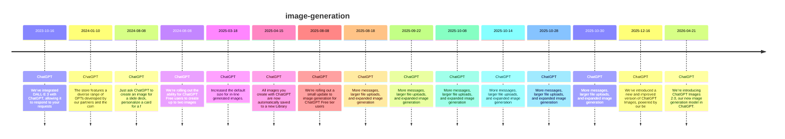

# Theme: image-generation

## Cross-Product Timeline
<!-- chronolog:begin region="timeline" -->

<!-- chronolog:end -->

## Change Cards
<!-- chronolog:begin region="cards" -->
- 2023-10-16 ChatGPT: [[Changes/ChatGPT/2023-10-16-we-ve-integrated-dall-e-3-with-chatgpt-allowing-it-to-respond-to-your-requests-w|We’ve integrated DALL·E 3 with ChatGPT, allowing it to respond to your requests]]
- 2024-01-10 ChatGPT: [[Changes/ChatGPT/2024-01-10-the-store-features-a-diverse-range-of-gpts-developed-by-our-partners-and-the-com|The store features a diverse range of GPTs developed by our partners and the com]]
- 2024-08-08 ChatGPT: [[Changes/ChatGPT/2024-08-08-just-ask-chatgpt-to-create-an-image-for-a-slide-deck-personalize-a-card-for-a-fr|Just ask ChatGPT to create an image for a slide deck, personalize a card for a f]]
- 2024-08-08 ChatGPT: [[Changes/ChatGPT/2024-08-08-we-re-rolling-out-the-ability-for-chatgpt-free-users-to-create-up-to-two-images|We’re rolling out the ability for ChatGPT Free users to create up to two images]]
- 2025-03-18 ChatGPT: [[Changes/ChatGPT/2025-03-18-increased-the-default-size-for-in-line-generated-images|Increased the default size for in‐line generated images.]]
- 2025-04-15 ChatGPT: [[Changes/ChatGPT/2025-04-15-all-images-you-create-with-chatgpt-are-now-automatically-saved-to-a-new-library|All images you create with ChatGPT are now automatically saved to a new Library]]
- 2025-08-08 ChatGPT: [[Changes/ChatGPT/2025-08-08-we-re-rolling-out-a-small-update-to-image-generation-for-chatgpt-free-tier-users|We're rolling out a small update to image generation for ChatGPT Free tier users]]
- 2025-08-18 ChatGPT: [[Changes/ChatGPT/2025-08-18-more-messages-larger-file-uploads-and-expanded-image-generation|More messages, larger file uploads, and expanded image generation]]
- 2025-09-22 ChatGPT: [[Changes/ChatGPT/2025-09-22-more-messages-larger-file-uploads-and-expanded-image-generation|More messages, larger file uploads, and expanded image generation]]
- 2025-10-08 ChatGPT: [[Changes/ChatGPT/2025-10-08-more-messages-larger-file-uploads-and-expanded-image-generation|More messages, larger file uploads, and expanded image generation]]
- 2025-10-14 ChatGPT: [[Changes/ChatGPT/2025-10-14-more-messages-larger-file-uploads-and-expanded-image-generation|More messages, larger file uploads, and expanded image generation]]
- 2025-10-28 ChatGPT: [[Changes/ChatGPT/2025-10-28-more-messages-larger-file-uploads-and-expanded-image-generation|More messages, larger file uploads, and expanded image generation]]
- 2025-10-30 ChatGPT: [[Changes/ChatGPT/2025-10-30-more-messages-larger-file-uploads-and-expanded-image-generation|More messages, larger file uploads, and expanded image generation]]
- 2025-12-16 ChatGPT: [[Changes/ChatGPT/2025-12-16-we-ve-introduced-a-new-and-improved-version-of-chatgpt-images-powered-by-our-bes|We’ve introduced a new and improved version of ChatGPT Images, powered by our be]]
- 2026-04-21 ChatGPT: [[Changes/ChatGPT/2026-04-21-we-re-introducing-chatgpt-images-2-0-our-new-image-generation-model-in-chatgpt-c|We’re introducing ChatGPT Images 2.0, our new image generation model in ChatGPT.]]
<!-- chronolog:end -->