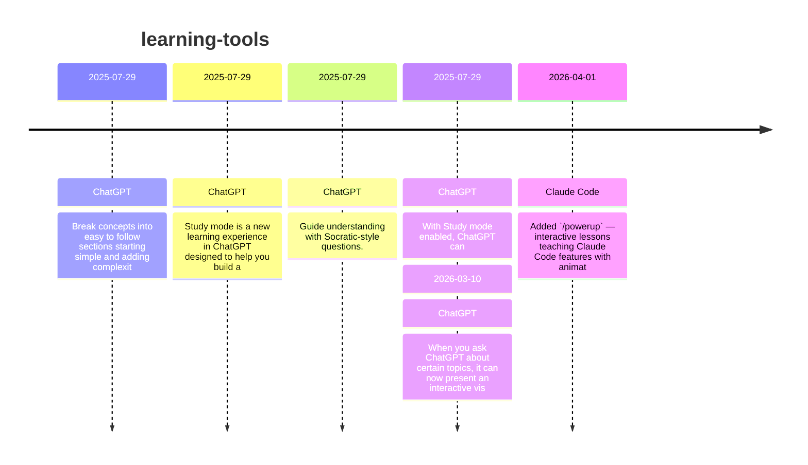

# Theme: learning-tools

## Cross-Product Timeline
<!-- chronolog:begin region="timeline" -->

<!-- chronolog:end -->

## Change Cards
<!-- chronolog:begin region="cards" -->
- 2025-07-29 ChatGPT: [[Changes/ChatGPT/2025-07-29-break-concepts-into-easy-to-follow-sections-starting-simple-and-adding-complexit|Break concepts into easy to follow sections starting simple and adding complexit]]
- 2025-07-29 ChatGPT: [[Changes/ChatGPT/2025-07-29-study-mode-is-a-new-learning-experience-in-chatgpt-designed-to-help-you-build-a|Study mode is a new learning experience in ChatGPT designed to help you build a]]
- 2025-07-29 ChatGPT: [[Changes/ChatGPT/2025-07-29-guide-understanding-with-socratic-style-questions|Guide understanding with Socratic-style questions.]]
- 2025-07-29 ChatGPT: [[Changes/ChatGPT/2025-07-29-with-study-mode-enabled-chatgpt-can|With Study mode enabled, ChatGPT can:]]
- 2026-03-10 ChatGPT: [[Changes/ChatGPT/2026-03-10-when-you-ask-chatgpt-about-certain-topics-it-can-now-present-an-interactive-visu|When you ask ChatGPT about certain topics, it can now present an interactive vis]]
- 2026-04-01 Claude Code: [[Changes/Claude Code/2026-04-01-added-powerup-interactive-lessons-teaching-claude-code-features-with-animated-de|Added `/powerup` — interactive lessons teaching Claude Code features with animat]]
<!-- chronolog:end -->