# Theme: memory

## Cross-Product Timeline

```mermaid
timeline
    title memory
    2023-07-20 : ChatGPT : We’re starting to roll out custom instructions, giving you more control over Cha
    2023-07-20 : ChatGPT : Custom instructions are available to all Plus users and expanding to all users i
    2023-08-09 : ChatGPT : Custom instructions are now available to ChatGPT users on the free plan, except
    2023-08-09 : ChatGPT : Customize your interactions with ChatGPT by providing specific details and guide
    2023-08-21 : ChatGPT : Custom instructions are now available to users in the European Union United King
    2023-09-07 : Cursor : We no longer store any full files in memory and prevent users from @'ing very la
    2023-09-07 : Cursor : This should reduce any significant memory issues that users have been experienci
    2024-02-13 : ChatGPT : We’re testing memory with ChatGPT. Remembering things you discuss across all cha
    2024-02-13 : ChatGPT : You can read more about memory and controls here.
    2024-02-13 : ChatGPT : You're in control of ChatGPT's memory. You can explicitly tell it to remember so
    2024-04-29 : ChatGPT : Memory can be turned on or off in settings. Team, Enterprise, and GPTs to come.
    2024-04-29 : ChatGPT : Memory is now available to all ChatGPT Plus users, except in Europe Korea where
    2025-01-17 : ChatGPT : If you're already using custom instructions, this won't change your current sett
    2025-01-17 : ChatGPT : We've updated custom instructions to make it easier to customize how ChatGPT res
    2025-02-19 : Cursor : Crashes: Enhanced stability through memory and performance improvements, with ad
    2025-04-16 : ChatGPT : ChatGPT can also use memories to inform search queries when ChatGPT searches the
    2025-05-08 : ChatGPT : • Saved memories and Chat history are offered only to Plus and Pro accounts.
    2025-05-08 : ChatGPT : • Outside the European regions listed above, all Plus and Pro accounts that have
    2025-05-08 : ChatGPT : Enhanced memory rolling out to all Plus and Pro users (including the EU). The ne
    2025-05-08 : ChatGPT : • Free‑tier users have access to Saved memories only.
    2025-06-03 : ChatGPT : Memory improvements are starting to roll out to Free users. In addition to the s
    2025-06-03 : ChatGPT : Free users in EEA (EU + UK), Switzerland, Norway, Iceland, or Liechtenstein will
    2025-06-03 : ChatGPT : Outside the European regions listed above, all Free users that have memory enabl
    2025-06-12 : ChatGPT : Improvements to memory to reference past chats in a project*
    2025-08-07 : ChatGPT : Nerd – Playful and curious, explaining concepts clearly while celebrating knowle
    2025-08-07 : ChatGPT : Listener – Warm and laid-back, reflecting your thoughts back with calm clarity a
    2025-08-07 : ChatGPT : Cynic – Sarcastic and dry, delivers blunt help with wit. Often teases, but provi
    2025-08-07 : ChatGPT : Robot – Precise, efficient, and emotionless, delivering direct answers without e
    2025-08-07 : ChatGPT : You can now choose from four distinct personalities or use the Default personali
    2025-08-15 : ChatGPT : Warmth here means small acknowledgements that make interactions feel more person
    2025-08-15 : ChatGPT : We’re making GPT-5’s default personality warmer and more familiar. This is in re
    2025-08-18 : ChatGPT : Longer memory for more personalized responses
    2025-08-22 : ChatGPT : Personal Memory must be enabled to utilize this feature. Settings -> Personaliza
    2025-08-22 : ChatGPT : An improvement to projects is now available. When creating a project, users have
    2025-08-22 : ChatGPT : With project-only memory enabled, ChatGPT can use other conversations in that pr
    2025-09-15 : ChatGPT : Personalization no longer opens in a separate modal. You can manage personalizat
    2025-09-22 : ChatGPT : Longer memory for more personalized responses
    2025-09-25 : ChatGPT : It requires saved memory and chat history to be turned on, and you can switch pu
    2025-09-25 : ChatGPT : As a preview, pulse has some limitations. It aims to show you what’s most releva
    2025-09-25 : ChatGPT : We’re launching an early preview of ChatGPT pulse for Pro users on iOS and Andro
    2025-10-08 : ChatGPT : Longer memory for more personalized responses
    2025-10-14 : ChatGPT : Longer memory for more personalized responses
    2025-10-15 : ChatGPT : These updates are designed to make saved memory feel seamless, reliable, and eas
    2025-10-15 : ChatGPT : ChatGPT now manages saved memories automatically by keeping the most relevant de
    2025-10-15 : ChatGPT : You’re always in control: you can turn off automatic memory management at any ti
    2025-10-15 : ChatGPT : To decide which memories stay top of mind, ChatGPT considers factors such as how
    2025-10-23 : ChatGPT : ChatGPT can draw from anything in the shared project – including chats, uploaded
    2025-10-28 : ChatGPT : Longer memory for more personalized responses
    2025-10-29 : ChatGPT : With Pulse, ChatGPT can do asynchronous research on your behalf once a day based
    2025-10-30 : ChatGPT : Longer memory for more personalized responses
    2025-11-07 : ChatGPT : Previously, changes you made to your ChatGPT personality or custom instructions
    2025-11-12 : ChatGPT : Changes you make in Personalization now apply across all chats immediately (incl
    2025-11-12 : ChatGPT : We’re updating ChatGPT’s tone controls so it’s easier to make responses sound th
    2025-11-24 : ChatGPT : Shopping research is a new interactive experience that helps you find the right
    2025-12-19 : ChatGPT : Be more or less warm
    2025-12-19 : ChatGPT : Use more or fewer emojis
    2025-12-19 : ChatGPT : Be more or less enthusiastic
    2025-12-19 : ChatGPT : In addition to selecting a base style and tone preset—like candid and friendly—y
    2025-12-19 : ChatGPT : Use more or fewer headers & lists
    2025-12-22 : ChatGPT : To see Your Year with ChatGPT, Memory and Reference Chat History must be turned
    2026-01-07 : ChatGPT : We’re starting to roll out Health, a dedicated space in ChatGPT for health and w
    2026-01-15 : ChatGPT : When reference chat history is enabled, ChatGPT can now more reliably find speci
    2026-02-05 : Claude Code : Claude now automatically records and recalls memories as it works
    2026-02-06 : Claude Code : Added `memory` frontmatter field support for agents, enabling persistent memory
    2026-02-09 : ChatGPT : We’re beginning to roll out a test for ads in ChatGPT in the U.S. for logged-in
    2026-02-26 : Claude Code : Claude automatically saves useful context to auto-memory. Manage with /memory
    2026-02-28 : Claude Code : Project configs & auto memory now shared across git worktrees of the same reposi
    2026-03-06 : Claude Code : Reduced startup memory by ~426KB for users without custom CA certificates
    2026-03-12 : Claude Code : Added `autoMemoryDirectory` setting to configure a custom directory for auto-mem
    2026-03-12 : Claude Code : Added actionable suggestions to `/context` command — identifies context-heavy to
    2026-03-17 : ChatGPT : We’re sunsetting the preset Nerdy base style to simplify options and improve res
    2026-04-22 : ChatGPT : Sometimes, you just want the right answer as quickly as possible. We’re rolling
    2026-05-05 : ChatGPT : Starting today, we’re rolling out memory improvements to ChatGPT Plus and Pro us
    2026-06-04 : ChatGPT : We’ve upgraded memory so ChatGPT can better keep your context up to date, helpin
    2026-06-12 : ChatGPT : Highlight any text in the memory summary to make a specific correction.
    2026-06-12 : ChatGPT : You can now delete the memories shown on your memory summary page and turn memor
    2026-06-12 : ChatGPT : Type what you want changed into the text box at the bottom of the memory summary
    2026-06-12 : ChatGPT : If you don’t want information from a chat to be used to personalize responses, y
```

<!-- chronolog:begin region="timeline" -->

<!-- chronolog:end -->

## Change Cards
<!-- chronolog:begin region="cards" -->
- 2023-07-20 ChatGPT: [[Changes/ChatGPT/2023-07-20-we-re-starting-to-roll-out-custom-instructions-giving-you-more-control-over-chat|We’re starting to roll out custom instructions, giving you more control over Cha]]
- 2023-07-20 ChatGPT: [[Changes/ChatGPT/2023-07-20-custom-instructions-are-available-to-all-plus-users-and-expanding-to-all-users-i|Custom instructions are available to all Plus users and expanding to all users i]]
- 2023-08-09 ChatGPT: [[Changes/ChatGPT/2023-08-09-custom-instructions-are-now-available-to-chatgpt-users-on-the-free-plan-except-f|Custom instructions are now available to ChatGPT users on the free plan, except]]
- 2023-08-09 ChatGPT: [[Changes/ChatGPT/2023-08-09-customize-your-interactions-with-chatgpt-by-providing-specific-details-and-guide|Customize your interactions with ChatGPT by providing specific details and guide]]
- 2023-08-21 ChatGPT: [[Changes/ChatGPT/2023-08-21-custom-instructions-are-now-available-to-users-in-the-european-union-united-king|Custom instructions are now available to users in the European Union United King]]
- 2023-09-07 Cursor: [[Changes/Cursor/2023-09-07-we-no-longer-store-any-full-files-in-memory-and-prevent-users-from-ing-very-larg|We no longer store any full files in memory and prevent users from @'ing very la]]
- 2023-09-07 Cursor: [[Changes/Cursor/2023-09-07-this-should-reduce-any-significant-memory-issues-that-users-have-been-experienci|This should reduce any significant memory issues that users have been experienci]]
- 2024-02-13 ChatGPT: [[Changes/ChatGPT/2024-02-13-we-re-testing-memory-with-chatgpt-remembering-things-you-discuss-across-all-chat|We’re testing memory with ChatGPT. Remembering things you discuss across all cha]]
- 2024-02-13 ChatGPT: [[Changes/ChatGPT/2024-02-13-you-can-read-more-about-memory-and-controls-here|You can read more about memory and controls here.]]
- 2024-02-13 ChatGPT: [[Changes/ChatGPT/2024-02-13-you-re-in-control-of-chatgpt-s-memory-you-can-explicitly-tell-it-to-remember-som|You're in control of ChatGPT's memory. You can explicitly tell it to remember so]]
- 2024-04-29 ChatGPT: [[Changes/ChatGPT/2024-04-29-memory-can-be-turned-on-or-off-in-settings-team-enterprise-and-gpts-to-come|Memory can be turned on or off in settings. Team, Enterprise, and GPTs to come.]]
- 2024-04-29 ChatGPT: [[Changes/ChatGPT/2024-04-29-memory-is-now-available-to-all-chatgpt-plus-users-except-in-europe-korea-where-w|Memory is now available to all ChatGPT Plus users, except in Europe Korea where]]
- 2025-01-17 ChatGPT: [[Changes/ChatGPT/2025-01-17-if-you-re-already-using-custom-instructions-this-won-t-change-your-current-setti|If you're already using custom instructions, this won't change your current sett]]
- 2025-01-17 ChatGPT: [[Changes/ChatGPT/2025-01-17-we-ve-updated-custom-instructions-to-make-it-easier-to-customize-how-chatgpt-res|We've updated custom instructions to make it easier to customize how ChatGPT res]]
- 2025-02-19 Cursor: [[Changes/Cursor/2025-02-19-crashes-enhanced-stability-through-memory-and-performance-improvements-with-addi|Crashes: Enhanced stability through memory and performance improvements, with ad]]
- 2025-04-16 ChatGPT: [[Changes/ChatGPT/2025-04-16-chatgpt-can-also-use-memories-to-inform-search-queries-when-chatgpt-searches-the|ChatGPT can also use memories to inform search queries when ChatGPT searches the]]
- 2025-05-08 ChatGPT: [[Changes/ChatGPT/2025-05-08-saved-memories-and-chat-history-are-offered-only-to-plus-and-pro-accounts|• Saved memories and Chat history are offered only to Plus and Pro accounts.]]
- 2025-05-08 ChatGPT: [[Changes/ChatGPT/2025-05-08-outside-the-european-regions-listed-above-all-plus-and-pro-accounts-that-have-me|• Outside the European regions listed above, all Plus and Pro accounts that have]]
- 2025-05-08 ChatGPT: [[Changes/ChatGPT/2025-05-08-enhanced-memory-rolling-out-to-all-plus-and-pro-users-including-the-eu-the-new-m|Enhanced memory rolling out to all Plus and Pro users (including the EU). The ne]]
- 2025-05-08 ChatGPT: [[Changes/ChatGPT/2025-05-08-free-tier-users-have-access-to-saved-memories-only|• Free‑tier users have access to Saved memories only.]]
- 2025-06-03 ChatGPT: [[Changes/ChatGPT/2025-06-03-memory-improvements-are-starting-to-roll-out-to-free-users-in-addition-to-the-sa|Memory improvements are starting to roll out to Free users. In addition to the s]]
- 2025-06-03 ChatGPT: [[Changes/ChatGPT/2025-06-03-free-users-in-eea-eu-uk-switzerland-norway-iceland-or-liechtenstein-will-see-a-p|Free users in EEA (EU + UK), Switzerland, Norway, Iceland, or Liechtenstein will]]
- 2025-06-03 ChatGPT: [[Changes/ChatGPT/2025-06-03-outside-the-european-regions-listed-above-all-free-users-that-have-memory-enable|Outside the European regions listed above, all Free users that have memory enabl]]
- 2025-06-12 ChatGPT: [[Changes/ChatGPT/2025-06-12-improvements-to-memory-to-reference-past-chats-in-a-project|Improvements to memory to reference past chats in a project*]]
- 2025-08-07 ChatGPT: [[Changes/ChatGPT/2025-08-07-nerd-playful-and-curious-explaining-concepts-clearly-while-celebrating-knowledge|Nerd – Playful and curious, explaining concepts clearly while celebrating knowle]]
- 2025-08-07 ChatGPT: [[Changes/ChatGPT/2025-08-07-listener-warm-and-laid-back-reflecting-your-thoughts-back-with-calm-clarity-and|Listener – Warm and laid-back, reflecting your thoughts back with calm clarity a]]
- 2025-08-07 ChatGPT: [[Changes/ChatGPT/2025-08-07-cynic-sarcastic-and-dry-delivers-blunt-help-with-wit-often-teases-but-provides-d|Cynic – Sarcastic and dry, delivers blunt help with wit. Often teases, but provi]]
- 2025-08-07 ChatGPT: [[Changes/ChatGPT/2025-08-07-robot-precise-efficient-and-emotionless-delivering-direct-answers-without-extra|Robot – Precise, efficient, and emotionless, delivering direct answers without e]]
- 2025-08-07 ChatGPT: [[Changes/ChatGPT/2025-08-07-you-can-now-choose-from-four-distinct-personalities-or-use-the-default-personali|You can now choose from four distinct personalities or use the Default personali]]
- 2025-08-15 ChatGPT: [[Changes/ChatGPT/2025-08-15-warmth-here-means-small-acknowledgements-that-make-interactions-feel-more-person|Warmth here means small acknowledgements that make interactions feel more person]]
- 2025-08-15 ChatGPT: [[Changes/ChatGPT/2025-08-15-we-re-making-gpt-5-s-default-personality-warmer-and-more-familiar-this-is-in-res|We’re making GPT-5’s default personality warmer and more familiar. This is in re]]
- 2025-08-18 ChatGPT: [[Changes/ChatGPT/2025-08-18-longer-memory-for-more-personalized-responses|Longer memory for more personalized responses]]
- 2025-08-22 ChatGPT: [[Changes/ChatGPT/2025-08-22-personal-memory-must-be-enabled-to-utilize-this-feature-settings-personalization|Personal Memory must be enabled to utilize this feature. Settings -> Personaliza]]
- 2025-08-22 ChatGPT: [[Changes/ChatGPT/2025-08-22-an-improvement-to-projects-is-now-available-when-creating-a-project-users-have-t|An improvement to projects is now available. When creating a project, users have]]
- 2025-08-22 ChatGPT: [[Changes/ChatGPT/2025-08-22-with-project-only-memory-enabled-chatgpt-can-use-other-conversations-in-that-pro|With project-only memory enabled, ChatGPT can use other conversations in that pr]]
- 2025-09-15 ChatGPT: [[Changes/ChatGPT/2025-09-15-personalization-no-longer-opens-in-a-separate-modal-you-can-manage-personalizati|Personalization no longer opens in a separate modal. You can manage personalizat]]
- 2025-09-22 ChatGPT: [[Changes/ChatGPT/2025-09-22-longer-memory-for-more-personalized-responses|Longer memory for more personalized responses]]
- 2025-09-25 ChatGPT: [[Changes/ChatGPT/2025-09-25-it-requires-saved-memory-and-chat-history-to-be-turned-on-and-you-can-switch-pul|It requires saved memory and chat history to be turned on, and you can switch pu]]
- 2025-09-25 ChatGPT: [[Changes/ChatGPT/2025-09-25-as-a-preview-pulse-has-some-limitations-it-aims-to-show-you-what-s-most-relevant|As a preview, pulse has some limitations. It aims to show you what’s most releva]]
- 2025-09-25 ChatGPT: [[Changes/ChatGPT/2025-09-25-we-re-launching-an-early-preview-of-chatgpt-pulse-for-pro-users-on-ios-and-andro|We’re launching an early preview of ChatGPT pulse for Pro users on iOS and Andro]]
- 2025-10-08 ChatGPT: [[Changes/ChatGPT/2025-10-08-longer-memory-for-more-personalized-responses|Longer memory for more personalized responses]]
- 2025-10-14 ChatGPT: [[Changes/ChatGPT/2025-10-14-longer-memory-for-more-personalized-responses|Longer memory for more personalized responses]]
- 2025-10-15 ChatGPT: [[Changes/ChatGPT/2025-10-15-these-updates-are-designed-to-make-saved-memory-feel-seamless-reliable-and-easy|These updates are designed to make saved memory feel seamless, reliable, and eas]]
- 2025-10-15 ChatGPT: [[Changes/ChatGPT/2025-10-15-chatgpt-now-manages-saved-memories-automatically-by-keeping-the-most-relevant-de|ChatGPT now manages saved memories automatically by keeping the most relevant de]]
- 2025-10-15 ChatGPT: [[Changes/ChatGPT/2025-10-15-you-re-always-in-control-you-can-turn-off-automatic-memory-management-at-any-tim|You’re always in control: you can turn off automatic memory management at any ti]]
- 2025-10-15 ChatGPT: [[Changes/ChatGPT/2025-10-15-to-decide-which-memories-stay-top-of-mind-chatgpt-considers-factors-such-as-how|To decide which memories stay top of mind, ChatGPT considers factors such as how]]
- 2025-10-23 ChatGPT: [[Changes/ChatGPT/2025-10-23-chatgpt-can-draw-from-anything-in-the-shared-project-including-chats-uploaded-fi|ChatGPT can draw from anything in the shared project – including chats, uploaded]]
- 2025-10-28 ChatGPT: [[Changes/ChatGPT/2025-10-28-longer-memory-for-more-personalized-responses|Longer memory for more personalized responses]]
- 2025-10-29 ChatGPT: [[Changes/ChatGPT/2025-10-29-with-pulse-chatgpt-can-do-asynchronous-research-on-your-behalf-once-a-day-based|With Pulse, ChatGPT can do asynchronous research on your behalf once a day based]]
- 2025-10-30 ChatGPT: [[Changes/ChatGPT/2025-10-30-longer-memory-for-more-personalized-responses|Longer memory for more personalized responses]]
- 2025-11-07 ChatGPT: [[Changes/ChatGPT/2025-11-07-previously-changes-you-made-to-your-chatgpt-personality-or-custom-instructions-o|Previously, changes you made to your ChatGPT personality or custom instructions]]
- 2025-11-12 ChatGPT: [[Changes/ChatGPT/2025-11-12-changes-you-make-in-personalization-now-apply-across-all-chats-immediately-inclu|Changes you make in Personalization now apply across all chats immediately (incl]]
- 2025-11-12 ChatGPT: [[Changes/ChatGPT/2025-11-12-we-re-updating-chatgpt-s-tone-controls-so-it-s-easier-to-make-responses-sound-th|We’re updating ChatGPT’s tone controls so it’s easier to make responses sound th]]
- 2025-11-24 ChatGPT: [[Changes/ChatGPT/2025-11-24-shopping-research-is-a-new-interactive-experience-that-helps-you-find-the-right|Shopping research is a new interactive experience that helps you find the right]]
- 2025-12-19 ChatGPT: [[Changes/ChatGPT/2025-12-19-be-more-or-less-warm|Be more or less warm]]
- 2025-12-19 ChatGPT: [[Changes/ChatGPT/2025-12-19-use-more-or-fewer-emojis|Use more or fewer emojis]]
- 2025-12-19 ChatGPT: [[Changes/ChatGPT/2025-12-19-be-more-or-less-enthusiastic|Be more or less enthusiastic]]
- 2025-12-19 ChatGPT: [[Changes/ChatGPT/2025-12-19-in-addition-to-selecting-a-base-style-and-tone-preset-like-candid-and-friendly-y|In addition to selecting a base style and tone preset—like candid and friendly—y]]
- 2025-12-19 ChatGPT: [[Changes/ChatGPT/2025-12-19-use-more-or-fewer-headers-lists|Use more or fewer headers & lists]]
- 2025-12-22 ChatGPT: [[Changes/ChatGPT/2025-12-22-to-see-your-year-with-chatgpt-memory-and-reference-chat-history-must-be-turned-o|To see Your Year with ChatGPT, Memory and Reference Chat History must be turned]]
- 2026-01-07 ChatGPT: [[Changes/ChatGPT/2026-01-07-we-re-starting-to-roll-out-health-a-dedicated-space-in-chatgpt-for-health-and-we|We’re starting to roll out Health, a dedicated space in ChatGPT for health and w]]
- 2026-01-15 ChatGPT: [[Changes/ChatGPT/2026-01-15-when-reference-chat-history-is-enabled-chatgpt-can-now-more-reliably-find-specif|When reference chat history is enabled, ChatGPT can now more reliably find speci]]
- 2026-02-05 Claude Code: [[Changes/Claude Code/2026-02-05-claude-now-automatically-records-and-recalls-memories-as-it-works|Claude now automatically records and recalls memories as it works]]
- 2026-02-06 Claude Code: [[Changes/Claude Code/2026-02-06-added-memory-frontmatter-field-support-for-agents-enabling-persistent-memory-wit|Added `memory` frontmatter field support for agents, enabling persistent memory]]
- 2026-02-09 ChatGPT: [[Changes/ChatGPT/2026-02-09-we-re-beginning-to-roll-out-a-test-for-ads-in-chatgpt-in-the-u-s-for-logged-in-a|We’re beginning to roll out a test for ads in ChatGPT in the U.S. for logged-in]]
- 2026-02-26 Claude Code: [[Changes/Claude Code/2026-02-26-claude-automatically-saves-useful-context-to-auto-memory-manage-with-memory|Claude automatically saves useful context to auto-memory. Manage with /memory]]
- 2026-02-28 Claude Code: [[Changes/Claude Code/2026-02-28-project-configs-auto-memory-now-shared-across-git-worktrees-of-the-same-reposito|Project configs & auto memory now shared across git worktrees of the same reposi]]
- 2026-03-06 Claude Code: [[Changes/Claude Code/2026-03-06-reduced-startup-memory-by-426kb-for-users-without-custom-ca-certificates|Reduced startup memory by ~426KB for users without custom CA certificates]]
- 2026-03-12 Claude Code: [[Changes/Claude Code/2026-03-12-added-automemorydirectory-setting-to-configure-a-custom-directory-for-auto-memor|Added `autoMemoryDirectory` setting to configure a custom directory for auto-mem]]
- 2026-03-12 Claude Code: [[Changes/Claude Code/2026-03-12-added-actionable-suggestions-to-context-command-identifies-context-heavy-tools-m|Added actionable suggestions to `/context` command — identifies context-heavy to]]
- 2026-03-17 ChatGPT: [[Changes/ChatGPT/2026-03-17-we-re-sunsetting-the-preset-nerdy-base-style-to-simplify-options-and-improve-res|We’re sunsetting the preset Nerdy base style to simplify options and improve res]]
- 2026-04-22 ChatGPT: [[Changes/ChatGPT/2026-04-22-sometimes-you-just-want-the-right-answer-as-quickly-as-possible-we-re-rolling-ou|Sometimes, you just want the right answer as quickly as possible. We’re rolling]]
- 2026-05-05 ChatGPT: [[Changes/ChatGPT/2026-05-05-starting-today-we-re-rolling-out-memory-improvements-to-chatgpt-plus-and-pro-use|Starting today, we’re rolling out memory improvements to ChatGPT Plus and Pro us]]
- 2026-06-04 ChatGPT: [[Changes/ChatGPT/2026-06-04-we-ve-upgraded-memory-so-chatgpt-can-better-keep-your-context-up-to-date-helping|We’ve upgraded memory so ChatGPT can better keep your context up to date, helpin]]
- 2026-06-12 ChatGPT: [[Changes/ChatGPT/2026-06-12-highlight-any-text-in-the-memory-summary-to-make-a-specific-correction|Highlight any text in the memory summary to make a specific correction.]]
- 2026-06-12 ChatGPT: [[Changes/ChatGPT/2026-06-12-you-can-now-delete-the-memories-shown-on-your-memory-summary-page-and-turn-memor|You can now delete the memories shown on your memory summary page and turn memor]]
- 2026-06-12 ChatGPT: [[Changes/ChatGPT/2026-06-12-type-what-you-want-changed-into-the-text-box-at-the-bottom-of-the-memory-summary|Type what you want changed into the text box at the bottom of the memory summary]]
- 2026-06-12 ChatGPT: [[Changes/ChatGPT/2026-06-12-if-you-don-t-want-information-from-a-chat-to-be-used-to-personalize-responses-yo|If you don’t want information from a chat to be used to personalize responses, y]]
<!-- chronolog:end -->