# Theme: mobile-desktop

## Cross-Product Timeline

```mermaid
timeline
    title mobile-desktop
    2023-03-14 : Cursor : Windows and Linux support 🥳
    2023-05-24 : ChatGPT : ChatGPT app for iOS in more countries
    2023-05-24 : ChatGPT : Good news! We’re expanding availability of the ChatGPT app for iOS to more count
    2023-05-24 : ChatGPT : We will continue to roll out to more countries and regions in the coming weeks.
    2023-06-22 : ChatGPT : We’ve made two updates to the mobile ChatGPT app:
    2023-07-25 : ChatGPT : We plan to expand the rollout to additional countries over the next week. You ca
    2023-07-25 : ChatGPT : ChatGPT for Android is now available for download in the United States, India, B
    2023-09-25 : ChatGPT : You can now show ChatGPT one or more images. Troubleshoot why your grill won’t s
    2023-12-30 : Cursor : Cursor is now based on VS Code 1.85.1, which, among other things, includes float
    2024-11-19 : ChatGPT : Starting today, we’re beginning to roll out Advanced Voice Mode on web (already
    2025-01-15 : ChatGPT : Web only (no desktop or mobile in this release).
    2025-01-17 : ChatGPT : The new UI is rolling out now on http://chatgpt.com and desktop on Windows, and
    2025-02-14 : ChatGPT : Improved Android conversation parsing performance.
    2025-02-14 : ChatGPT : iOS performance fixes.
    2025-02-14 : ChatGPT : Confirmation dialog for logging out (iOS, web).
    2025-02-14 : ChatGPT : Updated launch animations and composer design on Android.
    2025-02-21 : ChatGPT : iOS widget (see below):
    2025-02-28 : ChatGPT : Long press to select text on iOS and moved the message quick actions to always b
    2025-02-28 : ChatGPT : iOS Long press to select text on iOS and moved the message quick actions to alwa
    2025-03-18 : ChatGPT : We have been working on a variety of usability and performance improvements and
    2025-03-18 : ChatGPT : Improved table-copying functionality out of ChatGPT responses on iOS and macOS.
    2025-05-06 : ChatGPT : We've removed the row of individual tool icons from the mobile composer and repl
    2025-06-03 : ChatGPT : Free users must be logged in and on up-to-date apps (iOS/Android v1.2025.147+).
    2025-07-16 : ChatGPT : Record mode is now available to ChatGPT Plus users globally in the macOS desktop
    2025-07-29 : ChatGPT : Study mode is currently available to users in Free, Plus, Pro, and Teams plans g
    2025-08-07 : ChatGPT : GPT-5 is slowly rolling out to all users on ChatGPT Plus, Pro, Team, and Free pl
    2025-08-07 : ChatGPT : On mobile (iOS and Android): Tap your profile icon at the bottom, go to Personal
    2025-08-22 : ChatGPT : This feature will initially only be available on the ChatGPT website and Windows
    2025-09-29 : ChatGPT : We’re rolling out parental controls globally in ChatGPT to help families guide h
    2025-10-23 : ChatGPT : Starting today, project sharing is available to all ChatGPT users, including for
    2025-11-03 : ChatGPT : Eligible customers in India can get now get 12 months of ChatGPT Go at no cost.
    2025-11-13 : ChatGPT : Group chats are starting to roll out on ChatGPT Web, iOS, and Android in New Zea
    2025-11-24 : ChatGPT : Shopping research is available on ChatGPT Web, iOS, and Android for logged‑in Fr
    2025-12-18 : ChatGPT : You can now pin chats to the top of your list for quick access to important conv
    2025-12-19 : Claude Code : Added guidance for macOS users when Alt shortcuts fail due to terminal configura
    2026-01-07 : ChatGPT : Health appears as a new space in the ChatGPT sidebar. If you ask a health-relate
    2026-01-09 : Claude Code : Added support for Windows Package Manager (winget) installations with automatic
    2026-01-22 : Claude Code : [IDE] Fixed a race condition on Windows where the Claude Code sidebar view conta
    2026-02-13 : Claude Code : Added Windows ARM64 (win32-arm64) native binary support
    2026-02-24 : Cursor : Cloud agents are available anywhere you use Cursor, including web, desktop, mobi
    2026-03-03 : Cursor : Desktop Improvements (15)↓↑
    2026-03-23 : ChatGPT : Now, it’s easier to find, reuse, and build on your files over time. When you upl
    2026-03-26 : ChatGPT : To give you more space to view your most critical chats and projects, the sideba
    2026-03-26 : ChatGPT : Users can now choose to share their device location so ChatGPT can provide more
    2026-03-26 : Claude Code : Added PowerShell tool for Windows as an opt-in preview. Learn more at https://co
    2026-04-02 : ChatGPT : We’re rolling out ChatGPT in CarPlay, giving you access to a hands-free ChatGPT
    2026-04-15 : Claude Code : Added push notification tool — Claude can send mobile push notifications when Re
    2026-04-29 : Cursor : The agents that run in the Cursor desktop app, CLI, and web app are now accessib
    2026-05-09 : Claude Code : [VSCode] Fixed extension failing to activate on Windows
    2026-05-12 : ChatGPT : Free users in ChatGPT will now see more inline images from the web to help make
    2026-05-14 : ChatGPT : Codex is now available in preview in the ChatGPT mobile app, so you can stay con
    2026-05-14 : ChatGPT : Generated images will continue to appear in the Images tab. Storage management i
    2026-06-08 : ChatGPT : Web, iOS, and Android
    2026-06-10 : ChatGPT : On iOS and Android, you can find the picker at the top of the conversation. On w
    2026-06-17 : Claude Code : Added `CLAUDE_CLIENT_PRESENCE_FILE` environment variable: point it at a marker f
    2026-06-17 : Cursor : This release introduces updates to cloud agents in the Agents Window of the Curs
    2026-06-18 : ChatGPT : Web, iOS, and Android
    2026-06-18 : ChatGPT : ChatGPT now has more ways to help with common questions, from pronunciation guid
    2026-06-29 : Claude Code : Improved background session reliability: long-running commands and workflows now
    2026-06-29 : Cursor : Cloud agents on mobile
    2026-06-29 : Cursor : Cursor for iOS is now available in public beta on all paid plans. Launch and man
    2026-07-09 : ChatGPT : To create a Site, start in ChatGPT Work on the web or in Work or Codex in the Ch
    2026-07-09 : ChatGPT : The new ChatGPT desktop app is available globally for macOS and Windows. It comb
    2026-07-09 : ChatGPT : Beginning July 9, users on web, iOS, and Android will no longer be able to creat
    2026-07-13 : ChatGPT : ChatGPT is available again on WhatsApp in the European Economic Area (EEA). You
    2026-07-14 : ChatGPT : We’ve rolled out a new way to search your chats, projects, images, and documents
    2026-07-16 : ChatGPT : macOS and Windows
    2026-07-16 : ChatGPT : A clearer desktop layout: A global switcher lets you choose between ChatGPT and
    2026-07-16 : ChatGPT : We’ve updated the ChatGPT desktop app to make it easier to choose between Chat a
    2026-07-23 : ChatGPT : Available on web and iOS, Health lets you view lab results, medications, activit
    2026-07-29 : Cursor : The iPad layout is rebuilt around the extra space. Sidebar chats stay pinned so
    2026-07-29 : Cursor : Cursor for iPad is now available on all paid plans.
    2026-07-29 : Cursor : New to both iPhone and iPad: an inbox to stay organized, and a review experience
    2026-07-29 : Cursor : Built for the bigger screen
```

<!-- chronolog:begin region="timeline" -->

<!-- chronolog:end -->

## Change Cards
<!-- chronolog:begin region="cards" -->
- 2023-03-14 Cursor: [[Changes/Cursor/2023-03-14-windows-and-linux-support|Windows and Linux support 🥳]]
- 2023-05-24 ChatGPT: [[Changes/ChatGPT/2023-05-24-chatgpt-app-for-ios-in-more-countries|ChatGPT app for iOS in more countries]]
- 2023-05-24 ChatGPT: [[Changes/ChatGPT/2023-05-24-good-news-we-re-expanding-availability-of-the-chatgpt-app-for-ios-to-more-countr|Good news! We’re expanding availability of the ChatGPT app for iOS to more count]]
- 2023-05-24 ChatGPT: [[Changes/ChatGPT/2023-05-24-we-will-continue-to-roll-out-to-more-countries-and-regions-in-the-coming-weeks-y|We will continue to roll out to more countries and regions in the coming weeks.]]
- 2023-06-22 ChatGPT: [[Changes/ChatGPT/2023-06-22-we-ve-made-two-updates-to-the-mobile-chatgpt-app|We’ve made two updates to the mobile ChatGPT app:]]
- 2023-07-25 ChatGPT: [[Changes/ChatGPT/2023-07-25-we-plan-to-expand-the-rollout-to-additional-countries-over-the-next-week-you-can|We plan to expand the rollout to additional countries over the next week. You ca]]
- 2023-07-25 ChatGPT: [[Changes/ChatGPT/2023-07-25-chatgpt-for-android-is-now-available-for-download-in-the-united-states-india-ban|ChatGPT for Android is now available for download in the United States, India, B]]
- 2023-09-25 ChatGPT: [[Changes/ChatGPT/2023-09-25-you-can-now-show-chatgpt-one-or-more-images-troubleshoot-why-your-grill-won-t-st|You can now show ChatGPT one or more images. Troubleshoot why your grill won’t s]]
- 2023-12-30 Cursor: [[Changes/Cursor/2023-12-30-cursor-is-now-based-on-vs-code-1-85-1-which-among-other-things-includes-floating|Cursor is now based on VS Code 1.85.1, which, among other things, includes float]]
- 2024-11-19 ChatGPT: [[Changes/ChatGPT/2024-11-19-starting-today-we-re-beginning-to-roll-out-advanced-voice-mode-on-web-already-av|Starting today, we’re beginning to roll out Advanced Voice Mode on web (already]]
- 2025-01-15 ChatGPT: [[Changes/ChatGPT/2025-01-15-web-only-no-desktop-or-mobile-in-this-release|Web only (no desktop or mobile in this release).]]
- 2025-01-17 ChatGPT: [[Changes/ChatGPT/2025-01-17-the-new-ui-is-rolling-out-now-on-http-chatgpt-com-and-desktop-on-windows-and-is|The new UI is rolling out now on http://chatgpt.com and desktop on Windows, and]]
- 2025-02-14 ChatGPT: [[Changes/ChatGPT/2025-02-14-improved-android-conversation-parsing-performance|Improved Android conversation parsing performance.]]
- 2025-02-14 ChatGPT: [[Changes/ChatGPT/2025-02-14-ios-performance-fixes|iOS performance fixes.]]
- 2025-02-14 ChatGPT: [[Changes/ChatGPT/2025-02-14-confirmation-dialog-for-logging-out-ios-web|Confirmation dialog for logging out (iOS, web).]]
- 2025-02-14 ChatGPT: [[Changes/ChatGPT/2025-02-14-updated-launch-animations-and-composer-design-on-android|Updated launch animations and composer design on Android.]]
- 2025-02-21 ChatGPT: [[Changes/ChatGPT/2025-02-21-ios-widget-see-below|iOS widget (see below):]]
- 2025-02-28 ChatGPT: [[Changes/ChatGPT/2025-02-28-long-press-to-select-text-on-ios-and-moved-the-message-quick-actions-to-always-b|Long press to select text on iOS and moved the message quick actions to always b]]
- 2025-02-28 ChatGPT: [[Changes/ChatGPT/2025-02-28-ios-long-press-to-select-text-on-ios-and-moved-the-message-quick-actions-to-alwa|iOS Long press to select text on iOS and moved the message quick actions to alwa]]
- 2025-03-18 ChatGPT: [[Changes/ChatGPT/2025-03-18-we-have-been-working-on-a-variety-of-usability-and-performance-improvements-and|We have been working on a variety of usability and performance improvements and]]
- 2025-03-18 ChatGPT: [[Changes/ChatGPT/2025-03-18-improved-table-copying-functionality-out-of-chatgpt-responses-on-ios-and-macos|Improved table-copying functionality out of ChatGPT responses on iOS and macOS.]]
- 2025-05-06 ChatGPT: [[Changes/ChatGPT/2025-05-06-we-ve-removed-the-row-of-individual-tool-icons-from-the-mobile-composer-and-repl|We've removed the row of individual tool icons from the mobile composer and repl]]
- 2025-06-03 ChatGPT: [[Changes/ChatGPT/2025-06-03-free-users-must-be-logged-in-and-on-up-to-date-apps-ios-android-v1-2025-147|Free users must be logged in and on up-to-date apps (iOS/Android v1.2025.147+).]]
- 2025-07-16 ChatGPT: [[Changes/ChatGPT/2025-07-16-record-mode-is-now-available-to-chatgpt-plus-users-globally-in-the-macos-desktop|Record mode is now available to ChatGPT Plus users globally in the macOS desktop]]
- 2025-07-29 ChatGPT: [[Changes/ChatGPT/2025-07-29-study-mode-is-currently-available-to-users-in-free-plus-pro-and-teams-plans-glob|Study mode is currently available to users in Free, Plus, Pro, and Teams plans g]]
- 2025-08-07 ChatGPT: [[Changes/ChatGPT/2025-08-07-gpt-5-is-slowly-rolling-out-to-all-users-on-chatgpt-plus-pro-team-and-free-plans|GPT-5 is slowly rolling out to all users on ChatGPT Plus, Pro, Team, and Free pl]]
- 2025-08-07 ChatGPT: [[Changes/ChatGPT/2025-08-07-on-mobile-ios-and-android-tap-your-profile-icon-at-the-bottom-go-to-personalizat|On mobile (iOS and Android): Tap your profile icon at the bottom, go to Personal]]
- 2025-08-22 ChatGPT: [[Changes/ChatGPT/2025-08-22-this-feature-will-initially-only-be-available-on-the-chatgpt-website-and-windows|This feature will initially only be available on the ChatGPT website and Windows]]
- 2025-09-29 ChatGPT: [[Changes/ChatGPT/2025-09-29-we-re-rolling-out-parental-controls-globally-in-chatgpt-to-help-families-guide-h|We’re rolling out parental controls globally in ChatGPT to help families guide h]]
- 2025-10-23 ChatGPT: [[Changes/ChatGPT/2025-10-23-starting-today-project-sharing-is-available-to-all-chatgpt-users-including-for-f|Starting today, project sharing is available to all ChatGPT users, including for]]
- 2025-11-03 ChatGPT: [[Changes/ChatGPT/2025-11-03-eligible-customers-in-india-can-get-now-get-12-months-of-chatgpt-go-at-no-cost-n|Eligible customers in India can get now get 12 months of ChatGPT Go at no cost.]]
- 2025-11-13 ChatGPT: [[Changes/ChatGPT/2025-11-13-group-chats-are-starting-to-roll-out-on-chatgpt-web-ios-and-android-in-new-zeala|Group chats are starting to roll out on ChatGPT Web, iOS, and Android in New Zea]]
- 2025-11-24 ChatGPT: [[Changes/ChatGPT/2025-11-24-shopping-research-is-available-on-chatgpt-web-ios-and-android-for-logged-in-free|Shopping research is available on ChatGPT Web, iOS, and Android for logged‑in Fr]]
- 2025-12-18 ChatGPT: [[Changes/ChatGPT/2025-12-18-you-can-now-pin-chats-to-the-top-of-your-list-for-quick-access-to-important-conv|You can now pin chats to the top of your list for quick access to important conv]]
- 2025-12-19 Claude Code: [[Changes/Claude Code/2025-12-19-added-guidance-for-macos-users-when-alt-shortcuts-fail-due-to-terminal-configura|Added guidance for macOS users when Alt shortcuts fail due to terminal configura]]
- 2026-01-07 ChatGPT: [[Changes/ChatGPT/2026-01-07-health-appears-as-a-new-space-in-the-chatgpt-sidebar-if-you-ask-a-health-related|Health appears as a new space in the ChatGPT sidebar. If you ask a health-relate]]
- 2026-01-09 Claude Code: [[Changes/Claude Code/2026-01-09-added-support-for-windows-package-manager-winget-installations-with-automatic-de|Added support for Windows Package Manager (winget) installations with automatic]]
- 2026-01-22 Claude Code: [[Changes/Claude Code/2026-01-22-ide-fixed-a-race-condition-on-windows-where-the-claude-code-sidebar-view-contain|[IDE] Fixed a race condition on Windows where the Claude Code sidebar view conta]]
- 2026-02-13 Claude Code: [[Changes/Claude Code/2026-02-13-added-windows-arm64-win32-arm64-native-binary-support|Added Windows ARM64 (win32-arm64) native binary support]]
- 2026-02-24 Cursor: [[Changes/Cursor/2026-02-24-cloud-agents-are-available-anywhere-you-use-cursor-including-web-desktop-mobile|Cloud agents are available anywhere you use Cursor, including web, desktop, mobi]]
- 2026-03-03 Cursor: [[Changes/Cursor/2026-03-03-desktop-improvements-15|Desktop Improvements (15)↓↑]]
- 2026-03-23 ChatGPT: [[Changes/ChatGPT/2026-03-23-now-it-s-easier-to-find-reuse-and-build-on-your-files-over-time-when-you-upload|Now, it’s easier to find, reuse, and build on your files over time. When you upl]]
- 2026-03-26 ChatGPT: [[Changes/ChatGPT/2026-03-26-to-give-you-more-space-to-view-your-most-critical-chats-and-projects-the-sidebar|To give you more space to view your most critical chats and projects, the sideba]]
- 2026-03-26 ChatGPT: [[Changes/ChatGPT/2026-03-26-users-can-now-choose-to-share-their-device-location-so-chatgpt-can-provide-more|Users can now choose to share their device location so ChatGPT can provide more]]
- 2026-03-26 Claude Code: [[Changes/Claude Code/2026-03-26-added-powershell-tool-for-windows-as-an-opt-in-preview-learn-more-at-https-code|Added PowerShell tool for Windows as an opt-in preview. Learn more at https://co]]
- 2026-04-02 ChatGPT: [[Changes/ChatGPT/2026-04-02-we-re-rolling-out-chatgpt-in-carplay-giving-you-access-to-a-hands-free-chatgpt-e|We’re rolling out ChatGPT in CarPlay, giving you access to a hands-free ChatGPT]]
- 2026-04-15 Claude Code: [[Changes/Claude Code/2026-04-15-added-push-notification-tool-claude-can-send-mobile-push-notifications-when-remo|Added push notification tool — Claude can send mobile push notifications when Re]]
- 2026-04-29 Cursor: [[Changes/Cursor/2026-04-29-the-agents-that-run-in-the-cursor-desktop-app-cli-and-web-app-are-now-accessible|The agents that run in the Cursor desktop app, CLI, and web app are now accessib]]
- 2026-05-09 Claude Code: [[Changes/Claude Code/2026-05-09-vscode-fixed-extension-failing-to-activate-on-windows|[VSCode] Fixed extension failing to activate on Windows]]
- 2026-05-12 ChatGPT: [[Changes/ChatGPT/2026-05-12-free-users-in-chatgpt-will-now-see-more-inline-images-from-the-web-to-help-make|Free users in ChatGPT will now see more inline images from the web to help make]]
- 2026-05-14 ChatGPT: [[Changes/ChatGPT/2026-05-14-codex-is-now-available-in-preview-in-the-chatgpt-mobile-app-so-you-can-stay-conn|Codex is now available in preview in the ChatGPT mobile app, so you can stay con]]
- 2026-05-14 ChatGPT: [[Changes/ChatGPT/2026-05-14-generated-images-will-continue-to-appear-in-the-images-tab-storage-management-is|Generated images will continue to appear in the Images tab. Storage management i]]
- 2026-06-08 ChatGPT: [[Changes/ChatGPT/2026-06-08-web-ios-and-android|Web, iOS, and Android]]
- 2026-06-10 ChatGPT: [[Changes/ChatGPT/2026-06-10-on-ios-and-android-you-can-find-the-picker-at-the-top-of-the-conversation-on-web|On iOS and Android, you can find the picker at the top of the conversation. On w]]
- 2026-06-17 Claude Code: [[Changes/Claude Code/2026-06-17-added-claude-client-presence-file-environment-variable-point-it-at-a-marker-file|Added `CLAUDE_CLIENT_PRESENCE_FILE` environment variable: point it at a marker f]]
- 2026-06-17 Cursor: [[Changes/Cursor/2026-06-17-this-release-introduces-updates-to-cloud-agents-in-the-agents-window-of-the-curs|This release introduces updates to cloud agents in the Agents Window of the Curs]]
- 2026-06-18 ChatGPT: [[Changes/ChatGPT/2026-06-18-web-ios-and-android|Web, iOS, and Android]]
- 2026-06-18 ChatGPT: [[Changes/ChatGPT/2026-06-18-chatgpt-now-has-more-ways-to-help-with-common-questions-from-pronunciation-guida|ChatGPT now has more ways to help with common questions, from pronunciation guid]]
- 2026-06-29 Claude Code: [[Changes/Claude Code/2026-06-29-improved-background-session-reliability-long-running-commands-and-workflows-now|Improved background session reliability: long-running commands and workflows now]]
- 2026-06-29 Cursor: [[Changes/Cursor/2026-06-29-cloud-agents-on-mobile|Cloud agents on mobile]]
- 2026-06-29 Cursor: [[Changes/Cursor/2026-06-29-cursor-for-ios-is-now-available-in-public-beta-on-all-paid-plans-launch-and-mana|Cursor for iOS is now available in public beta on all paid plans. Launch and man]]
- 2026-07-09 ChatGPT: [[Changes/ChatGPT/2026-07-09-to-create-a-site-start-in-chatgpt-work-on-the-web-or-in-work-or-codex-in-the-cha|To create a Site, start in ChatGPT Work on the web or in Work or Codex in the Ch]]
- 2026-07-09 ChatGPT: [[Changes/ChatGPT/2026-07-09-the-new-chatgpt-desktop-app-is-available-globally-for-macos-and-windows-it-combi|The new ChatGPT desktop app is available globally for macOS and Windows. It comb]]
- 2026-07-09 ChatGPT: [[Changes/ChatGPT/2026-07-09-beginning-july-9-users-on-web-ios-and-android-will-no-longer-be-able-to-create-n|Beginning July 9, users on web, iOS, and Android will no longer be able to creat]]
- 2026-07-13 ChatGPT: [[Changes/ChatGPT/2026-07-13-chatgpt-is-available-again-on-whatsapp-in-the-european-economic-area-eea-you-can|ChatGPT is available again on WhatsApp in the European Economic Area (EEA). You]]
- 2026-07-14 ChatGPT: [[Changes/ChatGPT/2026-07-14-we-ve-rolled-out-a-new-way-to-search-your-chats-projects-images-and-documents-in|We’ve rolled out a new way to search your chats, projects, images, and documents]]
- 2026-07-16 ChatGPT: [[Changes/ChatGPT/2026-07-16-macos-and-windows|macOS and Windows]]
- 2026-07-16 ChatGPT: [[Changes/ChatGPT/2026-07-16-a-clearer-desktop-layout-a-global-switcher-lets-you-choose-between-chatgpt-and-c|A clearer desktop layout: A global switcher lets you choose between ChatGPT and]]
- 2026-07-16 ChatGPT: [[Changes/ChatGPT/2026-07-16-we-ve-updated-the-chatgpt-desktop-app-to-make-it-easier-to-choose-between-chat-a|We’ve updated the ChatGPT desktop app to make it easier to choose between Chat a]]
- 2026-07-23 ChatGPT: [[Changes/ChatGPT/2026-07-23-available-on-web-and-ios-health-lets-you-view-lab-results-medications-activity-s|Available on web and iOS, Health lets you view lab results, medications, activit]]
- 2026-07-29 Cursor: [[Changes/Cursor/2026-07-29-the-ipad-layout-is-rebuilt-around-the-extra-space-sidebar-chats-stay-pinned-so-y|The iPad layout is rebuilt around the extra space. Sidebar chats stay pinned so]]
- 2026-07-29 Cursor: [[Changes/Cursor/2026-07-29-cursor-for-ipad-is-now-available-on-all-paid-plans|Cursor for iPad is now available on all paid plans.]]
- 2026-07-29 Cursor: [[Changes/Cursor/2026-07-29-new-to-both-iphone-and-ipad-an-inbox-to-stay-organized-and-a-review-experience-t|New to both iPhone and iPad: an inbox to stay organized, and a review experience]]
- 2026-07-29 Cursor: [[Changes/Cursor/2026-07-29-built-for-the-bigger-screen|Built for the bigger screen]]
<!-- chronolog:end -->