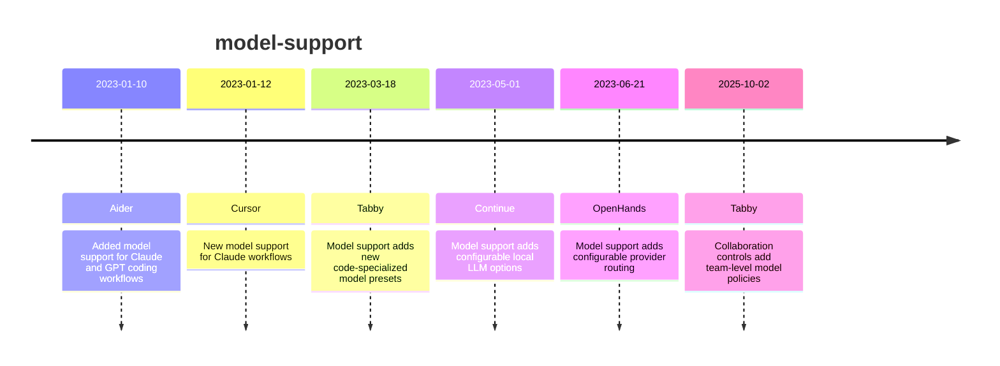

# Theme: model-support

## Cross-Product Timeline
<!-- chronolog:begin region="timeline" -->

<!-- chronolog:end -->

## Change Cards
<!-- chronolog:begin region="cards" -->
- 2023-01-10 Aider: [[2023-01-10-added-model-support-for-claude-and-gpt-coding-workflows|Added model support for Claude and GPT coding workflows]]
- 2023-01-12 Cursor: [[2023-01-12-new-model-support-for-claude-workflows|New model support for Claude workflows]]
- 2023-03-18 Tabby: [[2023-03-18-model-support-adds-new-code-specialized-model-presets|Model support adds new code-specialized model presets]]
- 2023-05-01 Continue: [[2023-05-01-model-support-adds-configurable-local-llm-options|Model support adds configurable local LLM options]]
- 2023-06-21 OpenHands: [[2023-06-21-model-support-adds-configurable-provider-routing|Model support adds configurable provider routing]]
- 2025-10-02 Tabby: [[2025-10-02-collaboration-controls-add-team-level-model-policies|Collaboration controls add team-level model policies]]
<!-- chronolog:end -->