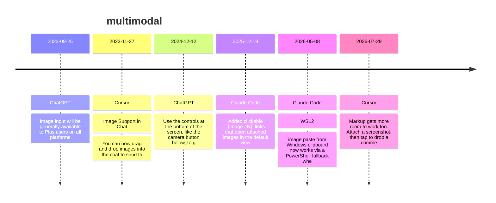

# Theme: multimodal

## Cross-Product Timeline
<!-- chronolog:begin region="timeline" -->

<!-- chronolog:end -->

## Change Cards
<!-- chronolog:begin region="cards" -->
- 2023-09-25 ChatGPT: [[Changes/ChatGPT/2023-09-25-image-input-will-be-generally-available-to-plus-users-on-all-platforms|Image input will be generally available to Plus users on all platforms]]
- 2023-11-27 Cursor: [[Changes/Cursor/2023-11-27-image-support-in-chat-you-can-now-drag-and-drop-images-into-the-chat-to-send-the|Image Support in Chat: You can now drag and drop images into the chat to send th]]
- 2024-12-12 ChatGPT: [[Changes/ChatGPT/2024-12-12-use-the-controls-at-the-bottom-of-the-screen-like-the-camera-button-below-to-get|Use the controls at the bottom of the screen, like the camera button below, to g]]
- 2025-12-19 Claude Code: [[Changes/Claude Code/2025-12-19-added-clickable-image-n-links-that-open-attached-images-in-the-default-viewer|Added clickable `[Image #N]` links that open attached images in the default view]]
- 2026-05-08 Claude Code: [[Changes/Claude Code/2026-05-08-wsl2-image-paste-from-windows-clipboard-now-works-via-a-powershell-fallback-when|WSL2: image paste from Windows clipboard now works via a PowerShell fallback whe]]
- 2026-07-29 Cursor: [[Changes/Cursor/2026-07-29-markup-gets-more-room-to-work-too-attach-a-screenshot-then-tap-to-drop-a-comment|Markup gets more room to work too. Attach a screenshot, then tap to drop a comme]]
<!-- chronolog:end -->