# Theme: pricing-model

## Cross-Product Timeline

```mermaid
timeline
    title pricing-model
    2022-12-15 : ChatGPT : Daily limit: To ensure a high-quality experience for all ChatGPT users, we are e
    2023-02-13 : ChatGPT : We rolled out the ability to purchase ChatGPT Plus internationally.
    2023-03-27 : Cursor : Adds an optional paid plan if you'd like to avoid the server capacity rate limit
    2023-11-03 : Cursor : Pro++ plan: if you hit your fast request limit and prefer to purchase more, you
    2025-03-23 : Cursor : Chat will now display a notification about usage-based pricing when approaching
    2025-05-15 : Cursor : Simpler, unified pricing
    2025-05-15 : Cursor : Max mode now uses token-based pricing (similar to how models API pricing works)
    2025-05-15 : Cursor : We’ve heard your feedback and are rolling out a unified pricing model to make it
    2025-05-15 : Cursor : All model usage is now unified into request-based pricing
    2025-08-18 : ChatGPT : We’re launching ChatGPT Go, a new low-cost subscription plan. This will initiall
    2025-08-18 : ChatGPT : ChatGPT Go is geo-restricted to India at launch, and is able to be subscribed to
    2025-08-18 : ChatGPT : For ₹399/month (GST included), ChatGPT Go provides everything included in the Fr
    2025-09-22 : ChatGPT : We're launching ChatGPT Go, our low cost subscription plan, in Indonesia.
    2025-09-22 : ChatGPT : For Rp 75.000/month, ChatGPT Go provides everything included in the Free plan, a
    2025-10-08 : ChatGPT : We're excited to announce that ChatGPT Go, our low cost subscription plan, is no
    2025-10-14 : ChatGPT : For an affordable price, ChatGPT Go provides everything included in the Free pla
    2025-10-14 : ChatGPT : We're excited to announce that ChatGPT Go, our low cost subscription plan, is no
    2025-10-28 : ChatGPT : We're launching ChatGPT Go, our low cost subscription plan, in Brazil. ChatGPT G
    2025-10-30 : ChatGPT : For an affordable price, ChatGPT Go provides everything included in the Free pla
    2025-10-30 : ChatGPT : We're excited to announce that ChatGPT Go, our low cost subscription plan, is no
    2025-11-03 : ChatGPT : If you have an existing ChatGPT Go membership, we may be able to automatically a
    2026-03-10 : ChatGPT : You can manage auto top-up from Codex Settings → Usage Dashboard. Auto top-up ap
    2026-03-10 : ChatGPT : Eligible ChatGPT Plus and Pro users can now turn on auto top-up for credits used
    2026-03-24 : ChatGPT : We’ve improved shopping in ChatGPT to make it easier to discover, compare, and d
    2026-04-04 : Claude Code : Added per-model and cache-hit breakdown to `/cost` for subscription users
    2026-04-09 : ChatGPT : We’re introducing a new $100/month Pro plan and updating how Codex usage works a
    2026-04-09 : ChatGPT : Plus ($20/month): Plus remains best for steady, day-to-day use. As the temporary
    2026-04-09 : ChatGPT : Pro ($200/month): Our highest-usage option remains available and continues on it
    2026-04-09 : ChatGPT : You can upgrade, switch, or cancel your plan from Settings > My Plan or from the
    2026-05-11 : Cursor : Customers must be on usage-based billing for Bugbot to customize effort levels.
    2026-05-15 : Claude Code : Added projected context cost (per-turn and per-invocation token estimates) to th
    2026-05-19 : Claude Code : Renamed "extra usage" to "usage credits" across CLI copy; `/extra-usage` is now
    2026-07-28 : Cursor : We're introducing Cursor Start, a new ₹649 monthly plan for developers in India,
    2026-07-28 : Cursor : Start bills monthly with auto-renewal and is available from July 28, 2026.
```

<!-- chronolog:begin region="timeline" -->

<!-- chronolog:end -->

## Change Cards
<!-- chronolog:begin region="cards" -->
- 2022-12-15 ChatGPT: [[Changes/ChatGPT/2022-12-15-daily-limit-to-ensure-a-high-quality-experience-for-all-chatgpt-users-we-are-exp|Daily limit: To ensure a high-quality experience for all ChatGPT users, we are e]]
- 2023-02-13 ChatGPT: [[Changes/ChatGPT/2023-02-13-we-rolled-out-the-ability-to-purchase-chatgpt-plus-internationally|We rolled out the ability to purchase ChatGPT Plus internationally.]]
- 2023-03-27 Cursor: [[Changes/Cursor/2023-03-27-adds-an-optional-paid-plan-if-you-d-like-to-avoid-the-server-capacity-rate-limit|Adds an optional paid plan if you'd like to avoid the server capacity rate limit]]
- 2023-11-03 Cursor: [[Changes/Cursor/2023-11-03-pro-plan-if-you-hit-your-fast-request-limit-and-prefer-to-purchase-more-you-now|Pro++ plan: if you hit your fast request limit and prefer to purchase more, you]]
- 2025-03-23 Cursor: [[Changes/Cursor/2025-03-23-chat-will-now-display-a-notification-about-usage-based-pricing-when-approaching|Chat will now display a notification about usage-based pricing when approaching]]
- 2025-05-15 Cursor: [[Changes/Cursor/2025-05-15-simpler-unified-pricing|Simpler, unified pricing]]
- 2025-05-15 Cursor: [[Changes/Cursor/2025-05-15-max-mode-now-uses-token-based-pricing-similar-to-how-models-api-pricing-works|Max mode now uses token-based pricing (similar to how models API pricing works)]]
- 2025-05-15 Cursor: [[Changes/Cursor/2025-05-15-we-ve-heard-your-feedback-and-are-rolling-out-a-unified-pricing-model-to-make-it|We’ve heard your feedback and are rolling out a unified pricing model to make it]]
- 2025-05-15 Cursor: [[Changes/Cursor/2025-05-15-all-model-usage-is-now-unified-into-request-based-pricing|All model usage is now unified into request-based pricing]]
- 2025-08-18 ChatGPT: [[Changes/ChatGPT/2025-08-18-we-re-launching-chatgpt-go-a-new-low-cost-subscription-plan-this-will-initially|We’re launching ChatGPT Go, a new low-cost subscription plan. This will initiall]]
- 2025-08-18 ChatGPT: [[Changes/ChatGPT/2025-08-18-chatgpt-go-is-geo-restricted-to-india-at-launch-and-is-able-to-be-subscribed-to|ChatGPT Go is geo-restricted to India at launch, and is able to be subscribed to]]
- 2025-08-18 ChatGPT: [[Changes/ChatGPT/2025-08-18-for-399-month-gst-included-chatgpt-go-provides-everything-included-in-the-free-p|For ₹399/month (GST included), ChatGPT Go provides everything included in the Fr]]
- 2025-09-22 ChatGPT: [[Changes/ChatGPT/2025-09-22-we-re-launching-chatgpt-go-our-low-cost-subscription-plan-in-indonesia|We're launching ChatGPT Go, our low cost subscription plan, in Indonesia.]]
- 2025-09-22 ChatGPT: [[Changes/ChatGPT/2025-09-22-for-rp-75-000-month-chatgpt-go-provides-everything-included-in-the-free-plan-and|For Rp 75.000/month, ChatGPT Go provides everything included in the Free plan, a]]
- 2025-10-08 ChatGPT: [[Changes/ChatGPT/2025-10-08-we-re-excited-to-announce-that-chatgpt-go-our-low-cost-subscription-plan-is-now|We're excited to announce that ChatGPT Go, our low cost subscription plan, is no]]
- 2025-10-14 ChatGPT: [[Changes/ChatGPT/2025-10-14-for-an-affordable-price-chatgpt-go-provides-everything-included-in-the-free-plan|For an affordable price, ChatGPT Go provides everything included in the Free pla]]
- 2025-10-14 ChatGPT: [[Changes/ChatGPT/2025-10-14-we-re-excited-to-announce-that-chatgpt-go-our-low-cost-subscription-plan-is-now|We're excited to announce that ChatGPT Go, our low cost subscription plan, is no]]
- 2025-10-28 ChatGPT: [[Changes/ChatGPT/2025-10-28-we-re-launching-chatgpt-go-our-low-cost-subscription-plan-in-brazil-chatgpt-go-p|We're launching ChatGPT Go, our low cost subscription plan, in Brazil. ChatGPT G]]
- 2025-10-30 ChatGPT: [[Changes/ChatGPT/2025-10-30-for-an-affordable-price-chatgpt-go-provides-everything-included-in-the-free-plan|For an affordable price, ChatGPT Go provides everything included in the Free pla]]
- 2025-10-30 ChatGPT: [[Changes/ChatGPT/2025-10-30-we-re-excited-to-announce-that-chatgpt-go-our-low-cost-subscription-plan-is-now|We're excited to announce that ChatGPT Go, our low cost subscription plan, is no]]
- 2025-11-03 ChatGPT: [[Changes/ChatGPT/2025-11-03-if-you-have-an-existing-chatgpt-go-membership-we-may-be-able-to-automatically-ad|If you have an existing ChatGPT Go membership, we may be able to automatically a]]
- 2026-03-10 ChatGPT: [[Changes/ChatGPT/2026-03-10-you-can-manage-auto-top-up-from-codex-settings-usage-dashboard-auto-top-up-appli|You can manage auto top-up from Codex Settings → Usage Dashboard. Auto top-up ap]]
- 2026-03-10 ChatGPT: [[Changes/ChatGPT/2026-03-10-eligible-chatgpt-plus-and-pro-users-can-now-turn-on-auto-top-up-for-credits-used|Eligible ChatGPT Plus and Pro users can now turn on auto top-up for credits used]]
- 2026-03-24 ChatGPT: [[Changes/ChatGPT/2026-03-24-we-ve-improved-shopping-in-chatgpt-to-make-it-easier-to-discover-compare-and-dec|We’ve improved shopping in ChatGPT to make it easier to discover, compare, and d]]
- 2026-04-04 Claude Code: [[Changes/Claude Code/2026-04-04-added-per-model-and-cache-hit-breakdown-to-cost-for-subscription-users|Added per-model and cache-hit breakdown to `/cost` for subscription users]]
- 2026-04-09 ChatGPT: [[Changes/ChatGPT/2026-04-09-we-re-introducing-a-new-100-month-pro-plan-and-updating-how-codex-usage-works-ac|We’re introducing a new $100/month Pro plan and updating how Codex usage works a]]
- 2026-04-09 ChatGPT: [[Changes/ChatGPT/2026-04-09-plus-20-month-plus-remains-best-for-steady-day-to-day-use-as-the-temporary-codex|Plus ($20/month): Plus remains best for steady, day-to-day use. As the temporary]]
- 2026-04-09 ChatGPT: [[Changes/ChatGPT/2026-04-09-pro-200-month-our-highest-usage-option-remains-available-and-continues-on-its-cu|Pro ($200/month): Our highest-usage option remains available and continues on it]]
- 2026-04-09 ChatGPT: [[Changes/ChatGPT/2026-04-09-you-can-upgrade-switch-or-cancel-your-plan-from-settings-my-plan-or-from-the-pri|You can upgrade, switch, or cancel your plan from Settings > My Plan or from the]]
- 2026-05-11 Cursor: [[Changes/Cursor/2026-05-11-customers-must-be-on-usage-based-billing-for-bugbot-to-customize-effort-levels-l|Customers must be on usage-based billing for Bugbot to customize effort levels.]]
- 2026-05-15 Claude Code: [[Changes/Claude Code/2026-05-15-added-projected-context-cost-per-turn-and-per-invocation-token-estimates-to-the|Added projected context cost (per-turn and per-invocation token estimates) to th]]
- 2026-05-19 Claude Code: [[Changes/Claude Code/2026-05-19-renamed-extra-usage-to-usage-credits-across-cli-copy-extra-usage-is-now-usage-cr|Renamed "extra usage" to "usage credits" across CLI copy; `/extra-usage` is now]]
- 2026-07-28 Cursor: [[Changes/Cursor/2026-07-28-we-re-introducing-cursor-start-a-new-649-monthly-plan-for-developers-in-india-ma|We're introducing Cursor Start, a new ₹649 monthly plan for developers in India,]]
- 2026-07-28 Cursor: [[Changes/Cursor/2026-07-28-start-bills-monthly-with-auto-renewal-and-is-available-from-july-28-2026|Start bills monthly with auto-renewal and is available from July 28, 2026.]]
<!-- chronolog:end -->