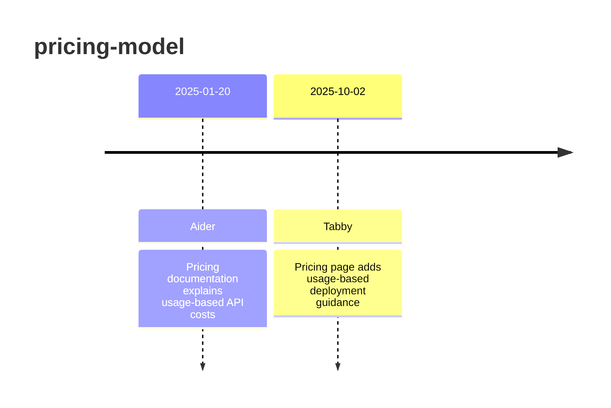

# Theme: pricing-model

## Cross-Product Timeline
<!-- chronolog:begin region="timeline" -->

<!-- chronolog:end -->

## Change Cards
<!-- chronolog:begin region="cards" -->
- 2025-01-20 Aider: [[Changes/Aider/2025-01-20-pricing-documentation-explains-usage-based-api-costs|Pricing documentation explains usage-based API costs]]
- 2025-10-02 Tabby: [[Changes/Tabby/2025-10-02-pricing-page-adds-usage-based-deployment-guidance|Pricing page adds usage-based deployment guidance]]
<!-- chronolog:end -->