# Theme: safety-privacy

## Cross-Product Timeline

```mermaid
timeline
    title safety-privacy
    2023-04-16 : Cursor : Ghost mode for opting out of storing any kind of data on our servers
    2023-06-27 : Cursor : Cursor is now based on version 1.79.2 of VSCodium, which comes with security upd
    2023-08-28 : ChatGPT : Today we’re launching ChatGPT Enterprise, which offers enterprise-grade security
    2023-08-30 : Cursor : API Key input box is now a password type
    2024-09-17 : Cursor : This update fixes the following security issue: CVE-2024-45599.
    2025-03-18 : ChatGPT : More clear and private Incognito keyboard for Temporary Chats.
    2025-03-18 : ChatGPT : New UI for Temporary Chats: We’ve made accessing and viewing these private conve
    2025-09-29 : ChatGPT : To set up parental controls, a parent or guardian sends an invite to their teen
    2025-09-29 : ChatGPT : Parents don’t have access to their teen’s conversations, except in rare cases wh
    2025-09-29 : ChatGPT : Once a teen is connected to a parent’s account, they automatically receive addit
    2025-09-29 : ChatGPT : Parents can adjust certain features, set time limits, and add safeguards that wo
    2025-12-18 : Cursor : Enterprise customers can also extend these categories across their organization
    2025-12-22 : Cursor : Improved stability around how the agent respects auto-run preferences to prevent
    2026-01-09 : Claude Code : Added detection and warnings for unreachable permission rules, with warnings in
    2026-01-14 : Claude Code : Added ability to provide feedback when accepting permission prompts
    2026-01-14 : Claude Code : Fixed security vulnerability where wildcard permission rules could match compoun
    2026-01-29 : Claude Code : Fixed per-user temp directory isolation to prevent permission conflicts on share
    2026-01-30 : Claude Code : Permissions now respect content-level `ask` over tool-level `allow`. Previously
    2026-02-06 : Claude Code : Fixed a bug where commands excluded from sandboxing (via `sandbox.excludedComman
    2026-02-10 : Claude Code : Blocked writes to `.claude/skills` directory in sandbox mode
    2026-02-10 : Claude Code : Fixed bash permission matching for commands using environment variable wrappers
    2026-02-13 : Claude Code : Fixed permission wait time being included in subagent elapsed time display
    2026-02-19 : Claude Code : Permission suggestions are now populated when safety checks trigger an ask respo
    2026-02-24 : Claude Code : Fixed a security issue where `statusLine` and `fileSuggestion` hook commands cou
    2026-03-05 : Cursor : When invoked, the agent spins up a cloud sandbox and follows your instructions u
    2026-03-07 : Claude Code : Fixed false-positive permission prompts for compound bash commands containing he
    2026-03-11 : Claude Code : Fixed freezes and 100% CPU loops triggered by permission prompts for complex bas
    2026-03-12 : Claude Code : Fixed voice mode silently failing on the macOS native binary for users whose ter
    2026-03-17 : Claude Code : Added `allowRead` sandbox filesystem setting to re-allow read access within `den
    2026-03-17 : Claude Code : Fixed "Always Allow" on compound bash commands (e.g. `cd src && npm test`) savin
    2026-03-17 : Claude Code : Fixed PreToolUse hooks returning `"allow"` bypassing `deny` permission rules, in
    2026-03-18 : Claude Code : Fixed custom status line showing nothing when workspace trust is blocking it
    2026-03-20 : Claude Code : Added `--channels` permission relay — channel servers that declare the permissio
    2026-03-20 : Claude Code : Fixed unnecessary permission prompts for Bash commands containing dashes in stri
    2026-03-25 : Claude Code : Added `sandbox.failIfUnavailable` setting to exit with an error when sandbox is
    2026-03-26 : Claude Code : Added conditional `if` field for hooks using permission rule syntax (e.g., `Bash
    2026-03-27 : Claude Code : Fixed official marketplace plugin scripts failing with "Permission denied" on ma
    2026-04-01 : Claude Code : Added `.husky` to protected directories (acceptEdits mode)
    2026-04-01 : Claude Code : Fixed UI crash when malformed tool input reached the permission dialog
    2026-04-01 : Claude Code : Hardened PowerShell tool permission checks: fixed trailing `&` background job by
    2026-04-01 : Claude Code : Added `"defer"` permission decision to `PreToolUse` hooks — headless sessions ca
    2026-04-02 : Claude Code : Fixed plan mode in remote sessions losing track of the plan file after a contain
    2026-04-09 : Claude Code : Added subprocess sandboxing with PID namespace isolation on Linux when `CLAUDE_C
    2026-04-14 : Claude Code : The model can now discover and invoke built-in slash commands like `/init`, `/re
    2026-04-17 : Claude Code : Added `sandbox.network.deniedDomains` setting to block specific domains even whe
    2026-04-18 : Claude Code : Fixed a crash in the permission dialog when an agent teams teammate requested to
    2026-04-30 : Cursor : Security Reviewer
    2026-04-30 : Cursor : Cursor Security Review is now in beta on Teams and Enterprise plans. You can run
    2026-04-30 : Cursor : Vulnerability Scanner runs scheduled scans of your codebase to check for known v
    2026-04-30 : Cursor : Security Reviewer checks every PR for security vulnerabilities, auth regressions
    2026-04-30 : Cursor : Vulnerability Scanner
    2026-05-01 : Claude Code : `--dangerously-skip-permissions` now bypasses prompts for writes to `.claude/`,
    2026-05-01 : Cursor : Default Off: users can discover and opt in
    2026-05-06 : Claude Code : Fixed `--permission-mode` flag being ignored when resuming a plan-mode session w
    2026-05-07 : ChatGPT : Over the coming weeks, we'll be rolling out trusted contact, an optional safety
    2026-05-07 : Claude Code : Added `sandbox.bwrapPath` and `sandbox.socatPath` managed settings (Linux/WSL) t
    2026-05-08 : Claude Code : Fixed Bash permission prompts showing an internal parser diagnostic instead of a
    2026-05-14 : Claude Code : Added new `claude agents` flags: `--add-dir`, `--settings`, `--mcp-config`, `--p
    2026-05-15 : Claude Code : PowerShell tool now passes `-ExecutionPolicy Bypass`. Opt out with `CLAUDE_CODE_
    2026-05-22 : Claude Code : Fixed a PowerShell permission bypass: built-in `cd` functions (`cd..`, `cd\`, `c
    2026-05-29 : Cursor : Auto-review applies to Shell, MCP, and Fetch tool calls. Allowlisted calls run i
    2026-06-02 : ChatGPT : Review first-party OpenAI sessions from Settings > Security > Active sessions, w
    2026-06-02 : ChatGPT : We’re rolling out Active sessions, a new security feature in ChatGPT that helps
    2026-06-03 : Claude Code : `claude agents --json` now includes `waitingFor` showing what a waiting session
    2026-06-03 : Cursor : Enterprise customers can now manage multiple Cursor teams from one place, with d
    2026-06-03 : Cursor : Teams are the operating unit for a department, region, or subsidiary. This is wh
    2026-06-04 : Cursor : You can now hand the local agent your own tools by passing function definitions
    2026-06-06 : Claude Code : Hardened cross-session messaging: messages relayed via `SendMessage` from other
    2026-06-08 : Claude Code : Added `--safe-mode` flag (and `CLAUDE_CODE_SAFE_MODE`) to start Claude Code with
    2026-06-08 : Claude Code : Fixed stale permission and dialog prompts reappearing every time you reattached
    2026-06-10 : Claude Code : Fixed `WebFetch(domain:*.example.com)` wildcard domain rules never matching subd
    2026-06-10 : Cursor : You can now run Bugbot and Security Review with /review before pushing code. /re
    2026-06-15 : Claude Code : Added `Tool(param:value)` syntax for permission rules to match a tool's input pa
    2026-06-17 : Claude Code : Added `sandbox.allowAppleEvents` opt-in setting that lets sandboxed commands sen
    2026-06-18 : ChatGPT : App permission controls: You can now choose when ChatGPT asks before using conne
    2026-06-23 : Claude Code : Added mouse click support to select menus (permission prompts, `/model`, `/confi
    2026-06-23 : Claude Code : Added `sandbox.credentials` setting to block sandboxed commands from reading cre
    2026-06-24 : Claude Code : Improved sandbox network permission dialog: hosts you allow with "Yes" are now r
    2026-06-26 : Claude Code : Fixed external plugins enabled only by project `.claude/settings.json` not requi
    2026-06-29 : Claude Code : Security: `claude mcp list`/`get` no longer spawn `.mcp.json` servers that a rep
    2026-07-03 : Claude Code : Changed the "default" permission mode to "Manual" across the CLI, `--help`, VS C
    2026-07-06 : Claude Code : Fixed `/remote-control` sessions showing the wrong permission mode in the mobile
    2026-07-07 : Claude Code : Added a grey ⏸ badge to the footer when in manual permission mode, making the ac
    2026-07-08 : Claude Code : Background task notifications now explicitly state that no human input has occur
    2026-07-09 : ChatGPT : If you already use the Codex app, update it as usual to move to the new ChatGPT
    2026-07-09 : ChatGPT : On desktop, Work can use local files and desktop apps with your permission. The
    2026-07-11 : Claude Code : Fixed compound commands with `cd` prompting for permission when the only output
    2026-07-11 : Claude Code : Fixed remote managed settings from a non-interactive run (`claude -p`, the SDK)
    2026-07-14 : Claude Code : Improved auto mode: the permission classifier now defaults to Sonnet 5 for exter
    2026-07-14 : Claude Code : Fixed multi-second per-turn slowdowns in sessions with many permission deny/ask
    2026-07-14 : Claude Code : Added a startup warning for `Write(path)`, `NotebookEdit(path)`, and `Glob(path)
    2026-07-15 : Claude Code : Fixed permission previews relayed to chat channels not neutralizing bidirectiona
    2026-07-18 : Claude Code : Fixed a permission-check bypass affecting commands run in Windows PowerShell 5.1
    2026-07-18 : Claude Code : Fixed Bash permission checks treating zsh variable subscripts and modifiers in `
    2026-07-18 : Claude Code : Fixed Bash permission checks to no longer auto-approve certain `help` and `man`
    2026-07-18 : Claude Code : Fixed Bash permission checks misjudging very long commands — commands over 10,00
    2026-07-18 : Claude Code : Fixed Bash permission checks to fail closed on file-descriptor redirect forms th
    2026-07-20 : Claude Code : Fixed telemetry misreporting permission denials: failed permission-prompt reques
    2026-07-20 : Claude Code : Added `sandbox.filesystem.disabled` setting to skip filesystem isolation while k
    2026-07-20 : Claude Code : Fixed read-only commands on Windows accessing network paths without a permission
    2026-07-20 : Claude Code : Fixed Bash command permission checking for compound statements with redirects in
    2026-07-20 : Claude Code : Fixed PowerShell tool permission validation of commands containing invisible Uni
    2026-07-21 : Claude Code : Fixed Remote Control sessions not showing a pending permission prompt or dialog
    2026-07-22 : Claude Code : Improved auto mode: the dangerous-rm, background-`&`, and suspicious-Windows-pat
    2026-07-22 : Claude Code : Fixed agent frontmatter hooks running from untrusted folders: hooks now require
    2026-07-23 : ChatGPT : Health is built with layered privacy and security safeguards. Connected medical
    2026-07-24 : Claude Code : Added `sandbox.network.strictAllowlist` setting to deny non-allowlisted hosts fo
```

<!-- chronolog:begin region="timeline" -->

<!-- chronolog:end -->

## Change Cards
<!-- chronolog:begin region="cards" -->
- 2023-04-16 Cursor: [[Changes/Cursor/2023-04-16-ghost-mode-for-opting-out-of-storing-any-kind-of-data-on-our-servers|Ghost mode for opting out of storing any kind of data on our servers]]
- 2023-06-27 Cursor: [[Changes/Cursor/2023-06-27-cursor-is-now-based-on-version-1-79-2-of-vscodium-which-comes-with-security-upda|Cursor is now based on version 1.79.2 of VSCodium, which comes with security upd]]
- 2023-08-28 ChatGPT: [[Changes/ChatGPT/2023-08-28-today-we-re-launching-chatgpt-enterprise-which-offers-enterprise-grade-security|Today we’re launching ChatGPT Enterprise, which offers enterprise-grade security]]
- 2023-08-30 Cursor: [[Changes/Cursor/2023-08-30-api-key-input-box-is-now-a-password-type|API Key input box is now a password type]]
- 2024-09-17 Cursor: [[Changes/Cursor/2024-09-17-this-update-fixes-the-following-security-issue-cve-2024-45599|This update fixes the following security issue: CVE-2024-45599.]]
- 2025-03-18 ChatGPT: [[Changes/ChatGPT/2025-03-18-more-clear-and-private-incognito-keyboard-for-temporary-chats|More clear and private Incognito keyboard for Temporary Chats.]]
- 2025-03-18 ChatGPT: [[Changes/ChatGPT/2025-03-18-new-ui-for-temporary-chats-we-ve-made-accessing-and-viewing-these-private-conver|New UI for Temporary Chats: We’ve made accessing and viewing these private conve]]
- 2025-09-29 ChatGPT: [[Changes/ChatGPT/2025-09-29-to-set-up-parental-controls-a-parent-or-guardian-sends-an-invite-to-their-teen-t|To set up parental controls, a parent or guardian sends an invite to their teen]]
- 2025-09-29 ChatGPT: [[Changes/ChatGPT/2025-09-29-parents-don-t-have-access-to-their-teen-s-conversations-except-in-rare-cases-whe|Parents don’t have access to their teen’s conversations, except in rare cases wh]]
- 2025-09-29 ChatGPT: [[Changes/ChatGPT/2025-09-29-once-a-teen-is-connected-to-a-parent-s-account-they-automatically-receive-additi|Once a teen is connected to a parent’s account, they automatically receive addit]]
- 2025-09-29 ChatGPT: [[Changes/ChatGPT/2025-09-29-parents-can-adjust-certain-features-set-time-limits-and-add-safeguards-that-work|Parents can adjust certain features, set time limits, and add safeguards that wo]]
- 2025-12-18 Cursor: [[Changes/Cursor/2025-12-18-enterprise-customers-can-also-extend-these-categories-across-their-organization|Enterprise customers can also extend these categories across their organization]]
- 2025-12-22 Cursor: [[Changes/Cursor/2025-12-22-improved-stability-around-how-the-agent-respects-auto-run-preferences-to-prevent|Improved stability around how the agent respects auto-run preferences to prevent]]
- 2026-01-09 Claude Code: [[Changes/Claude Code/2026-01-09-added-detection-and-warnings-for-unreachable-permission-rules-with-warnings-in-d|Added detection and warnings for unreachable permission rules, with warnings in]]
- 2026-01-14 Claude Code: [[Changes/Claude Code/2026-01-14-added-ability-to-provide-feedback-when-accepting-permission-prompts|Added ability to provide feedback when accepting permission prompts]]
- 2026-01-14 Claude Code: [[Changes/Claude Code/2026-01-14-fixed-security-vulnerability-where-wildcard-permission-rules-could-match-compoun|Fixed security vulnerability where wildcard permission rules could match compoun]]
- 2026-01-29 Claude Code: [[Changes/Claude Code/2026-01-29-fixed-per-user-temp-directory-isolation-to-prevent-permission-conflicts-on-share|Fixed per-user temp directory isolation to prevent permission conflicts on share]]
- 2026-01-30 Claude Code: [[Changes/Claude Code/2026-01-30-permissions-now-respect-content-level-ask-over-tool-level-allow-previously-allow|Permissions now respect content-level `ask` over tool-level `allow`. Previously]]
- 2026-02-06 Claude Code: [[Changes/Claude Code/2026-02-06-fixed-a-bug-where-commands-excluded-from-sandboxing-via-sandbox-excludedcommands|Fixed a bug where commands excluded from sandboxing (via `sandbox.excludedComman]]
- 2026-02-10 Claude Code: [[Changes/Claude Code/2026-02-10-blocked-writes-to-claude-skills-directory-in-sandbox-mode|Blocked writes to `.claude/skills` directory in sandbox mode]]
- 2026-02-10 Claude Code: [[Changes/Claude Code/2026-02-10-fixed-bash-permission-matching-for-commands-using-environment-variable-wrappers|Fixed bash permission matching for commands using environment variable wrappers]]
- 2026-02-13 Claude Code: [[Changes/Claude Code/2026-02-13-fixed-permission-wait-time-being-included-in-subagent-elapsed-time-display|Fixed permission wait time being included in subagent elapsed time display]]
- 2026-02-19 Claude Code: [[Changes/Claude Code/2026-02-19-permission-suggestions-are-now-populated-when-safety-checks-trigger-an-ask-respo|Permission suggestions are now populated when safety checks trigger an ask respo]]
- 2026-02-24 Claude Code: [[Changes/Claude Code/2026-02-24-fixed-a-security-issue-where-statusline-and-filesuggestion-hook-commands-could-e|Fixed a security issue where `statusLine` and `fileSuggestion` hook commands cou]]
- 2026-03-05 Cursor: [[Changes/Cursor/2026-03-05-when-invoked-the-agent-spins-up-a-cloud-sandbox-and-follows-your-instructions-us|When invoked, the agent spins up a cloud sandbox and follows your instructions u]]
- 2026-03-07 Claude Code: [[Changes/Claude Code/2026-03-07-fixed-false-positive-permission-prompts-for-compound-bash-commands-containing-he|Fixed false-positive permission prompts for compound bash commands containing he]]
- 2026-03-11 Claude Code: [[Changes/Claude Code/2026-03-11-fixed-freezes-and-100-cpu-loops-triggered-by-permission-prompts-for-complex-bash|Fixed freezes and 100% CPU loops triggered by permission prompts for complex bas]]
- 2026-03-12 Claude Code: [[Changes/Claude Code/2026-03-12-fixed-voice-mode-silently-failing-on-the-macos-native-binary-for-users-whose-ter|Fixed voice mode silently failing on the macOS native binary for users whose ter]]
- 2026-03-17 Claude Code: [[Changes/Claude Code/2026-03-17-added-allowread-sandbox-filesystem-setting-to-re-allow-read-access-within-denyre|Added `allowRead` sandbox filesystem setting to re-allow read access within `den]]
- 2026-03-17 Claude Code: [[Changes/Claude Code/2026-03-17-fixed-always-allow-on-compound-bash-commands-e-g-cd-src-npm-test-saving-a-single|Fixed "Always Allow" on compound bash commands (e.g. `cd src && npm test`) savin]]
- 2026-03-17 Claude Code: [[Changes/Claude Code/2026-03-17-fixed-pretooluse-hooks-returning-allow-bypassing-deny-permission-rules-including|Fixed PreToolUse hooks returning `"allow"` bypassing `deny` permission rules, in]]
- 2026-03-18 Claude Code: [[Changes/Claude Code/2026-03-18-fixed-custom-status-line-showing-nothing-when-workspace-trust-is-blocking-it|Fixed custom status line showing nothing when workspace trust is blocking it]]
- 2026-03-20 Claude Code: [[Changes/Claude Code/2026-03-20-added-channels-permission-relay-channel-servers-that-declare-the-permission-capa|Added `--channels` permission relay — channel servers that declare the permissio]]
- 2026-03-20 Claude Code: [[Changes/Claude Code/2026-03-20-fixed-unnecessary-permission-prompts-for-bash-commands-containing-dashes-in-stri|Fixed unnecessary permission prompts for Bash commands containing dashes in stri]]
- 2026-03-25 Claude Code: [[Changes/Claude Code/2026-03-25-added-sandbox-failifunavailable-setting-to-exit-with-an-error-when-sandbox-is-en|Added `sandbox.failIfUnavailable` setting to exit with an error when sandbox is]]
- 2026-03-26 Claude Code: [[Changes/Claude Code/2026-03-26-added-conditional-if-field-for-hooks-using-permission-rule-syntax-e-g-bash-git-t|Added conditional `if` field for hooks using permission rule syntax (e.g., `Bash]]
- 2026-03-27 Claude Code: [[Changes/Claude Code/2026-03-27-fixed-official-marketplace-plugin-scripts-failing-with-permission-denied-on-maco|Fixed official marketplace plugin scripts failing with "Permission denied" on ma]]
- 2026-04-01 Claude Code: [[Changes/Claude Code/2026-04-01-added-husky-to-protected-directories-acceptedits-mode|Added `.husky` to protected directories (acceptEdits mode)]]
- 2026-04-01 Claude Code: [[Changes/Claude Code/2026-04-01-fixed-ui-crash-when-malformed-tool-input-reached-the-permission-dialog|Fixed UI crash when malformed tool input reached the permission dialog]]
- 2026-04-01 Claude Code: [[Changes/Claude Code/2026-04-01-hardened-powershell-tool-permission-checks-fixed-trailing-background-job-bypass|Hardened PowerShell tool permission checks: fixed trailing `&` background job by]]
- 2026-04-01 Claude Code: [[Changes/Claude Code/2026-04-01-added-defer-permission-decision-to-pretooluse-hooks-headless-sessions-can-pause|Added `"defer"` permission decision to `PreToolUse` hooks — headless sessions ca]]
- 2026-04-02 Claude Code: [[Changes/Claude Code/2026-04-02-fixed-plan-mode-in-remote-sessions-losing-track-of-the-plan-file-after-a-contain|Fixed plan mode in remote sessions losing track of the plan file after a contain]]
- 2026-04-09 Claude Code: [[Changes/Claude Code/2026-04-09-added-subprocess-sandboxing-with-pid-namespace-isolation-on-linux-when-claude-co|Added subprocess sandboxing with PID namespace isolation on Linux when `CLAUDE_C]]
- 2026-04-14 Claude Code: [[Changes/Claude Code/2026-04-14-the-model-can-now-discover-and-invoke-built-in-slash-commands-like-init-review-a|The model can now discover and invoke built-in slash commands like `/init`, `/re]]
- 2026-04-17 Claude Code: [[Changes/Claude Code/2026-04-17-added-sandbox-network-denieddomains-setting-to-block-specific-domains-even-when|Added `sandbox.network.deniedDomains` setting to block specific domains even whe]]
- 2026-04-18 Claude Code: [[Changes/Claude Code/2026-04-18-fixed-a-crash-in-the-permission-dialog-when-an-agent-teams-teammate-requested-to|Fixed a crash in the permission dialog when an agent teams teammate requested to]]
- 2026-04-30 Cursor: [[Changes/Cursor/2026-04-30-security-reviewer|Security Reviewer]]
- 2026-04-30 Cursor: [[Changes/Cursor/2026-04-30-cursor-security-review-is-now-in-beta-on-teams-and-enterprise-plans-you-can-run|Cursor Security Review is now in beta on Teams and Enterprise plans. You can run]]
- 2026-04-30 Cursor: [[Changes/Cursor/2026-04-30-vulnerability-scanner-runs-scheduled-scans-of-your-codebase-to-check-for-known-v|Vulnerability Scanner runs scheduled scans of your codebase to check for known v]]
- 2026-04-30 Cursor: [[Changes/Cursor/2026-04-30-security-reviewer-checks-every-pr-for-security-vulnerabilities-auth-regressions|Security Reviewer checks every PR for security vulnerabilities, auth regressions]]
- 2026-04-30 Cursor: [[Changes/Cursor/2026-04-30-vulnerability-scanner|Vulnerability Scanner]]
- 2026-05-01 Claude Code: [[Changes/Claude Code/2026-05-01-dangerously-skip-permissions-now-bypasses-prompts-for-writes-to-claude-git-vscod|`--dangerously-skip-permissions` now bypasses prompts for writes to `.claude/`,]]
- 2026-05-01 Cursor: [[Changes/Cursor/2026-05-01-default-off-users-can-discover-and-opt-in|Default Off: users can discover and opt in]]
- 2026-05-06 Claude Code: [[Changes/Claude Code/2026-05-06-fixed-permission-mode-flag-being-ignored-when-resuming-a-plan-mode-session-with|Fixed `--permission-mode` flag being ignored when resuming a plan-mode session w]]
- 2026-05-07 ChatGPT: [[Changes/ChatGPT/2026-05-07-over-the-coming-weeks-we-ll-be-rolling-out-trusted-contact-an-optional-safety-fe|Over the coming weeks, we'll be rolling out trusted contact, an optional safety]]
- 2026-05-07 Claude Code: [[Changes/Claude Code/2026-05-07-added-sandbox-bwrappath-and-sandbox-socatpath-managed-settings-linux-wsl-to-spec|Added `sandbox.bwrapPath` and `sandbox.socatPath` managed settings (Linux/WSL) t]]
- 2026-05-08 Claude Code: [[Changes/Claude Code/2026-05-08-fixed-bash-permission-prompts-showing-an-internal-parser-diagnostic-instead-of-a|Fixed Bash permission prompts showing an internal parser diagnostic instead of a]]
- 2026-05-14 Claude Code: [[Changes/Claude Code/2026-05-14-added-new-claude-agents-flags-add-dir-settings-mcp-config-plugin-dir-permission|Added new `claude agents` flags: `--add-dir`, `--settings`, `--mcp-config`, `--p]]
- 2026-05-15 Claude Code: [[Changes/Claude Code/2026-05-15-powershell-tool-now-passes-executionpolicy-bypass-opt-out-with-claude-code-power|PowerShell tool now passes `-ExecutionPolicy Bypass`. Opt out with `CLAUDE_CODE_]]
- 2026-05-22 Claude Code: [[Changes/Claude Code/2026-05-22-fixed-a-powershell-permission-bypass-built-in-cd-functions-cd-cd-cd-x-changed-th|Fixed a PowerShell permission bypass: built-in `cd` functions (`cd..`, `cd\`, `c]]
- 2026-05-29 Cursor: [[Changes/Cursor/2026-05-29-auto-review-applies-to-shell-mcp-and-fetch-tool-calls-allowlisted-calls-run-imme|Auto-review applies to Shell, MCP, and Fetch tool calls. Allowlisted calls run i]]
- 2026-06-02 ChatGPT: [[Changes/ChatGPT/2026-06-02-review-first-party-openai-sessions-from-settings-security-active-sessions-with-a|Review first-party OpenAI sessions from Settings > Security > Active sessions, w]]
- 2026-06-02 ChatGPT: [[Changes/ChatGPT/2026-06-02-we-re-rolling-out-active-sessions-a-new-security-feature-in-chatgpt-that-helps-u|We’re rolling out Active sessions, a new security feature in ChatGPT that helps]]
- 2026-06-03 Claude Code: [[Changes/Claude Code/2026-06-03-claude-agents-json-now-includes-waitingfor-showing-what-a-waiting-session-is-blo|`claude agents --json` now includes `waitingFor` showing what a waiting session]]
- 2026-06-03 Cursor: [[Changes/Cursor/2026-06-03-enterprise-customers-can-now-manage-multiple-cursor-teams-from-one-place-with-di|Enterprise customers can now manage multiple Cursor teams from one place, with d]]
- 2026-06-03 Cursor: [[Changes/Cursor/2026-06-03-teams-are-the-operating-unit-for-a-department-region-or-subsidiary-this-is-what|Teams are the operating unit for a department, region, or subsidiary. This is wh]]
- 2026-06-04 Cursor: [[Changes/Cursor/2026-06-04-you-can-now-hand-the-local-agent-your-own-tools-by-passing-function-definitions|You can now hand the local agent your own tools by passing function definitions]]
- 2026-06-06 Claude Code: [[Changes/Claude Code/2026-06-06-hardened-cross-session-messaging-messages-relayed-via-sendmessage-from-other-cla|Hardened cross-session messaging: messages relayed via `SendMessage` from other]]
- 2026-06-08 Claude Code: [[Changes/Claude Code/2026-06-08-added-safe-mode-flag-and-claude-code-safe-mode-to-start-claude-code-with-all-cus|Added `--safe-mode` flag (and `CLAUDE_CODE_SAFE_MODE`) to start Claude Code with]]
- 2026-06-08 Claude Code: [[Changes/Claude Code/2026-06-08-fixed-stale-permission-and-dialog-prompts-reappearing-every-time-you-reattached|Fixed stale permission and dialog prompts reappearing every time you reattached]]
- 2026-06-10 Claude Code: [[Changes/Claude Code/2026-06-10-fixed-webfetch-domain-example-com-wildcard-domain-rules-never-matching-subdomain|Fixed `WebFetch(domain:*.example.com)` wildcard domain rules never matching subd]]
- 2026-06-10 Cursor: [[Changes/Cursor/2026-06-10-you-can-now-run-bugbot-and-security-review-with-review-before-pushing-code-revie|You can now run Bugbot and Security Review with /review before pushing code. /re]]
- 2026-06-15 Claude Code: [[Changes/Claude Code/2026-06-15-added-tool-param-value-syntax-for-permission-rules-to-match-a-tool-s-input-param|Added `Tool(param:value)` syntax for permission rules to match a tool's input pa]]
- 2026-06-17 Claude Code: [[Changes/Claude Code/2026-06-17-added-sandbox-allowappleevents-opt-in-setting-that-lets-sandboxed-commands-send|Added `sandbox.allowAppleEvents` opt-in setting that lets sandboxed commands sen]]
- 2026-06-18 ChatGPT: [[Changes/ChatGPT/2026-06-18-app-permission-controls-you-can-now-choose-when-chatgpt-asks-before-using-connec|App permission controls: You can now choose when ChatGPT asks before using conne]]
- 2026-06-23 Claude Code: [[Changes/Claude Code/2026-06-23-added-mouse-click-support-to-select-menus-permission-prompts-model-config-etc-in|Added mouse click support to select menus (permission prompts, `/model`, `/confi]]
- 2026-06-23 Claude Code: [[Changes/Claude Code/2026-06-23-added-sandbox-credentials-setting-to-block-sandboxed-commands-from-reading-crede|Added `sandbox.credentials` setting to block sandboxed commands from reading cre]]
- 2026-06-24 Claude Code: [[Changes/Claude Code/2026-06-24-improved-sandbox-network-permission-dialog-hosts-you-allow-with-yes-are-now-reme|Improved sandbox network permission dialog: hosts you allow with "Yes" are now r]]
- 2026-06-26 Claude Code: [[Changes/Claude Code/2026-06-26-fixed-external-plugins-enabled-only-by-project-claude-settings-json-not-requirin|Fixed external plugins enabled only by project `.claude/settings.json` not requi]]
- 2026-06-29 Claude Code: [[Changes/Claude Code/2026-06-29-security-claude-mcp-list-get-no-longer-spawn-mcp-json-servers-that-a-repo-self-a|Security: `claude mcp list`/`get` no longer spawn `.mcp.json` servers that a rep]]
- 2026-07-03 Claude Code: [[Changes/Claude Code/2026-07-03-changed-the-default-permission-mode-to-manual-across-the-cli-help-vs-code-and-je|Changed the "default" permission mode to "Manual" across the CLI, `--help`, VS C]]
- 2026-07-06 Claude Code: [[Changes/Claude Code/2026-07-06-fixed-remote-control-sessions-showing-the-wrong-permission-mode-in-the-mobile-an|Fixed `/remote-control` sessions showing the wrong permission mode in the mobile]]
- 2026-07-07 Claude Code: [[Changes/Claude Code/2026-07-07-added-a-grey-badge-to-the-footer-when-in-manual-permission-mode-making-the-activ|Added a grey ⏸ badge to the footer when in manual permission mode, making the ac]]
- 2026-07-08 Claude Code: [[Changes/Claude Code/2026-07-08-background-task-notifications-now-explicitly-state-that-no-human-input-has-occur|Background task notifications now explicitly state that no human input has occur]]
- 2026-07-09 ChatGPT: [[Changes/ChatGPT/2026-07-09-if-you-already-use-the-codex-app-update-it-as-usual-to-move-to-the-new-chatgpt-d|If you already use the Codex app, update it as usual to move to the new ChatGPT]]
- 2026-07-09 ChatGPT: [[Changes/ChatGPT/2026-07-09-on-desktop-work-can-use-local-files-and-desktop-apps-with-your-permission-the-bu|On desktop, Work can use local files and desktop apps with your permission. The]]
- 2026-07-11 Claude Code: [[Changes/Claude Code/2026-07-11-fixed-compound-commands-with-cd-prompting-for-permission-when-the-only-output-re|Fixed compound commands with `cd` prompting for permission when the only output]]
- 2026-07-11 Claude Code: [[Changes/Claude Code/2026-07-11-fixed-remote-managed-settings-from-a-non-interactive-run-claude-p-the-sdk-being|Fixed remote managed settings from a non-interactive run (`claude -p`, the SDK)]]
- 2026-07-14 Claude Code: [[Changes/Claude Code/2026-07-14-improved-auto-mode-the-permission-classifier-now-defaults-to-sonnet-5-for-extern|Improved auto mode: the permission classifier now defaults to Sonnet 5 for exter]]
- 2026-07-14 Claude Code: [[Changes/Claude Code/2026-07-14-fixed-multi-second-per-turn-slowdowns-in-sessions-with-many-permission-deny-ask|Fixed multi-second per-turn slowdowns in sessions with many permission deny/ask]]
- 2026-07-14 Claude Code: [[Changes/Claude Code/2026-07-14-added-a-startup-warning-for-write-path-notebookedit-path-and-glob-path-permissio|Added a startup warning for `Write(path)`, `NotebookEdit(path)`, and `Glob(path)]]
- 2026-07-15 Claude Code: [[Changes/Claude Code/2026-07-15-fixed-permission-previews-relayed-to-chat-channels-not-neutralizing-bidirectiona|Fixed permission previews relayed to chat channels not neutralizing bidirectiona]]
- 2026-07-18 Claude Code: [[Changes/Claude Code/2026-07-18-fixed-a-permission-check-bypass-affecting-commands-run-in-windows-powershell-5-1|Fixed a permission-check bypass affecting commands run in Windows PowerShell 5.1]]
- 2026-07-18 Claude Code: [[Changes/Claude Code/2026-07-18-fixed-bash-permission-checks-treating-zsh-variable-subscripts-and-modifiers-in-c|Fixed Bash permission checks treating zsh variable subscripts and modifiers in `]]
- 2026-07-18 Claude Code: [[Changes/Claude Code/2026-07-18-fixed-bash-permission-checks-to-no-longer-auto-approve-certain-help-and-man-comm|Fixed Bash permission checks to no longer auto-approve certain `help` and `man`]]
- 2026-07-18 Claude Code: [[Changes/Claude Code/2026-07-18-fixed-bash-permission-checks-misjudging-very-long-commands-commands-over-10-000|Fixed Bash permission checks misjudging very long commands — commands over 10,00]]
- 2026-07-18 Claude Code: [[Changes/Claude Code/2026-07-18-fixed-bash-permission-checks-to-fail-closed-on-file-descriptor-redirect-forms-th|Fixed Bash permission checks to fail closed on file-descriptor redirect forms th]]
- 2026-07-20 Claude Code: [[Changes/Claude Code/2026-07-20-fixed-telemetry-misreporting-permission-denials-failed-permission-prompt-request|Fixed telemetry misreporting permission denials: failed permission-prompt reques]]
- 2026-07-20 Claude Code: [[Changes/Claude Code/2026-07-20-added-sandbox-filesystem-disabled-setting-to-skip-filesystem-isolation-while-kee|Added `sandbox.filesystem.disabled` setting to skip filesystem isolation while k]]
- 2026-07-20 Claude Code: [[Changes/Claude Code/2026-07-20-fixed-read-only-commands-on-windows-accessing-network-paths-without-a-permission|Fixed read-only commands on Windows accessing network paths without a permission]]
- 2026-07-20 Claude Code: [[Changes/Claude Code/2026-07-20-fixed-bash-command-permission-checking-for-compound-statements-with-redirects-in|Fixed Bash command permission checking for compound statements with redirects in]]
- 2026-07-20 Claude Code: [[Changes/Claude Code/2026-07-20-fixed-powershell-tool-permission-validation-of-commands-containing-invisible-uni|Fixed PowerShell tool permission validation of commands containing invisible Uni]]
- 2026-07-21 Claude Code: [[Changes/Claude Code/2026-07-21-fixed-remote-control-sessions-not-showing-a-pending-permission-prompt-or-dialog|Fixed Remote Control sessions not showing a pending permission prompt or dialog]]
- 2026-07-22 Claude Code: [[Changes/Claude Code/2026-07-22-improved-auto-mode-the-dangerous-rm-background-and-suspicious-windows-path-check|Improved auto mode: the dangerous-rm, background-`&`, and suspicious-Windows-pat]]
- 2026-07-22 Claude Code: [[Changes/Claude Code/2026-07-22-fixed-agent-frontmatter-hooks-running-from-untrusted-folders-hooks-now-require-t|Fixed agent frontmatter hooks running from untrusted folders: hooks now require]]
- 2026-07-23 ChatGPT: [[Changes/ChatGPT/2026-07-23-health-is-built-with-layered-privacy-and-security-safeguards-connected-medical-r|Health is built with layered privacy and security safeguards. Connected medical]]
- 2026-07-24 Claude Code: [[Changes/Claude Code/2026-07-24-added-sandbox-network-strictallowlist-setting-to-deny-non-allowlisted-hosts-for|Added `sandbox.network.strictAllowlist` setting to deny non-allowlisted hosts fo]]
<!-- chronolog:end -->