# Theme: search-browsing

## Cross-Product Timeline

```mermaid
timeline
    title search-browsing
    2023-03-23 : ChatGPT : Browsing: An experimental model that knows when and how to browse the internet
    2023-05-12 : ChatGPT : Web browsing: Try a new version of ChatGPT that knows when and how to browse the
    2023-05-24 : ChatGPT : Browse with Bing. We’ve integrated the browsing feature - currently in beta for
    2023-06-22 : ChatGPT : Browsing: Plus users can now use Browsing to get comprehensive answers and curre
    2023-06-22 : ChatGPT : Search History Improvements: Tapping on a search result takes you directly to th
    2023-07-03 : ChatGPT : We've learned that the browsing beta can occasionally display content in ways we
    2023-09-27 : ChatGPT : To try it out, enable Browsing in your beta features setting.
    2023-09-27 : ChatGPT : Choose Browse with Bing in the selector under GPT-4.
    2023-09-27 : ChatGPT : Browsing is rolling out to all Plus users. ChatGPT can now browse the internet t
    2023-10-17 : ChatGPT : Browsing, which we re-launched a few weeks ago, is moving out of beta.
    2024-01-25 : Cursor : Using @Web in chat will give the AI the ability to crawl the web! The tools it c
    2025-02-14 : ChatGPT : Set ChatGPT as default search engine in Safari.
    2025-05-08 : ChatGPT : ChatGPT deep research with GitHub is available globally to Team users. It is als
    2025-05-12 : ChatGPT : ChatGPT deep research with Sharepoint and OneDrive is available globally to Team
    2025-05-12 : ChatGPT : You can now export your deep research reports as well-formatted PDFs—complete wi
    2025-05-15 : ChatGPT : ChatGPT deep research with Dropbox is available globally to Team users. It is al
    2025-06-04 : ChatGPT : Combines internal + web sources for synthesis
    2025-06-04 : ChatGPT : ChatGPT Team, Enterprise, and Edu customers globally can use connectors in deep
    2025-06-13 : ChatGPT : We’ve upgraded ChatGPT search for all users to provide even more comprehensive,
    2025-07-24 : ChatGPT : Pro users can now connect to Canva and Notion for both chat search and deep rese
    2025-08-11 : ChatGPT : The following connectors are now available to search by chat in addition to deep
    2025-08-12 : ChatGPT : If you already have Gmail or Google Calendar enabled for deep research, you can
    2025-09-16 : ChatGPT : We’ve made further improvements to search in ChatGPT, making results more accura
    2025-09-16 : ChatGPT : Shopping: Search is better at detecting shopping intent, showing products when y
    2025-09-29 : ChatGPT : Instant Checkout makes it easy to go from chat to checkout in just a few taps.
    2025-09-29 : ChatGPT : ChatGPT can help you find anything on the web and now with Instant Checkout, you
    2025-09-29 : ChatGPT : Instant Checkout
    2025-09-29 : ChatGPT : Ask ChatGPT a shopping question and it finds organic, unsponsored product result
    2025-10-13 : ChatGPT : With the ChatGPT connector for Slack, you can securely bring in context from you
    2025-11-20 : ChatGPT : Instant Checkout is available for logged in Plus, Pro, and Free users in the US.
    2025-11-20 : ChatGPT : When a product from a Shopify merchant supports Instant Checkout, you can comple
    2025-11-20 : ChatGPT : You can now find and buy from Shopify merchants starting with Spanx, Skims, and
    2025-11-21 : ChatGPT : ChatGPT now adds more inline images from the web to help you quickly understand
    2025-11-24 : ChatGPT : ChatGPT learns what you like through an interactive interface allowing you to gu
    2025-12-16 : ChatGPT : All images you create with ChatGPT are automatically saved under My images at ht
    2026-02-27 : ChatGPT : Open search results in a new tab. Cmd+click in the search panel now opens result
    2026-03-19 : ChatGPT : The legacy deep research mode will be removed on Thursday, March 26, 2026. This
    2026-04-08 : ChatGPT : The Outlook Email and Calendar apps for ChatGPT can now help with delegated or s
    2026-05-19 : Claude Code : The `/plugin` browse and discover panes now show when a plugin was last updated
    2026-06-01 : ChatGPT : ChatGPT can now help with more of the job search process, from finding relevant
    2026-07-17 : Claude Code : Added a session-wide limit on WebSearch tool calls (default 200, tunable via `CL
```

<!-- chronolog:begin region="timeline" -->

<!-- chronolog:end -->

## Change Cards
<!-- chronolog:begin region="cards" -->
- 2023-03-23 ChatGPT: [[Changes/ChatGPT/2023-03-23-browsing-an-experimental-model-that-knows-when-and-how-to-browse-the-internet|Browsing: An experimental model that knows when and how to browse the internet]]
- 2023-05-12 ChatGPT: [[Changes/ChatGPT/2023-05-12-web-browsing-try-a-new-version-of-chatgpt-that-knows-when-and-how-to-browse-the|Web browsing: Try a new version of ChatGPT that knows when and how to browse the]]
- 2023-05-24 ChatGPT: [[Changes/ChatGPT/2023-05-24-browse-with-bing-we-ve-integrated-the-browsing-feature-currently-in-beta-for-pai|Browse with Bing. We’ve integrated the browsing feature - currently in beta for]]
- 2023-06-22 ChatGPT: [[Changes/ChatGPT/2023-06-22-browsing-plus-users-can-now-use-browsing-to-get-comprehensive-answers-and-curren|Browsing: Plus users can now use Browsing to get comprehensive answers and curre]]
- 2023-06-22 ChatGPT: [[Changes/ChatGPT/2023-06-22-search-history-improvements-tapping-on-a-search-result-takes-you-directly-to-the|Search History Improvements: Tapping on a search result takes you directly to th]]
- 2023-07-03 ChatGPT: [[Changes/ChatGPT/2023-07-03-we-ve-learned-that-the-browsing-beta-can-occasionally-display-content-in-ways-we|We've learned that the browsing beta can occasionally display content in ways we]]
- 2023-09-27 ChatGPT: [[Changes/ChatGPT/2023-09-27-to-try-it-out-enable-browsing-in-your-beta-features-setting|To try it out, enable Browsing in your beta features setting.]]
- 2023-09-27 ChatGPT: [[Changes/ChatGPT/2023-09-27-choose-browse-with-bing-in-the-selector-under-gpt-4|Choose Browse with Bing in the selector under GPT-4.]]
- 2023-09-27 ChatGPT: [[Changes/ChatGPT/2023-09-27-browsing-is-rolling-out-to-all-plus-users-chatgpt-can-now-browse-the-internet-to|Browsing is rolling out to all Plus users. ChatGPT can now browse the internet t]]
- 2023-10-17 ChatGPT: [[Changes/ChatGPT/2023-10-17-browsing-which-we-re-launched-a-few-weeks-ago-is-moving-out-of-beta|Browsing, which we re-launched a few weeks ago, is moving out of beta.]]
- 2024-01-25 Cursor: [[Changes/Cursor/2024-01-25-using-web-in-chat-will-give-the-ai-the-ability-to-crawl-the-web-the-tools-it-can|Using @Web in chat will give the AI the ability to crawl the web! The tools it c]]
- 2025-02-14 ChatGPT: [[Changes/ChatGPT/2025-02-14-set-chatgpt-as-default-search-engine-in-safari|Set ChatGPT as default search engine in Safari.]]
- 2025-05-08 ChatGPT: [[Changes/ChatGPT/2025-05-08-chatgpt-deep-research-with-github-is-available-globally-to-team-users-it-is-also|ChatGPT deep research with GitHub is available globally to Team users. It is als]]
- 2025-05-12 ChatGPT: [[Changes/ChatGPT/2025-05-12-chatgpt-deep-research-with-sharepoint-and-onedrive-is-available-globally-to-team|ChatGPT deep research with Sharepoint and OneDrive is available globally to Team]]
- 2025-05-12 ChatGPT: [[Changes/ChatGPT/2025-05-12-you-can-now-export-your-deep-research-reports-as-well-formatted-pdfs-complete-wi|You can now export your deep research reports as well-formatted PDFs—complete wi]]
- 2025-05-15 ChatGPT: [[Changes/ChatGPT/2025-05-15-chatgpt-deep-research-with-dropbox-is-available-globally-to-team-users-it-is-als|ChatGPT deep research with Dropbox is available globally to Team users. It is al]]
- 2025-06-04 ChatGPT: [[Changes/ChatGPT/2025-06-04-combines-internal-web-sources-for-synthesis|Combines internal + web sources for synthesis]]
- 2025-06-04 ChatGPT: [[Changes/ChatGPT/2025-06-04-chatgpt-team-enterprise-and-edu-customers-globally-can-use-connectors-in-deep-re|ChatGPT Team, Enterprise, and Edu customers globally can use connectors in deep]]
- 2025-06-13 ChatGPT: [[Changes/ChatGPT/2025-06-13-we-ve-upgraded-chatgpt-search-for-all-users-to-provide-even-more-comprehensive-u|We’ve upgraded ChatGPT search for all users to provide even more comprehensive,]]
- 2025-07-24 ChatGPT: [[Changes/ChatGPT/2025-07-24-pro-users-can-now-connect-to-canva-and-notion-for-both-chat-search-and-deep-rese|Pro users can now connect to Canva and Notion for both chat search and deep rese]]
- 2025-08-11 ChatGPT: [[Changes/ChatGPT/2025-08-11-the-following-connectors-are-now-available-to-search-by-chat-in-addition-to-deep|The following connectors are now available to search by chat in addition to deep]]
- 2025-08-12 ChatGPT: [[Changes/ChatGPT/2025-08-12-if-you-already-have-gmail-or-google-calendar-enabled-for-deep-research-you-can-n|If you already have Gmail or Google Calendar enabled for deep research, you can]]
- 2025-09-16 ChatGPT: [[Changes/ChatGPT/2025-09-16-we-ve-made-further-improvements-to-search-in-chatgpt-making-results-more-accurat|We’ve made further improvements to search in ChatGPT, making results more accura]]
- 2025-09-16 ChatGPT: [[Changes/ChatGPT/2025-09-16-shopping-search-is-better-at-detecting-shopping-intent-showing-products-when-you|Shopping: Search is better at detecting shopping intent, showing products when y]]
- 2025-09-29 ChatGPT: [[Changes/ChatGPT/2025-09-29-instant-checkout-makes-it-easy-to-go-from-chat-to-checkout-in-just-a-few-taps|Instant Checkout makes it easy to go from chat to checkout in just a few taps.]]
- 2025-09-29 ChatGPT: [[Changes/ChatGPT/2025-09-29-chatgpt-can-help-you-find-anything-on-the-web-and-now-with-instant-checkout-you|ChatGPT can help you find anything on the web and now with Instant Checkout, you]]
- 2025-09-29 ChatGPT: [[Changes/ChatGPT/2025-09-29-instant-checkout|Instant Checkout]]
- 2025-09-29 ChatGPT: [[Changes/ChatGPT/2025-09-29-ask-chatgpt-a-shopping-question-and-it-finds-organic-unsponsored-product-results|Ask ChatGPT a shopping question and it finds organic, unsponsored product result]]
- 2025-10-13 ChatGPT: [[Changes/ChatGPT/2025-10-13-with-the-chatgpt-connector-for-slack-you-can-securely-bring-in-context-from-your|With the ChatGPT connector for Slack, you can securely bring in context from you]]
- 2025-11-20 ChatGPT: [[Changes/ChatGPT/2025-11-20-instant-checkout-is-available-for-logged-in-plus-pro-and-free-users-in-the-us|Instant Checkout is available for logged in Plus, Pro, and Free users in the US.]]
- 2025-11-20 ChatGPT: [[Changes/ChatGPT/2025-11-20-when-a-product-from-a-shopify-merchant-supports-instant-checkout-you-can-complet|When a product from a Shopify merchant supports Instant Checkout, you can comple]]
- 2025-11-20 ChatGPT: [[Changes/ChatGPT/2025-11-20-you-can-now-find-and-buy-from-shopify-merchants-starting-with-spanx-skims-and-gl|You can now find and buy from Shopify merchants starting with Spanx, Skims, and]]
- 2025-11-21 ChatGPT: [[Changes/ChatGPT/2025-11-21-chatgpt-now-adds-more-inline-images-from-the-web-to-help-you-quickly-understand|ChatGPT now adds more inline images from the web to help you quickly understand]]
- 2025-11-24 ChatGPT: [[Changes/ChatGPT/2025-11-24-chatgpt-learns-what-you-like-through-an-interactive-interface-allowing-you-to-gu|ChatGPT learns what you like through an interactive interface allowing you to gu]]
- 2025-12-16 ChatGPT: [[Changes/ChatGPT/2025-12-16-all-images-you-create-with-chatgpt-are-automatically-saved-under-my-images-at-ht|All images you create with ChatGPT are automatically saved under My images at ht]]
- 2026-02-27 ChatGPT: [[Changes/ChatGPT/2026-02-27-open-search-results-in-a-new-tab-cmd-click-in-the-search-panel-now-opens-results|Open search results in a new tab. Cmd+click in the search panel now opens result]]
- 2026-03-19 ChatGPT: [[Changes/ChatGPT/2026-03-19-the-legacy-deep-research-mode-will-be-removed-on-thursday-march-26-2026-this-cha|The legacy deep research mode will be removed on Thursday, March 26, 2026. This]]
- 2026-04-08 ChatGPT: [[Changes/ChatGPT/2026-04-08-the-outlook-email-and-calendar-apps-for-chatgpt-can-now-help-with-delegated-or-s|The Outlook Email and Calendar apps for ChatGPT can now help with delegated or s]]
- 2026-05-19 Claude Code: [[Changes/Claude Code/2026-05-19-the-plugin-browse-and-discover-panes-now-show-when-a-plugin-was-last-updated|The `/plugin` browse and discover panes now show when a plugin was last updated]]
- 2026-06-01 ChatGPT: [[Changes/ChatGPT/2026-06-01-chatgpt-can-now-help-with-more-of-the-job-search-process-from-finding-relevant-l|ChatGPT can now help with more of the job search process, from finding relevant]]
- 2026-07-17 Claude Code: [[Changes/Claude Code/2026-07-17-added-a-session-wide-limit-on-websearch-tool-calls-default-200-tunable-via-claud|Added a session-wide limit on WebSearch tool calls (default 200, tunable via `CL]]
<!-- chronolog:end -->