# Theme: voice

## Cross-Product Timeline

```mermaid
timeline
    title voice
    2023-09-25 : ChatGPT : Voice (Beta) is now rolling out to Plus users on iOS and Android
    2023-09-25 : ChatGPT : You can now use voice to engage in a back-and-forth conversation with your assis
    2023-09-25 : ChatGPT : We are beginning to roll out new voice and image capabilities in ChatGPT. They o
    2023-11-21 : ChatGPT : ChatGPT with voice is now available to all free users. Download the app on your
    2024-12-12 : ChatGPT : Video and screenshare: In our latest mobile apps, we are starting to roll out re
    2024-12-12 : ChatGPT : Today we started rolling out two updates to voice mode in ChatGPT:
    2024-12-12 : ChatGPT : Santa voice: You can now chat with Santa in ChatGPT! Until early January, you ca
    2024-12-12 : ChatGPT : The first time you chat with Santa, your advanced voice limit will reset one tim
    2025-05-01 : ChatGPT : Launched on April 1 as a one-month surprise, our “Monday” personality (available
    2025-06-07 : ChatGPT : Additionally, rare hallucinations in Voice Mode persist with this update, result
    2025-06-07 : ChatGPT : In testing, we've observed that this update may occasionally cause minor decreas
    2025-06-07 : ChatGPT : Voice also now offers intuitive and effective language translation. Just ask Voi
    2025-06-07 : ChatGPT : We're upgrading Advanced Voice in ChatGPT for paid users with significant enhanc
    2025-06-07 : ChatGPT : This upgrade to Advanced Voice is available for all paid users across markets an
    2025-06-12 : ChatGPT : Deep research and voice mode support
    2025-06-18 : ChatGPT : ChatGPT will transcribe, summarize, and turn them into helpful outputs like foll
    2025-06-18 : ChatGPT : Capture meetings, brainstorms, or voice notes. Launching today for Pro, Enterpri
    2025-07-16 : ChatGPT : Record live conversations like team meetings or voice notes, and turn those into
    2025-07-17 : ChatGPT : The Advanced Voice upgrades we announced on June 7th are now rolling out to Chat
    2025-08-07 : ChatGPT : You can now set an accent color that applies to elements in ChatGPT, including y
    2025-08-07 : ChatGPT : Today we’re rolling out improvements to Voice Mode to make it more accessible an
    2025-08-07 : ChatGPT : For paid users, Voice now adapts to your instructions, adjusting its speaking st
    2025-09-09 : ChatGPT : Last month we announced that everyone now has access to Advanced Voice Mode, wit
    2025-09-09 : ChatGPT : Stay tuned—more improvements to Voice are coming soon.
    2025-09-09 : ChatGPT : We also shared that Standard Voice Mode would be retired following a 30-day suns
    2025-09-18 : ChatGPT : We’re improving the quality and latency of responses of the version of Advanced
    2025-11-25 : ChatGPT : We’re making ChatGPT Voice a seamless part of the ChatGPT experience, so you can
    2025-11-25 : ChatGPT : This makes voice chats clearer, richer and more contextual by pairing spoken ans
    2025-11-25 : ChatGPT : Many of you have asked for a more flexible Voice experience—now, you can speak,
    2025-11-25 : ChatGPT : Follow along with typed answers as you listen
    2025-11-25 : ChatGPT : Refer back to earlier messages without interrupting the conversation
    2025-12-11 : ChatGPT : We’re retiring the Voice experience in the ChatGPT macOS app on January 15, 2026
    2025-12-11 : ChatGPT : Voice will continue to be available on chatgpt.com, iOS, Android, and Windows ap
    2026-01-12 : ChatGPT : We’re improving our dictation capabilities in ChatGPT for all logged-in users, s
    2026-01-20 : ChatGPT : We’re making an update to ChatGPT Voice for paid users that improves its ability
    2026-01-26 : ChatGPT : We’ve improved search responses in ChatGPT Voice to deliver more complete, up-to
    2026-02-12 : ChatGPT : We’re making an update to ChatGPT Voice that improves its ability to follow user
    2026-03-05 : Claude Code : Added Voice STT support for 10 new languages (20 total) — Russian, Polish, Turki
    2026-03-07 : Claude Code : Added `voice:pushToTalk` keybinding to make the voice activation key rebindable
    2026-04-13 : Cursor : Upgraded voice input
    2026-06-05 : Cursor : Narrate changes through the Design Mode overlay. The mic stays available while a
    2026-06-05 : Cursor : With Design Mode in the Cursor browser, you can click, draw, or describe changes
    2026-06-18 : ChatGPT : Help with pronunciations: ChatGPT can now include text and audio pronunciation g
    2026-06-26 : ChatGPT : We’re rolling out a new speech-to-text model for dictation in ChatGPT across all
    2026-06-26 : Claude Code : Improved voice mode on Linux: now distinguishes "no microphone" from "SoX not in
    2026-06-29 : Cursor : Open the Cursor mobile app, choose a repo, and launch an agent the same way you
    2026-07-08 : ChatGPT : We’re rolling out a new ChatGPT Voice experience. ChatGPT Voice is now powered b
    2026-07-13 : ChatGPT : On WhatsApp, you can message ChatGPT, upload images, send voice notes, create im
    2026-07-23 : ChatGPT : ChatGPT Voice is now available in Work and Codex in the ChatGPT desktop app. Sta
```

<!-- chronolog:begin region="timeline" -->

<!-- chronolog:end -->

## Change Cards
<!-- chronolog:begin region="cards" -->
- 2023-09-25 ChatGPT: [[Changes/ChatGPT/2023-09-25-voice-beta-is-now-rolling-out-to-plus-users-on-ios-and-android|Voice (Beta) is now rolling out to Plus users on iOS and Android]]
- 2023-09-25 ChatGPT: [[Changes/ChatGPT/2023-09-25-you-can-now-use-voice-to-engage-in-a-back-and-forth-conversation-with-your-assis|You can now use voice to engage in a back-and-forth conversation with your assis]]
- 2023-09-25 ChatGPT: [[Changes/ChatGPT/2023-09-25-we-are-beginning-to-roll-out-new-voice-and-image-capabilities-in-chatgpt-they-of|We are beginning to roll out new voice and image capabilities in ChatGPT. They o]]
- 2023-11-21 ChatGPT: [[Changes/ChatGPT/2023-11-21-chatgpt-with-voice-is-now-available-to-all-free-users-download-the-app-on-your-p|ChatGPT with voice is now available to all free users. Download the app on your]]
- 2024-12-12 ChatGPT: [[Changes/ChatGPT/2024-12-12-video-and-screenshare-in-our-latest-mobile-apps-we-are-starting-to-roll-out-real|Video and screenshare: In our latest mobile apps, we are starting to roll out re]]
- 2024-12-12 ChatGPT: [[Changes/ChatGPT/2024-12-12-today-we-started-rolling-out-two-updates-to-voice-mode-in-chatgpt|Today we started rolling out two updates to voice mode in ChatGPT:]]
- 2024-12-12 ChatGPT: [[Changes/ChatGPT/2024-12-12-santa-voice-you-can-now-chat-with-santa-in-chatgpt-until-early-january-you-can-f|Santa voice: You can now chat with Santa in ChatGPT! Until early January, you ca]]
- 2024-12-12 ChatGPT: [[Changes/ChatGPT/2024-12-12-the-first-time-you-chat-with-santa-your-advanced-voice-limit-will-reset-one-time|The first time you chat with Santa, your advanced voice limit will reset one tim]]
- 2025-05-01 ChatGPT: [[Changes/ChatGPT/2025-05-01-launched-on-april-1-as-a-one-month-surprise-our-monday-personality-available-in|Launched on April 1 as a one-month surprise, our “Monday” personality (available]]
- 2025-06-07 ChatGPT: [[Changes/ChatGPT/2025-06-07-additionally-rare-hallucinations-in-voice-mode-persist-with-this-update-resultin|Additionally, rare hallucinations in Voice Mode persist with this update, result]]
- 2025-06-07 ChatGPT: [[Changes/ChatGPT/2025-06-07-in-testing-we-ve-observed-that-this-update-may-occasionally-cause-minor-decrease|In testing, we've observed that this update may occasionally cause minor decreas]]
- 2025-06-07 ChatGPT: [[Changes/ChatGPT/2025-06-07-voice-also-now-offers-intuitive-and-effective-language-translation-just-ask-voic|Voice also now offers intuitive and effective language translation. Just ask Voi]]
- 2025-06-07 ChatGPT: [[Changes/ChatGPT/2025-06-07-we-re-upgrading-advanced-voice-in-chatgpt-for-paid-users-with-significant-enhanc|We're upgrading Advanced Voice in ChatGPT for paid users with significant enhanc]]
- 2025-06-07 ChatGPT: [[Changes/ChatGPT/2025-06-07-this-upgrade-to-advanced-voice-is-available-for-all-paid-users-across-markets-an|This upgrade to Advanced Voice is available for all paid users across markets an]]
- 2025-06-12 ChatGPT: [[Changes/ChatGPT/2025-06-12-deep-research-and-voice-mode-support|Deep research and voice mode support]]
- 2025-06-18 ChatGPT: [[Changes/ChatGPT/2025-06-18-chatgpt-will-transcribe-summarize-and-turn-them-into-helpful-outputs-like-follow|ChatGPT will transcribe, summarize, and turn them into helpful outputs like foll]]
- 2025-06-18 ChatGPT: [[Changes/ChatGPT/2025-06-18-capture-meetings-brainstorms-or-voice-notes-launching-today-for-pro-enterprise-a|Capture meetings, brainstorms, or voice notes. Launching today for Pro, Enterpri]]
- 2025-07-16 ChatGPT: [[Changes/ChatGPT/2025-07-16-record-live-conversations-like-team-meetings-or-voice-notes-and-turn-those-into|Record live conversations like team meetings or voice notes, and turn those into]]
- 2025-07-17 ChatGPT: [[Changes/ChatGPT/2025-07-17-the-advanced-voice-upgrades-we-announced-on-june-7th-are-now-rolling-out-to-chat|The Advanced Voice upgrades we announced on June 7th are now rolling out to Chat]]
- 2025-08-07 ChatGPT: [[Changes/ChatGPT/2025-08-07-you-can-now-set-an-accent-color-that-applies-to-elements-in-chatgpt-including-yo|You can now set an accent color that applies to elements in ChatGPT, including y]]
- 2025-08-07 ChatGPT: [[Changes/ChatGPT/2025-08-07-today-we-re-rolling-out-improvements-to-voice-mode-to-make-it-more-accessible-an|Today we’re rolling out improvements to Voice Mode to make it more accessible an]]
- 2025-08-07 ChatGPT: [[Changes/ChatGPT/2025-08-07-for-paid-users-voice-now-adapts-to-your-instructions-adjusting-its-speaking-styl|For paid users, Voice now adapts to your instructions, adjusting its speaking st]]
- 2025-09-09 ChatGPT: [[Changes/ChatGPT/2025-09-09-last-month-we-announced-that-everyone-now-has-access-to-advanced-voice-mode-with|Last month we announced that everyone now has access to Advanced Voice Mode, wit]]
- 2025-09-09 ChatGPT: [[Changes/ChatGPT/2025-09-09-stay-tuned-more-improvements-to-voice-are-coming-soon|Stay tuned—more improvements to Voice are coming soon.]]
- 2025-09-09 ChatGPT: [[Changes/ChatGPT/2025-09-09-we-also-shared-that-standard-voice-mode-would-be-retired-following-a-30-day-suns|We also shared that Standard Voice Mode would be retired following a 30-day suns]]
- 2025-09-18 ChatGPT: [[Changes/ChatGPT/2025-09-18-we-re-improving-the-quality-and-latency-of-responses-of-the-version-of-advanced|We’re improving the quality and latency of responses of the version of Advanced]]
- 2025-11-25 ChatGPT: [[Changes/ChatGPT/2025-11-25-we-re-making-chatgpt-voice-a-seamless-part-of-the-chatgpt-experience-so-you-can|We’re making ChatGPT Voice a seamless part of the ChatGPT experience, so you can]]
- 2025-11-25 ChatGPT: [[Changes/ChatGPT/2025-11-25-this-makes-voice-chats-clearer-richer-and-more-contextual-by-pairing-spoken-answ|This makes voice chats clearer, richer and more contextual by pairing spoken ans]]
- 2025-11-25 ChatGPT: [[Changes/ChatGPT/2025-11-25-many-of-you-have-asked-for-a-more-flexible-voice-experience-now-you-can-speak-li|Many of you have asked for a more flexible Voice experience—now, you can speak,]]
- 2025-11-25 ChatGPT: [[Changes/ChatGPT/2025-11-25-follow-along-with-typed-answers-as-you-listen|Follow along with typed answers as you listen]]
- 2025-11-25 ChatGPT: [[Changes/ChatGPT/2025-11-25-refer-back-to-earlier-messages-without-interrupting-the-conversation|Refer back to earlier messages without interrupting the conversation]]
- 2025-12-11 ChatGPT: [[Changes/ChatGPT/2025-12-11-we-re-retiring-the-voice-experience-in-the-chatgpt-macos-app-on-january-15-2026|We’re retiring the Voice experience in the ChatGPT macOS app on January 15, 2026]]
- 2025-12-11 ChatGPT: [[Changes/ChatGPT/2025-12-11-voice-will-continue-to-be-available-on-chatgpt-com-ios-android-and-windows-app|Voice will continue to be available on chatgpt.com, iOS, Android, and Windows ap]]
- 2026-01-12 ChatGPT: [[Changes/ChatGPT/2026-01-12-we-re-improving-our-dictation-capabilities-in-chatgpt-for-all-logged-in-users-si|We’re improving our dictation capabilities in ChatGPT for all logged-in users, s]]
- 2026-01-20 ChatGPT: [[Changes/ChatGPT/2026-01-20-we-re-making-an-update-to-chatgpt-voice-for-paid-users-that-improves-its-ability|We’re making an update to ChatGPT Voice for paid users that improves its ability]]
- 2026-01-26 ChatGPT: [[Changes/ChatGPT/2026-01-26-we-ve-improved-search-responses-in-chatgpt-voice-to-deliver-more-complete-up-to|We’ve improved search responses in ChatGPT Voice to deliver more complete, up-to]]
- 2026-02-12 ChatGPT: [[Changes/ChatGPT/2026-02-12-we-re-making-an-update-to-chatgpt-voice-that-improves-its-ability-to-follow-user|We’re making an update to ChatGPT Voice that improves its ability to follow user]]
- 2026-03-05 Claude Code: [[Changes/Claude Code/2026-03-05-added-voice-stt-support-for-10-new-languages-20-total-russian-polish-turkish-dut|Added Voice STT support for 10 new languages (20 total) — Russian, Polish, Turki]]
- 2026-03-07 Claude Code: [[Changes/Claude Code/2026-03-07-added-voice-pushtotalk-keybinding-to-make-the-voice-activation-key-rebindable-in|Added `voice:pushToTalk` keybinding to make the voice activation key rebindable]]
- 2026-04-13 Cursor: [[Changes/Cursor/2026-04-13-upgraded-voice-input|Upgraded voice input]]
- 2026-06-05 Cursor: [[Changes/Cursor/2026-06-05-narrate-changes-through-the-design-mode-overlay-the-mic-stays-available-while-an|Narrate changes through the Design Mode overlay. The mic stays available while a]]
- 2026-06-05 Cursor: [[Changes/Cursor/2026-06-05-with-design-mode-in-the-cursor-browser-you-can-click-draw-or-describe-changes-by|With Design Mode in the Cursor browser, you can click, draw, or describe changes]]
- 2026-06-18 ChatGPT: [[Changes/ChatGPT/2026-06-18-help-with-pronunciations-chatgpt-can-now-include-text-and-audio-pronunciation-gu|Help with pronunciations: ChatGPT can now include text and audio pronunciation g]]
- 2026-06-26 ChatGPT: [[Changes/ChatGPT/2026-06-26-we-re-rolling-out-a-new-speech-to-text-model-for-dictation-in-chatgpt-across-all|We’re rolling out a new speech-to-text model for dictation in ChatGPT across all]]
- 2026-06-26 Claude Code: [[Changes/Claude Code/2026-06-26-improved-voice-mode-on-linux-now-distinguishes-no-microphone-from-sox-not-instal|Improved voice mode on Linux: now distinguishes "no microphone" from "SoX not in]]
- 2026-06-29 Cursor: [[Changes/Cursor/2026-06-29-open-the-cursor-mobile-app-choose-a-repo-and-launch-an-agent-the-same-way-you-wo|Open the Cursor mobile app, choose a repo, and launch an agent the same way you]]
- 2026-07-08 ChatGPT: [[Changes/ChatGPT/2026-07-08-we-re-rolling-out-a-new-chatgpt-voice-experience-chatgpt-voice-is-now-powered-by|We’re rolling out a new ChatGPT Voice experience. ChatGPT Voice is now powered b]]
- 2026-07-13 ChatGPT: [[Changes/ChatGPT/2026-07-13-on-whatsapp-you-can-message-chatgpt-upload-images-send-voice-notes-create-images|On WhatsApp, you can message ChatGPT, upload images, send voice notes, create im]]
- 2026-07-23 ChatGPT: [[Changes/ChatGPT/2026-07-23-chatgpt-voice-is-now-available-in-work-and-codex-in-the-chatgpt-desktop-app-star|ChatGPT Voice is now available in Work and Codex in the ChatGPT desktop app. Sta]]
<!-- chronolog:end -->